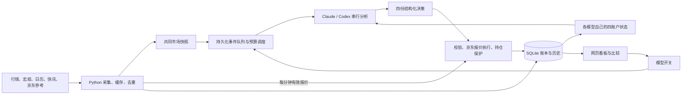

# 黄金积存金 AI 自主操盘与监控

让 Claude 与 Codex 基于共同市场数据，各自管理独立的黄金模拟账户，持续记录决策、成交与收益，比较两个模型的操盘表现。

本项目由黄金分析 Skill 扩展为常驻监控系统，包含数据采集、AI 调度、模拟交易执行、账户统计和网页看板。当前核心运行在 `monitor/`；原项目的独立分析 Skill 保留为兼容功能。

**所有交易均为本地模拟，不向京东或银行提交真实订单。**

[当前仓库](https://github.com/blue-green-red/Trade-Accumulated-Gold-CN) · [快速开始](#快速开始) · [核心配置](#核心配置) · [网页看板](#网页看板) · [独立 Skill](docs/legacy-skill.md) · [上游项目](https://github.com/PlevanTem/Trade-Accumulated-Gold-CN)

## 项目当前提供什么

| 能力 | 当前实现 |
|---|---|
| 双模型自主操盘 | Claude、Codex 分别决定买卖、数量、委托、止损止盈，程序校验并执行 |
| 四账户实验 | 每模型短、中线各设初始满仓/空仓账户，每户10万元；两模型共8户，另有3个规则对照账户 |
| 一轮统一决策 | 同一会话输入模型自己的四账户状态，返回四份决策，不按账户分别调用 |
| 京东价格成交 | 买卖和估值使用京东通用积存金直取报价，失效时暂停成交 |
| 持续数据采集 | 行情、技术指标、汇率、宏观、日历、快讯由程序采集与缓存，采集过程不调用大模型 |
| 低配机器调度 | 两模型后台串行运行，轮换先后顺序；常驻监控不启动银行 Chromium |
| 可追溯记录 | 保存共同市场快照、各模型账户输入、判断、委托状态、实际成交、费用与完整平仓周期 |
| 网页管理 | 七个页面查看行情、账户、成绩、记录与通知设置，可独立开关模型，支持桌面和手机 |

默认模式为 `four_account`。旧版概率门槛账户保留历史与已有持仓风控，不再参与新实验；定投类退出常驻运行，历史回测保留。

## 四账户实验

每个模型拥有以下四个账户，资金独立，不能跨账户转账：

| 周期 | 满仓起点 | 空仓起点 | 操作定位 |
|---|---|---|---|
| 短线 | `short_full` | `short_empty` | 数日至一两周的短线波段 |
| 中线 | `medium_full` | `medium_empty` | 数日至数周 |

账户标识包含模型，例如 `codex:short_empty`。每户初始本金10万元，每模型合计40万元；另保留买入持有 `hold`、趋势 `position`、规则短线 `short` 三个对照账户，总计11个账户。

模型开启、后端可用且京东报价有效后，其四个账户统一初始化：满仓账户一次性买满，空仓账户保留现金。尚未开启的模型暂不开账，重新开启已运行模型时沿用原账户；重启不会重复初始化。不同模型可能在不同时间开账，网页明确显示实验起点。

### 模型决定，程序执行

AI 可以买入、卖出、持有、观望或撤单，自主选择买入金额、卖出克数、市价/限价、止损、止盈、委托有效期与失效理由。概率只用于预测评估，不作为买卖门槛。

止损止盈可以不设、收紧、放宽或撤销，没有程序固定12%止损。初始满仓不预设保护；已有保护价保留，直到模型更新或显式撤销：

- `stop_loss_cny` / `take_profit_cny`：设置保护价；`null` 表示保留原设置。
- `clear_stop_loss=true` / `clear_take_profit=true`：撤销对应保护，不可同时指定新的同类保护价。
- 委托最长24小时，到期撤销未成交委托，已设置的持仓保护继续有效。

程序保留执行约束：不借款、不做空、不超卖；检查现金、持仓、报价新鲜度、价格逻辑、账户版本和模型开关代际。默认拒绝超过15分钟的输入；分析期间账户发生变化时，拒绝过时决策并记录原因。某账户拒绝不阻止其他合法账户执行。

执行器每分钟检查有效京东报价、条件委托和已设置的保护。限价买入等待报价不高于限价，限价卖出等待报价不低于限价；保护触发时按当时实际报价卖出全部持仓，跳价时不保证成交在保护价。未设置止损的账户不会按固定亏损比例自动平仓，前端会明确标出。

### 开关与比较口径

模型开关集中在 AI 页，修改后无需重启。关闭模型会停止分析与新开仓，撤销未成交委托；运行中的 CLI 分析会取消，已发出的 API 请求返回后丢弃结果。已有账户、历史和成绩保留，已设置的保护继续执行；重新开启后先获取新判断。

收益包含现金和持仓浮盈亏，按京东报价及卖出费用估值。胜率按**完整平仓周期**统计，分批卖出合并为一次交易，扣费后盈利才算胜。满仓起点基准是从该账户开账价持有不动，空仓基准是现金；模型组合按本金加权。

操盘对比展示收益、基准增益、回撤、胜率、完整平仓样本及盈利因子。实验起点不同、模型未开始或样本不足时会提示；预测命中率与交易胜率分别统计。

## 数据采集与模型输入



| 数据 | 采集频率/缓存 | 用途 |
|---|---|---|
| 京东通用积存金报价 | 每60秒；报价与抓取时间均须在120秒内 | 模拟成交及估值，失效时暂停成交 |
| XAU/USD、技术信号与点位 | 每60秒；TradingView、CNBC及程序计算 | 方向与技术参考 |
| USD/CNY | 每15分钟 | 汇率参考 |
| 美元指数、美债收益率、离岸人民币 | 每5分钟 | 宏观判断 |
| 经济日历 | 通常每30分钟；美国重要数据公布前15分钟至后30分钟每分钟 | 日程、实际值与事件触发 |
| 黄金相关快讯 | 金十每120秒，程序筛选去重 | 主要消息来源；输入最多12条重要、6条普通，每条最多160字 |
| 京东资金、挂单参考 | 仅分析时请求，每接口缓存15分钟，共用每日预算 | 辅助研究，不是积存金成交盘口 |
| 日线历史 | 按日缓存 | 模型5/20/60日趋势参考、规则账户与历史回测 |

京东成交报价与资金/挂单参考是不同接口。成交使用 `latestPrice` 的通用积存金报价，不标为某家银行专属盘口，也不以国际金价或理论换算价代替。默认卖出手续费0.4%，可配置价差。

京东参考使用 `gold-analysis-hub` 的资金与挂单结构化接口；后台不调用 `clawx-market-query` 自然语言查询，也不常驻请求机会评分、共振工具或 GUI 看板。今日必读、专栏等尚未接入。资金是最近一次事件，不能当成当前实时资金流；挂单价格单位未明确，不直接作为成交点位。

两个模型同批共用市场快照与基础提示，各自只接收自己的账户状态。默认允许每模型按需补搜最多2次，已提供的信息不重复搜索；各模型可能看到不同外部资料，比较的是各自完整研究与操盘表现。CLI 搜索次数通过提示词约束，API 通过工具参数限制。设置 `GOLD_AI_MAX_SEARCHES=0` 可关闭补搜。

共同输入按 `ai_input:<run_id>`、账户输入按 `ai_account_input:<run_id>:<model>` 存档。快照、模型开始和完成时刻分别记录。新预测从分析完成后5分钟内首个有效开市现货价格起算，无行情则记为缺数据，旧判断保留原口径。

## 分析频率与两套预算

AI 分析频率与数据采集频率分开；行情每分钟更新不代表每分钟调用模型。

| 触发来源 | 默认规则 |
|---|---|
| 价格变化复查 | 国际金价较该模型上次成功分析时的输入变化达到0.4%，无最小时间间隔 |
| 兜底复查 | 距上次成功分析满4小时，即使波动不足也可排队 |
| 定时 | 工作日北京时间08:40、20:45，附近已有分析则合并 |
| 经济数据 | 美国重要指标有效数值型实际值到达，且公布后至少10分钟；最小间隔15分钟 |
| 快讯 | 严格规则筛选，最多每天4批；单独触发的最小间隔30分钟 |
| 原有价格异动 | 30分钟内±0.6%，按原有冷却合并 |
| 初始化、保护触发、拒绝 | 初始化请求首次分析；保护触发和拒绝按15分钟冷却合并 |
| 分析失败 | 30分钟后允许重试，事件保留 |

0.4%按绝对变化计算：`abs(当前 XAU/USD / 上次输入 XAU/USD - 1) × 100%`。例如4000美元/盎司到4016或3984满足条件。各模型分别计算；成交仍使用京东人民币报价。

每模型北京时间每天最多120轮自动分析，普通来源最多118轮，最后2轮预留给重大消息、数据、初始化或持仓保护事件。成功、失败与取消都计入，不是固定每天运行120轮。其他满足条件的分析可合并覆盖已排队事件，因此单一事件的冷却不限制所有分析来源。两模型串行运行，事件存入 SQLite，成功后只确认本批实际覆盖的事件；额度用完后队列保留至次日。显式 CLI 手动强制分析可越过自动预算，仍记录次数。

### 京东参考接口预算

后台资金、挂单接口共享每天10次本地请求预算，失败与预留请求也计入，按北京时间重置。每批分析最多请求2次；15分钟内复用缓存，不按模型或账户重复获取。计数和缓存跨重启保留，请求前原子预留，避免并发重复或突破预算。

供应商返回当日额度耗尽时，两接口暂停24小时；普通429频率限制暂停15分钟，其他失败缓存15分钟。到可重试时间后，由正常分析触发重试，不由前端轮询。供应商实际重置时区尚未确认，页面显示的是本地重试时间。

本地账本从启用时开始记录，不包含历史或外部调用，**不是京东剩余额度**。手动运行安装的 Skill 不经过本项目预算。10次预算与AI的120轮上限相互独立，不限制独立的京东成交报价。

网页区分额度耗尽、本地预算用完、频率受限、获取失败、缓存待刷新、来源数据过期和暂无数据，并展示最近10条请求记录、成功获取与最近尝试时间。刷新失败时保留此前有效缓存；资金源超过24小时、挂单源超过1小时、成功缓存超过1小时均不可作为当前参考数据。

## 快速开始

当前运行环境为 Linux、Python 3.10。先准备可用的数据源网络连接；AI 后端按下面的配置选择。

```bash
git clone https://github.com/blue-green-red/Trade-Accumulated-Gold-CN.git
cd Trade-Accumulated-Gold-CN
python3 -m venv .venv
source .venv/bin/activate
python3 -m pip install -r requirements.txt
cp .env.example .env
chmod 600 .env
```

编辑 `.env`，填写需要的密钥、网页密码和推送配置。`claude` / `codex` CLI 应安装并完成登录，且能被运行服务的用户找到；程序检测命令是否存在，但可执行文件存在不等于鉴权已成功。CLI 非默认路径时，可设置 `GOLD_CLAUDE_CLI` / `GOLD_CODEX_CLI` 的绝对路径。

| 模型 | 后端选择 |
|---|---|
| Claude | `GOLD_AI_BACKEND=auto`：有 `ANTHROPIC_API_KEY` 使用 API，否则尝试本机 Claude Code；也可指定 `api` 或 `claude_code` |
| Codex | 使用本机已登录的 `codex` CLI，路径可通过 `GOLD_CODEX_CLI` 指定 |

没有可用后端的模型不进行分析。京东参考密钥可选，缺失时标为未配置；不影响独立的京东成交报价。通知可选，未配置 PushPlus/Server酱时仅记录日志。

分别启动监控与网页进程：

```bash
# 终端一
python3 -m monitor --dry-run

# 终端二，同样激活虚拟环境
python3 -m monitor.web
```

默认网页为 `http://127.0.0.1:8080`。`--dry-run` 只关闭通知推送，仍会请求行情、调度AI和推进模拟账户。首次运行会创建数据库和表；在网页 AI 页检查模型状态与开关，在账户页查看开账结果。

### 有效期与前端状态

未成交委托超过 `expires_at` 后标为“已到期”，不依赖开市或有效报价，也不触发强制平仓或自动续期。持有/观望在接收时已执行，前端另行显示“决策参考已到期”，保持原执行记录和持仓保护；已成交买卖不因原有效期结束变成到期未成交。总览“最新操作与待成交委托”分列待成交和最近6条到期项（包含决策参考到期），到期项独立查询，不受最近100条决策截断影响；已成交交易不会被列为到期未成交。AI账户卡片和操盘记录均显示有效期状态，页面自动刷新时即使业务数据未变也会更新到期提示。

### AI 按需查询自己的操作历史

每轮仍直接提供四账户当前状态、最新决策和最近3笔成交。需要复盘更早操作时，模型可调用 `query_account_history`，查询自己的成交 `fills`、决策委托 `plans` 和交易周期 `cycles`。`account` 只接受 `all` 或四账户起点名，模型身份由程序绑定，不能查询另一模型、传入任意SQL或读取其他表。

支持 `start` / `end`（含时区ISO8601）、`offset`、`limit`，按时间倒序分页；默认每页5条，最多10条，每轮默认最多6次查询。历史记录创建时间不晚于本轮快照；委托与交易周期的状态可能在查询时更新，因此历史结果只用于复盘，当前余额和持仓仍以本轮输入为准，不据此假定新成交。理由和失效说明最多保留160字，金额、数量、价格与手续费不降精度。缺失或查询失败时明确返回错误，不编造历史。

Codex CLI 与 Claude Code 通过每轮独立配置的本地 MCP stdio 工具访问，Claude API 使用相同只读查询逻辑。工具进程使用Python标准库和SQLite只读连接，不加载`.env`、不请求行情接口、不执行交易；不会额外占用京东额度。MCP接入采用[Codex官方文档](https://learn.chatgpt.com/docs/extend/mcp?surface=cli)的本地进程配置方式。

每次实际查询的参数和返回结果归档到数据库 `ai_history_queries:<run_id>:<model>`；成功、失败或取消的分析均保留已经取得的查询审计。AI页“本轮分析效率”显示历史查询次数和返回条数。查询本身不消耗模型token或额外创建操盘轮次，但模型阅读工具定义、结果并继续推理会增加token和耗时。默认不强制查询，已有摘要足够时不调用。

```dotenv
GOLD_AI_HISTORY_MAX_QUERIES=6
```

设为0关闭历史工具，修改后重启监控。该上限独立于网页补搜预算，不改变每日操盘轮次和价格风控。

### 前端手动触发操盘

AI 页的每个模型卡片提供“立即分析并操盘”按钮。点击提交一次持久化请求，监控在下一次有效行情周期使用最新数据分析该模型的四个账户，并按正常委托条件执行；模型可以选择持有或观望，不代表点击就一定成交。按钮不会改变自动分析频率，也不会开启已关闭的模型。

忙碌时最多排队一份手动请求，连续点击或刷新不会重复创建；状态展示排队、分析中、完成、失败或取消。关闭/重开模型会取消旧请求。休市或没有有效报价时等待；已经开始的请求若因服务重启中断，不自动重放。手动触发可跳过定时、价格变化和失败冷却条件，但仍计入每日调用预算，不能占用重大事件预留轮次，仍受串行执行、账户版本、输入时效、行情异动和成交价格区间校验约束。失败后可再次手动提交，不会无限自动重试本次请求。

接口 `POST /api/models/{claude|codex}/analyze` 的 JSON 请求体为 `{}`，返回202和请求状态；沿用网页登录认证、同源与 `X-Gold-Control: 1` 校验。Web进程只写入请求，模型调用和模拟成交由监控进程处理。

### 快行情下的决策与成交校验

AI 的买卖决策必须指定 `min_execution_price_cny` / `max_execution_price_cny`，即自身策略允许的京东成交价区间，程序不会代填固定滑点。市价委托在接收和成交前检查；限价委托未达到限价条件时等待，达到条件后再检查区间。若价格越界（含跳空穿越），拒绝本委托并排队复查，不追价成交。区间两端均可成交；缺少区间的旧买卖委托拒绝执行。观望、持有、撤单不要求区间，已有持仓保护按模型设置继续执行。

分析期间，监控仍约每分钟读取行情；有效京东报价或 XAU/USD 相对本轮输入的绝对涨跌幅达到 `GOLD_AI_INFLIGHT_MAX_MOVE_PCT`（默认0.4%）时，该轮四账户决策标记为失效。即使价格回落，失效标记也保留。模型继续完成本次生成供审计，程序不应用这轮交易或保护修改，并去重排队，按最新快照重做分析；已排队模型使用的共同快照也接受同样检查。接收结果时再次检查最新行情，拦截返回后、执行前出现的明显偏离。

失效分析不会确认其覆盖的新闻/事件已处理；复查不额外等待15分钟，但仍遵守每模型每日预算、串行执行和模型开关。不会因每次小波动反复取消或并发重跑模型。已有有效委托、持仓止损止盈继续执行，失效决策不能撤销这些保护。AI 页显示异动失效原因，账户和操盘记录展示成交价格区间及拒绝原因。

该机制以监控采样为准，不是逐笔实时风控：两次采样之间的瞬时变化可能看不到，过期报价仍禁止成交，文字形式的其他失效条件仍由后续AI判断。

### AI 调用效率与会话

仍通过本机 `codex exec` 调用模型。默认精简重复快讯和历史成交说明，保留四账户全部当前余额、版本、委托、保护价、最新计划和本轮触发事实。研究说明采用短格式，不改变模型的交易权限。Claude 同样使用输入精简和短说明。

Codex 使用固定的私有工作目录及输出 schema，支持按明确的会话 ID 续接（实测未稳定加速，默认关闭）。开启后每轮仍发送完整最新行情和四账户状态，旧决策不能被视为已成交。默认最多连续6轮、最长240分钟；跨北京时间日期、模型开关代际变化、模型/提示词/schema/搜索设置变化或调用失败后重建会话。失败不会自动追加一次付费重试。监控与测速的 Codex 进程使用同一把串行锁，避免低内存机器同时启动多个 Codex。

AI 页的“本轮分析效率”和操盘记录中的分析条目展示耗时、输入/输出 token、缓存 token、搜索次数及新建/续接状态。首个模型事件耗时并非首 token 延迟；未返回的缓存或搜索耗时显示为未知。完整原始输入与实际发送的精简输入分别留档，便于核查。固定前缀和会话续接有利于复用上下文，但缓存命中与加速取决于模型服务，不保证每轮更快。正常分析仍允许按需补搜，默认每轮最多2次。

```dotenv
GOLD_AI_OPTIMIZE=1
GOLD_CODEX_RESUME=0
GOLD_CODEX_SESSION_MAX_TURNS=6
GOLD_CODEX_SESSION_MAX_MINUTES=240
```

`GOLD_CODEX_RESUME=1` 可试用续接，默认每轮独立会话；关闭 `GOLD_AI_OPTIMIZE` 同时恢复完整输入和较长说明。修改环境配置后重启监控生效。

可使用已有归档做真实测速：

```bash
python3 -m monitor.benchmark_ai --warm-runs 2
```

默认调用真实 Codex 四轮：关闭优化一次、优化后新会话一次、续接两次，使用同一份冻结的四账户输入。所有轮次关闭补搜，隔离数据库，不执行交易，也不请求京东参考接口；会消耗模型额度。结果逐轮保存到被 Git 忽略的 `monitor/data/ai-speed-benchmark.json`。该测试用于观察调用方式差异，不能代表含联网搜索的日常完整分析耗时。

2026-10-19 的四轮实测如下（单样本，不能据此保证日常加速）：

| 模式 | 耗时 | 输入 token / 其中缓存 | 输出 token |
|---|---:|---:|---:|
| 原方式 | 56.2秒 | 23,053 / 0 | 原记录2,635，无法精确校正 |
| 优化后新会话 | 45.5秒 | 22,311 / 0 | 2,221 |
| 续接第2轮 | 44.9秒 | 31,948 / 22,144 | 2,291 |
| 续接第3轮 | 67.0秒 | 39,497 / 31,744 | 2,324 |

四轮均通过四账户结构校验。优化后首次调用比原方式约快19%，但续接未稳定加速，因此默认关闭续接。续接输入的缓存率约69%和80%，未缓存输入降至9,804和7,753 token，输出长度基本稳定；不能把变慢简单归因于未缓存输入或输出暴涨。第3轮与浏览器回归有重叠，低内存主机存在资源竞争的干扰，67秒不能全部归因于续接；该测试不足以证明续接本身更慢。原统计误将会话累计用量当作单轮用量，现已根据会话底层日志校正，并移除推理 token 的重复相加；原方式为临时会话，缺少日志，原输出 token 仅作待校正记录，耗时不受影响。完整指标见[测速记录](docs/benchmarks/codex-speed-2026-10-19.json)。这份实际输入中可删除的重复内容很少，不能声称输入精简必然减少 token。


### 核心配置

完整选项见 [`.env.example`](.env.example)，以下是当前运行模式的主要参数：

```dotenv
GOLD_AI_TRADING_MODE=four_account
GOLD_AI_ANALYSTS=claude,codex
GOLD_AI_BACKEND=auto
GOLD_AI_SHORT_REVIEW_MINUTES=0
GOLD_AI_PERIODIC_MIN_MOVE_PCT=0.4
GOLD_AI_REVIEW_MAX_IDLE_MINUTES=240
GOLD_AI_MAX_RUNS_PER_DAY=120
GOLD_AI_URGENT_RESERVE=2
GOLD_AI_MAX_SEARCHES=2
GOLD_AI_DECISION_MAX_AGE_MINUTES=15
GOLD_JD_RESEARCH_MAX_REQUESTS_PER_DAY=10
GOLD_MONITOR_ACCOUNT_BUDGET=100000
GOLD_MONITOR_SELL_FEE_RATE=0.004
GOLD_WEB_HOST=127.0.0.1
GOLD_WEB_PORT=8080
GOLD_WEB_MIN_PASSWORD_LENGTH=12
```

- `GOLD_AI_SHORT_REVIEW_MINUTES=0` 表示无最小间隔，负数关闭周期复查，正数设置最小间隔。
- `GOLD_JD_RESEARCH_MAX_REQUESTS_PER_DAY=0` 停止参考接口请求。
- `GOLD_AI_HARD_STOP_LOSS` 已移除，不控制四账户；旧概率模式的参数只用于兼容逻辑。
- 密钥与密码写入 `.env`：`ANTHROPIC_API_KEY`、`CLAWX_JR_API_KEY`、`GOLD_WEB_PASSWORD`，不要写入代码或 README。
- 对外监听须设置网页登录密码，默认最短12位，`GOLD_WEB_MIN_PASSWORD_LENGTH` 下限8位。浏览器使用 Basic 登录，用户名可填 `gold`，实际校验密码；公网访问可通过 HTTPS 反向代理；使用反向代理时也应配置该密码。
- 修改 `.env` 后重启对应服务；网页模型开关写入数据库，无需重启。

### systemd 常驻部署

模板默认使用 `/root/Trade-Accumulated-Gold-CN` 和 `/usr/bin/python3`。部署到其他目录或使用虚拟环境时，**先修改两个服务的 `WorkingDirectory` 和 `ExecStart`**，并按服务用户调整 `HOME`，确认其可访问 CLI 登录凭据。

```bash
sudo cp deploy/gold-monitor.service /etc/systemd/system/
sudo cp deploy/gold-web.service /etc/systemd/system/
# 编辑服务路径及 Python 解释器后执行
sudo systemctl daemon-reload
sudo systemctl enable --now gold-monitor
sudo systemctl enable --now gold-web
```

模板提供重启策略和内存限制：监控900MB、网页150MB。内存限制并不保证任何配置下都不会耗尽内存，应结合模型进程和服务日志观察。

## 网页看板

| 页面 | 内容顺序与用途 |
|---|---|
| 总览 | 京东成交价与可用状态 → 模型运行与成绩摘要 → 最新操作/待成交委托 → 重要事件 |
| 账户 | 模型/周期/起点筛选 → 所选账户资产与盈亏汇总 → 按模型分组的账户、当前仓位 → 展开成本、费用、回撤与决策 → 收益曲线；可直接跳转该账户的成交或决策记录 |
| 操盘对比 | 模型总成绩 → 四组同起点对比 → 组合曲线 → 比较口径及三个对照账户 |
| AI | 模型开关 → 最新分析 → 四账户决策 → 折叠输入详情与预测准确度 → 分析历史入口 |
| 行情 | 报价 → 价格走势 → 经济日历 → 快讯 → 宏观指标 → 京东参考与请求账本 |
| 通知 | 推送渠道配置状态 → 各模型与周期的操作通知开关 → 对照策略与行情报告开关 |
| 操盘记录 | 默认实际成交；切换AI决策、交易周期、分析历史、系统提醒，按模型/时间/账户筛选并加载更多 |

每分钟刷新时仅重绘当前页面发生变化的数据，保留筛选、展开状态和阅读位置。账户页明确区分初始满仓/空仓与当前持仓状态；未开账账户不计入资产汇总，缺少有效估值时显示未知。网页读取已有缓存与账本，不请求市场接口或直接调用模型；受登录保护的模型开关和手动触发接口写入控制或排队状态，AI 调用由监控进程处理。

### 历史查询接口

接口与网页使用相同登录保护。筛选先在数据库中执行，再分页，不限于看板默认加载的最近记录。

```text
GET /api/history?kind=fills&model=codex&days=30&account=codex:short_empty&offset=0&limit=50
```

| 参数 | 值 |
|---|---|
| `kind` | `fills`成交、`plans`账户决策、`cycles`交易周期、`analysis`分析历史、`alerts`系统提醒 |
| `model` | `all`、`claude`、`codex`、`rules` |
| `days` | `all` 或正整数天数 |
| `account` | `all` 或账户标识；分析历史和提醒无需指定 |
| `offset` / `limit` | 默认0/50，页大小最多100 |

返回 `items`、`offset`、`limit`、`has_more`。成交记录包含价格、数量、金额、手续费与决策依据；决策记录包含持有/观望、保护修改、拒绝和委托状态；分析历史关联已到期的预测结果。

## 运维、数据与验证

```bash
# 服务状态及监控日志
systemctl status gold-monitor gold-web
journalctl -u gold-monitor -f

# 更新代码后：先完成监控表结构初始化，再启动新版网页
sudo systemctl restart gold-monitor
sudo systemctl restart gold-web
```

默认数据库为 `monitor/data/monitor.db`，可通过 `GOLD_MONITOR_DB` 修改。账户、权益、开关、事件队列、市场缓存、分析输入、成交和请求账本均保存在 SQLite；升级前使用 SQLite 在线备份，避免只复制正在写入的数据库主文件而遗漏 WAL。重启保留账户与开关，不重置实验。

旧概率账户不复制进新实验，已有旧持仓仅保留原有风控。已删除的定投类不会重新创建。缺失或过期的京东成交报价暂停成交，估值可保留上次有效报价并显示状态；参考数据缺失不阻塞分析，模型不能编造缺失值。

### 辅助命令

```bash
python3 -m monitor --once              # 单轮监控，不推送
python3 -m monitor --once --ai-now     # 手动强制分析，并等待完成
python3 -m monitor --stats             # 命令行模拟统计
python3 -m monitor.backtest            # 原有规则的历史回测
```

前三条命令会初始化监控并请求行情，`--once` 也可能按正常调度触发AI和推进模拟账本。完整四账户决策、成交与比较以网页为主要入口。历史回测只验证可重放的规则，不能重现当前两个模型的自主研究与操盘。

### 离线测试

```bash
# 安装浏览器供集成测试使用；常驻监控本身不需要 Chromium
python3 -m playwright install chromium
python3 -m unittest discover -s tests -v
```

最近一次完整验证通过161项测试，覆盖独立账户执行、保护权限、模型开关、事件队列、预测计分、京东预算与并发缓存、历史分页，以及桌面/手机页面。测试使用临时数据库与模拟响应，不调用真实模型或京东参考接口。

`.env` 与数据库被 Git 忽略；京东密钥不进入模型上下文，调用模型 CLI 时也从子进程环境移除。网页登录密码仅用于本机配置，不提交仓库。

## 代码结构

```text
monitor/
├── __main__.py          # 常驻监控、串行模型调度、事件与网页快照
├── market.py            # 行情与京东成交报价采集
├── macro_cache.py       # 宏观行情与经济日历缓存
├── jd_research.py       # 京东参考采集、预算、退避与请求账本
├── ai.py                # Claude/Codex 后端、结构化输出及分析记录
├── ai_inputs.py         # 保留账户与触发事实的输入精简
├── history_tool.py      # 限定模型和账户的只读历史查询、MCP服务
├── history_access.py    # CLI/API接入、每轮查询预算与结果审计
├── codex_runtime.py     # 有界会话、串行锁、缓存与耗时统计
├── benchmark_ai.py      # 隔离账户的真实 Codex 对照测速
├── cadence.py           # 价格复查与AI自动调用预算
├── ai_events.py         # 持久化事件队列与成功确认
├── autonomous.py        # 四账户状态、成交价格区间、保护与成交执行
├── price_guard.py       # 分析中行情异动失效标记与复查去重
├── controls.py          # 模型开关、代际和账户身份
├── manual_ai.py         # 一次性手动请求、排队去重和状态恢复
├── performance.py       # 完整平仓统计与同起点比较
├── scorecard.py         # 预测命中率与概率成绩
├── web.py               # 登录保护、看板API、开关与历史分页
└── static/index.html    # 七页网页看板

deploy/                 # systemd 服务模板
tests/                  # 离线回归与浏览器集成测试
docs/legacy-skill.md     # 独立分析 Skill 的安装与使用
.claude/skills/gold-analysis/
                        # 保留的 Skill、技术资料与共享采集/计算脚本
```

## 上游来源与许可

本仓库在 [PlevanTem/Trade-Accumulated-Gold-CN](https://github.com/PlevanTem/Trade-Accumulated-Gold-CN) 基础上持续开发。上游提供黄金分析 Skill、技术资料与早期采集/计算脚本；当前项目扩展了双模型四账户自主操盘、常驻数据流、执行账本、事件预算调度和网页管理。

原作者资料与独立 Skill 使用方法保留在[兼容文档](docs/legacy-skill.md)。京东参考数据来源为[京东金融有钳](https://youqian.jd.com/)；其他数据源及口径见本文的数据表和代码。

MIT License（沿用上游声明）。本项目用于模拟实验与研究，输出不构成投资建议。

操盘记录按实际成交、AI 决策、交易周期、分析历史和系统提醒分别查看。总览优先展示最近成交与待成交委托，到期记录折叠显示；持有、观望明确标注无成交，初始化建仓不计作 AI 主动买入。记录中的决策时间与成交时间分别标注，买卖决策的状态表示委托处理结果。

微信操作通知在独立的“通知”页设置，按模型与短/中/长周期独立开关（每周期覆盖初始满仓、初始空仓两户），默认全部关闭，持久化到 SQLite，修改即时生效，不改变模型操盘开关。仅实际成交及持仓止损止盈推送，初始化、持有、观望、挂单不推送；行情提醒与定时报告使用单独开关，默认关闭。所有提醒仍保留数据库记录，只有已选通知参与推送，关闭通知不补发旧消息。

服务器 `.env` 设置 `PUSHPLUS_TOKEN`（优先）或 `SERVERCHAN_SENDKEY` 后重启 `gold-monitor` 和 `gold-web`；前端仅显示配置状态，不返回密钥。开关接口沿用登录与同源校验。

京东模拟交易按用户指定的固定北京时间时段运行：周一 09:00（含）至周六 02:30（不含）连续交易，其余时间休市；本规则不单独识别节假日。休市不请求京东成交报价、不启动常规或手动分析、不成交，委托到期仍正常清理。国际行情活跃状态单独记录，不再决定京东开闭市。AI 输入包含时段规则、当前状态及下次开盘时间，正常休市不会被解释为取价异常；监控观察到重新开盘且有效报价恢复后，向已开启模型排队一次新分析。

网页 HTML 与 JSON 在客户端支持时使用 gzip 压缩；数据刷新设15秒超时并合并同时发起的请求。失败或超时保留已有数据，顶部显示原因，可点击时间位置重新加载；模型开关等操作仍等待刷新获取最新状态。

看板接口复用同一轮账户汇总，并提供2秒进程内共享缓存，减少并发刷新时重复查询；模型、手动触发和通知设置写入后立即清除缓存。首屏仅携带各账户最新决策与待成交委托，到期摘要独立保留，完整历史由记录页分页读取；数据库历史记录不删除。

整页刷新时，登录验证后的 HTML 直接包含首屏看板快照，无需等待第二次看板请求；初始数据按 JSON 安全转义，生成失败时仍可通过原接口重试。后续定时刷新、手动刷新及开关操作继续使用看板接口。

短线决策以日线和数日至周级别价格结构、资金与事件变化判断机会，忽略共用输入里的30分钟、1小时、4小时信号，不要求小时K线、收盘或回踩确认，持仓数日至一两周，不要求日内平仓或三交易日退出。每周约两次买卖操作是节奏参考（买入、卖出各计一次），不是必须完成的配额，也不是限制必要风控的硬上限；不要求所有周期同时转多，不强制买入。每轮比较等待与小仓试入的收益、回撤和踏空代价；若以费用否定机会，须给目标/退出依据与扣费测算，无法估计则说明证据不足。观望需在 `invalidation` 写可验证的买回观察条件及复查时点，`reason` 复查上次条件及当轮变化；前端短线观望卡片将其标为“买回观察与复查条件”。目标不固定为900，短线不无限期延期。

空仓短线账户的输入增加 `short_wait_review`：上次观望快照价、当前京东报价、期间有效报价的采样高低价及变化百分比。统计截至本轮共同快照，不含未来行情；缺少锚定价或报价时保留未知，不以限价或成本代替。采样高低价不代表完整逐笔极值，是否满足日线及波段条件仍须AI结合信号判断，不自动触发分析或买入。四账户、频率、保护权限和执行条件保持原样。

短线账户输入包含策略周期说明与最近7天实际买卖操作次数（排除初始化及本轮快照之后的成交），提醒模型控制换手；分析频率与交易频率分开。历史账本与账户ID保持不变，短线的协议字段 `horizon=intraday` 作为兼容编码保留，实际含义为短线波段。

长线账户已移除：当前每模型仅短线、中线各满仓/空仓四户，各10万元。切换到 `four_account` 时删除原长线账户、持仓、委托、成交、净值、交易周期及历史分析/输入中对应的结构化账户数据；不清仓成交，不转移其资金，保留短中线账本。前端筛选、通知及当前成绩均只包含活动策略。旧 `six_account` 协议仅保留兼容测试，不用于当前服务。
