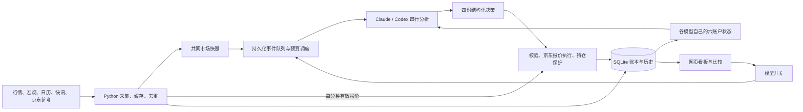

# 黄金积存金 AI 自主操盘与监控

让 Claude 与 Codex 基于共同市场数据，各自管理独立的黄金模拟账户，持续记录决策、成交与收益，比较两个模型的操盘表现。

本项目由黄金分析 Skill 扩展为常驻监控系统，包含数据采集、AI 调度、模拟交易执行、账户统计和网页看板。当前核心运行在 `monitor/`；原项目的独立分析 Skill 保留为兼容功能。

**所有交易均为本地模拟，不向京东或银行提交真实订单。**

[当前仓库](https://github.com/blue-green-red/Trade-Accumulated-Gold-CN) · [快速开始](#快速开始) · [核心配置](#核心配置) · [网页看板](#网页看板) · [独立 Skill](docs/legacy-skill.md) · [上游项目](https://github.com/PlevanTem/Trade-Accumulated-Gold-CN)

## 项目当前提供什么

| 能力 | 当前实现 |
|---|---|
| 双模型自主操盘 | Claude、Codex 分别决定买卖、数量、委托、止损止盈，程序校验并执行 |
| 六账户风险实验 | 每模型低/标准/高风险各设初始满仓/空仓账户，每户10万元；两模型共12户，以各户满仓持有/空仓持币为收益基准 |
| 一轮统一决策 | 同一会话输入模型自己的六账户状态，返回六份决策，不按账户分别调用 |
| 京东价格成交 | 买卖和估值使用京东通用积存金直取报价，失效时暂停成交 |
| 持续数据采集 | 行情、技术指标、汇率、宏观、日历、快讯由程序采集与缓存，采集过程不调用大模型 |
| 低配机器调度 | 两模型后台串行运行，轮换先后顺序；常驻监控不启动银行 Chromium |
| 真实账户建议 | 浙商、民生只读同步持仓和电子户余额，同轮分析给人工执行建议，支持独立微信订阅 |
| 可追溯记录 | 保存共同市场快照、各模型账户输入、判断、委托状态、实际成交、费用与完整平仓周期 |
| 网页管理 | 七个页面查看行情、账户、成绩、记录与通知设置，可独立开关模型，支持桌面和手机 |

默认模式为 `risk_six_account`。旧短中长线及概率门槛实验已重置；定投类退出常驻运行，历史回测保留。

分析摘要按模型独立订阅（如 `codex:analysis`），与模拟盘成交和真实账户建议分开。即使同轮分析两个模型，也分别生成摘要事件，关闭另一模型的订阅不会混入其内容；未选中的事件仍留在前端记录。

通知开关在保存成功后直接使用接口返回状态更新，无需等待整份看板刷新；较早的刷新结果不会覆盖新状态。保存失败保持原设置并提示重试。

关闭模型后，前端隐藏该模型的账户、收益曲线、操盘对比、分析与预测成绩、操作历史和通知项，仅保留重新开启的模型开关。历史接口在分页前排除关闭模型，切换时清空浏览器旧记录缓存；数据库持仓、历史与训练归档不删除，重新开启后恢复展示。模型关闭仍沿用原执行规则，已有保护不会因隐藏而取消。

## 数据源连接方式

2026-10-27在当前服务器禁用代理实测，以下10个业务接口均HTTP 200并返回所需数据：

| 数据 | 数据源域名 | 连接方式 |
|---|---|---|
| 国际现货、日线指标及美元/美债/离岸人民币 | `scanner.tradingview.com`（cfd与global两个接口） | 直连 |
| 国际现货备用 | `quote.cnbc.com` | 直连 |
| 经济日历 | `economic-calendar.tradingview.com` | 直连 |
| USD/CNY主、备用 | `api.frankfurter.app`、`open.er-api.com` | 直连 |
| 金十快讯 | `flash-api.jin10.com` | 直连 |
| 京东匿名积存金报价 | `api.jdjygold.com` | 直连 |
| 黄金期货及人民币历史日线 | `query1.finance.yahoo.com`（GC=F与CNY=X） | 直连 |
| 京东资金与挂单参考 | `youqian.jd.com` | 直连；只实测TLS握手，未额外消耗密钥额度验证业务响应 |

启动时 `net_proxy.apply_proxy()` 清除监控进程继承的HTTP/HTTPS/ALL环境代理，数据采集和通知默认直连，不依赖Clash节点；不表示所有网络环境下永久可达。只有模型CLI的独立子进程环境、以及模型API的专用HTTP客户端使用 `GOLD_TRADING_HTTP_PROXY`（默认本机7890）；不会污染主进程路由，模型自带联网工具随模型进程运行。显式设置该变量为空可同时停用模型代理。本次未调用模型或发送通知做联网测试，也未关闭Clash进程。

## 六账户短线风险实验

默认 `GOLD_AI_TRADING_MODE=risk_six_account`。全部AI账户只做数日至一两周的短线波段，三档只改变风险预算：

| 风险场景 | 满仓起点 | 空仓起点 | 单次计划风险 / 当前净值 | 阶段最大回撤线 |
|---|---|---|---|---|
| 低风险 | `low_full` | `low_empty` | 1% | 5% |
| 标准风险 | `standard_full` | `standard_empty` | 2% | 10% |
| 高风险 | `high_full` | `high_empty` | 4% | 20% |

账户标识包含模型，例如 `codex:high_empty`。每户初始本金10万元，每模型60万元；两个模型共12个AI账户；`hold`、`position`、`short` 三个独立规则账户已删除，不再运行、展示或推送，旧环境配置不能恢复它们。仓位自主选择，风险上限不是必须用满的配额，高风险不强制多交易。预算定义见 `monitor/risk_profiles.py`。

风险六账户实验启用时的一次性迁移曾清除旧实验的持仓、委托、成交、净值、平仓周期和AI分析/账户输入；保留行情历史、新闻、外部接口缓存与额度、当天AI调用计数、模型开关。一次性迁移标记 `risk_experiment:v1` 防止重启清零。

独立规则账户使用另一项幂等迁移 `removed_rule_accounts:v1`，只删除这三个账户及其成交、净值、平仓周期、旧通知订阅与待发事件，不重置 AI 账户、真实账户、行情数据、分析归档和调用额度。回测工具仍可使用历史规则策略。

每个 AI 账户保留自己的同起点收益基准：初始满仓对应开账时买入后一直持有，按相同卖费估值；初始空仓对应一直保留本金，基准收益为零。低、标准、高风险各比较这两种起点，不另开基准账户。前端明确列出基准名称、基准收益、AI 收益及领先/落后的百分点，`AI 增益 = AI 收益率 − 基准收益率`。

在同一笔有效京东报价下，两个模型的六账户一起开账：满仓账户一次性买满，空仓保留现金。初始化不依赖模型开关，但关闭的模型不会分析或提交新交易；已有模型开关保留，不自动开启Claude。满仓初始化是实验起点，不是AI买入，不受单次计划风险约束；后续新增买入受预算约束。无有效报价或休市时等待开账，重启不重复初始化。

买入必填 `risk_exit_cny` 作为整仓计划退出参考，按买入后全部持仓在参考价退出的净值（扣卖费和价差），与当前净值比较计划损失；加仓必须计入已有仓位，实际保护止损更低时按更低价测算。接单和成交前都检查预算，超预算拒绝。`risk_exit_cny` 不自动设置止损，模型仍可自主设置/撤销实际保护，计划预算不保证最大实际亏损。阶段历史最大回撤达到该档回撤线后，本实验暂停该户新增买入，仍允许持有、卖出及调整保护，不强制平仓，也不随净值反弹自动解除。

前端账户与AI页按风险场景筛选，显示预算与触线状态；操盘对比分别展示六种起点，避免只用模型总收益掩盖风险差异。通知按模型×风险档独立开关，新档默认关闭。

### 浙商、民生真实账户与人工执行建议

浙商、民生各自保存真实账户快照，与六账户模拟账本隔离。后台 `gold-jd-sync` 每15分钟直连查询一次，账户页支持手动刷新（30秒限频、重复排队合并）。每轮每家读取持仓、报价、最近一笔交易、待处理条件单数量、持仓批次首页、清仓记录首页及电子户可用余额，共14个只读请求；不消耗ClawX行情密钥额度、不调用模型采集。记录账户身份必须校验产品名称及SKU，外层HTTP 200不能当作账户已登录。

| 账户 | 产品编号 | 账户首页查询 | 电子户可用余额查询 |
|---|---|---|---|
| 浙商 | `1961543816` | `/gw2/generic/jrm/newh5/m/indexDataStd` | `/gw2/generic/jrm/h5/m/queryStdAssetsBalV2` → `datas.availBalance` |
| 民生 | `21001001000001` | `/gw2/generic/jrm/newh5/m/indexData` | `/gw/generic/hj/h5/m/queryAccountAssetsV2` → `datas.availableBalance` |

以上为 `api.jdjygold.com` 官方H5内部只读路径，不是承诺稳定的开放API；持仓批次/清仓首页通过 `ms.jr.jd.com` 已验证查询读取。电子户资金与绑定银行卡余额分别看待，两家资金不可混用。条件单使用官方新版 `/gw2/generic/hj/h5/m/queryConditionalRuleList` 查询，历史状态使用 `/gw2/generic/jrm/h5/m/queryStdTradeListResourceNew`，按产品编号校验银行。完整逐笔交易历史仍未知；待成交列表是否完整由接口总数和实取条数判断，失败保留未知，不能把失败当作0笔。前端展示每类历史首页最多20条，模型输入只选持仓批次3条、清仓样本5条、待成交明细最多5条并标注截断，避免输入过长。源报价时间与抓取时间分开，休市旧报价明确标为历史价格。持仓浮盈亏按该银行卖价、成本和持仓克数估算，标明未扣卖费；接口累计收益不能当作当前持仓浮盈亏。

采集进程恢复专用Chrome配置中的京东会话后只在内存保存Cookie，后续轮询直接使用HTTP请求；Cookie不进入SQLite、模型、Git、报告或看板接口。只有启动/失效恢复才短暂启动无界面Chrome，随即关闭；模型运行时延后恢复，避免与模型争内存。失效时保留上次成功快照并标记需要登录，不自动发送验证码，连续失败采用5至30分钟退避。账户快照超过30分钟标记过期；单独更新报价不重置账户快照年龄。一次京东登录可复用两家账户；会话没有保证的固定有效期，取决于京东服务端。本次两家真实只读验证冷启动及完整采集约15.9秒，复用会话后仅更新两家报价约0.21秒，实际网络耗时会变化。

每个启用模型同轮输入自己的六个模拟账户＋两家真实账户，不额外逐户调用模型。模拟决策仍只进入原模拟执行器；真实户输出独立的 `live_account_advice` 并单独存档，只有人工参考作用。真实户按用户指定使用高风险建议偏好，参考单次计划风险4%、回撤线20%，`GOLD_JD_LIVE_RISK_PROFILE` 可改为 `low/standard/high`，默认 `high`。真实账户规则仅在存在对应输入时添加；每户附本模型上一轮建议的精简理由、判断复核、价格条件及执行进度，并额外保留仍关联待成交挂单的旧建议，既有持有建议不会遮掉此前的卖出或条件单方案。模型提示先检查已有委托，区分挂单与成交，避免重复建议同一笔操作。预算仅是建议参考，缺少完整历史峰值时不假定20%是否触线，成本浮亏不等于峰值回撤。不能借用模拟盘现金；卖出数量、资金不足、输入过期或分析期间行情变化均提示复核。建议到期、账户或委托版本变化、模型重新开启均不会冒充仍有效的建议。

真实建议通过 `reassessment` 简述本轮变化、原假设状态、当前假设与推翻条件、目标/复评价来源及沿用或调整理由；原有 `reason` 专用于本户持有、加仓、减仓的扣费比较，避免重复市场摘要。旧条件尚未出现不能单独论证继续持有，情景目标也不是涨幅上限；允许有依据地保留旧价位，不强制每轮改价或交易。账户页直接展示判断复核，旧分析保留原文，不反向补造这些字段。

每轮同时评估两户是否适合提前设置条件单，最多各2笔 `suggested_orders`，支持限价买入、限价卖出、组合止盈止损卖出，明确克数、价格、独立截止时间与依据；没有合适机会填空并说明原因。所有建议仅为待本人确认的方案，**程序不会提交京东订单**。买单不能借用另一个账户或尚未卖出的收入，卖单核对可卖量；与已有挂单、改单方案及本轮新增买卖合计核对资金/克数占用，重复方案、过期数据、无效期限、已满足触发条件等标记待核对。组合单的同一份克数只计算一次。条件单截止时间与建议有效期分开：本人在建议有效期内确认挂出后，按京东订单自身期限生效；休市仍不保证触发成交。

新增或实质调整条件单方案沿用对应银行的微信订阅，即使账户动作是持有也可提醒；相同参数只改解释或滚动延长截止时间不重复提醒，失效数据恢复或旧条件单方案到期后重新提出可再提醒。无效方案不推送为可行动建议。真实挂单同步后可按种类、参数和时间关联原条件单方案，并保留其历史输入；关联只代表推断。总览显示附带方案数量，账户页将“建议预挂”“已有挂单处理”和“价格触发复评”分开展示。

用户确认“当前满仓”的现金0只是带来源的备用声明，接口余额优先。持仓/交易变化或接口查到非零现金后，该声明失效并待重新确认，不能在卖出后永久按0计算。持仓、可用余额、条件单数量/参数/状态变化均加入现有AI事件队列；观望所缺的银行报价恢复、尚未关联执行的买卖建议到期也会排队复评，每个事件去重。两银行事件合并到同轮六模拟＋两真实分析，沿用开盘调度、串行运行及每日120轮上限，不因为每分钟刷新报价就每分钟调用AI。没有价格复评条件或撤改建议的持有/观望不会仅因建议到期循环调用；已有对应待成交或已结束条件单的旧买卖建议也不再单凭过期重复复评。完整模型输入、真实建议和代码版本哈希也进入原分析归档，接口凭据不进入归档。

条件单以银行原始标识的摘要保存在独立账本，不向模型或前端返回原始订单号、用户标识和优惠券信息。建议与委托按同银行、方向、数量、价格及建议有效期内创建时间关联；相近参数明确标注“参数有调整”，多笔相近委托保留待核对，不声称是程序下单的证明。关联结果持久化，未完成条件单对应的旧建议会随最近3条建议一并进入模型；前端还保留最近条件单关联的历史建议，后续多轮持有或成交不会丢掉原始关联。成交、撤单、到期等结果以官方返回为准，消失于待成交列表而无结果证据时标记状态待核对，不能猜测已经成交。前端分别展示建议有效期和京东条件单有效期，提供最近建议、挂单和历史状态。

真实账户页采用银行双卡：桌面并排、手机单列，突出克数、电子户现金和浮盈亏估算。两家积存金买卖同价，各户只展示一个“银行金价”；浮盈亏仍标明未扣卖出手续费。报价时效、人工建议和历史样本分区展示，并支持暗色。

每户真实建议分为三个独立部分，允许“持有剩余仓位＋保留现有卖单＋到某价重新评估”同时存在：

| 字段 | 内容 | 行为 |
|---|---|---|
| `action/grams/price_condition/price_cny` | 账户持有、观望或新增买卖建议 | 仍由用户确认执行 |
| `order_management[]` | 对输入订单摘要标识给 `keep/cancel/replace`、理由及可选替换参数 | 保留、撤单或改单建议；不提交或撤销订单 |
| `review_conditions[]` | 本银行报价侧 `buy/sell`、`at_or_above/at_or_below`、元/克阈值、理由，可关联某个已有单 | 程序读取缓存报价，命中后只排队调用AI |

修改参数包括克数、触发方向、价格和含时区的截止时间，null保留原参数；部分成交单默认使用已确认未成交克数，未确认剩余量则要求核对。保存原单快照与修改后参数，校验未知/重复目标、无实际修改、期限无效、超可卖量或本户资金不足、卖单与新增卖出重复占用等问题。可见的有效待成交单若未给结构化处理建议，也标记需核对；校验失败不作为有效撤改通知发送。

价格复评只使用所属银行新鲜报价，条件随本条AI建议到期，并在账户/委托版本变化、目标单失效、模型关闭、休市或数据不可用时暂停。每条条件每份建议最多触发一次；同一条件在连续分析中持续满足时保持锁定，不反复调用，价格回到另一侧后才重新允许后续建议触发。复评事件与其他事件合并，继续受每日调用预算约束；它独立于周期复查的0.4%变化门槛，不会自动买卖或撤改。含价格条件或撤改建议的持有/观望到期时排队一次复评。

前端分别展示原单、保留/撤改建议、修改后参数、建议有效期、价格复评条件、监控状态与触发时间。老建议不从理由文字中猜测阈值，显示未结构化并为已开启模型合并排队一次升级分析；新输入还携带经过精简的历史挂单处理和复评条件。撤单、改单以及撤回这些建议的实质变化沿用各真实账户微信订阅，即使账户动作是hold/wait也可以提醒；单纯保留或条件未命中不新增微信通知。

账户页使用“真实账户 / 模拟账户”视图切换；有真实快照时默认展示真实账户，模拟盘的六账户筛选和收益曲线留在模拟视图。AI页提供真实建议入口，避免两页重复堆叠相同账户数据。通知页按真实建议、分析摘要、模拟成交分组，并展示消息回执及事件记录；记录条数不等于微信消息条数。

微信沿用现有PushPlus/Server酱渠道，新增 `codex:live_zheshang`、`codex:live_minsheng` 及Claude对应项，默认关闭，通知页可分别开启。首次可行动买卖建议、方向/数量/价格条件或账户版本实质变化才产生提醒，持续持有/观望不刷屏，已发事件防重复，投递时再次检查有效性。真实账户建议优先单独发送，标题先标明“真实账户”；同轮两家真实建议可以合并，但与模拟成交、分析摘要分开发送，各消息分别记录结果。消息明确写“真实账户建议，需本人手动确认；程序未自动下单”，附委托明细获取状态，不使用模拟成交措辞，不补发已过期建议。

`notification_deliveries` 保存实际消息标题、服务受理状态、关联事件及PushPlus返回的消息流水号。通知页显示“服务已受理”，这不表示手机已收到或已读；接口成功只代表推送服务接受请求。当前未接入最终送达回调或查询，也不为验证功能发送测试微信。记录不含推送密钥。

`notification_outbox` 持久化本次已订阅事件的发送任务。明确失败在约60秒、180秒后重试，总共最多3次尝试、最长15分钟；重试前核对通知开关、模型开关、真实建议有效性及账户版本。受理成功不重发，关闭通知不补发旧事件；读取超时、连接中断或发送中进程退出等结果不明的情况标为“受理结果待核对”，避免自动重复发送。前端可查看重试次数、下次尝试时间及停止状态。

```bash
# 安装依赖后，安装并启动独立只读采集服务
python3 -m pip install -r requirements.txt
cp deploy/gold-jd-sync.service /etc/systemd/system/
systemctl daemon-reload
systemctl enable --now gold-jd-sync
# 单次只读检查，不打印账户金额或凭据
python3 -m monitor.jd_live_sync --once
```

开市期间 `GOLD_JD_LIVE_QUOTE_SECONDS` 默认60秒，`GOLD_JD_LIVE_REFRESH_SECONDS` 默认300秒（持仓、现金与委托），`GOLD_JD_LIVE_HISTORY_SECONDS` 默认1800秒（批次与清仓样本）；最低60秒，历史不快于账户轮询。账户变化时提前更新历史样本；休市报价暂停、账户检查降至至少30分钟，开盘立即补齐账户、委托和报价。手动刷新合并30秒内的重复请求并读取全量。这些只读接口不使用ClawX密钥，与京东参考数据每天10次的额度独立，也不消耗模型Token。数据读取、手动刷新、建议通知均不创建、修改或撤销真实订单。公开参考 [jd-gold-price](https://github.com/cyanlis/jd-gold-price) 提供持仓查询实现，其交易接口只是待验证猜测；[jdgold](https://github.com/xuqingyuan0902-dot/jdgold) 的账户OAuth后端契约尚未确认，买卖部分为模拟比赛，均不能当作真实下单能力。

### ECS临时远程只读浏览器（1455）

部署组件为Xvfb、Chrome、x11vnc、noVNC/websockify与nginx（Ubuntu可用 `apt-get install -y xvfb x11vnc novnc websockify nginx` 安装，另需Chrome和Python Playwright）；安装服务模板后手动 `systemctl start gold-jd-readonly`。不启用开机启动，最长60分钟自动退出，650MB内存和512MB交换空间上限；主监控与模型开关不变。仅启动一个浏览器/显示会话，现有会话未停止时不会抢占端口。

默认服务支持直接打开 `http://8.218.117.20:1455/`，自动跳转到同端口HTTPS。服务模板使用 `--dashboard-auth`：用户名 `jd`，密码沿用现有 `GOLD_WEB_PASSWORD`，不再生成单独的临时访问密码，也没有第二次VNC密码；HTTPS仍验证HTTP和WebSocket访问。临时自签证书首次会触发浏览器证书提示，需要本人确认服务器地址。权限600的 `/run/gold-jd-readonly/access.txt` 只记录入口和认证方式，不重复保存看板明文密码，退出即删除。公网安全组须允许TCP 1455。内部1456（noVNC）、5905（VNC）和9225（CDP）只监听回环，不应放行。

浏览器及其子进程不继承看板密码、模型/API密钥、通知凭据或代理。页面加载超时保留远程通道，可在其中刷新；检测到本人登录成功后，向只读采集服务合并排队一次刷新，恢复两家账户同步。没有 `--dashboard-auth` 的独立HTTPS启动仍可使用原临时口令模式；SSH模式继续使用回环VNC临时口令。

部署模板可复制到 `/etc/systemd/system/` 后执行 `systemctl daemon-reload`。若仅通过SSH访问，可移除模板中的 `--public-host` 及 `--dashboard-auth` 参数，重载并重启后使用下列方式（此时1455也只监听回环，无需安全组放行）：

```bash
# 在自己的电脑终端运行，按实际SSH配置调整用户名/主机/SSH端口
ssh -L 1455:127.0.0.1:1455 root@8.218.117.20
# SSH连接后在同一个终端读取临时访问密码；不要把文件内容发到聊天
cat /run/gold-jd-readonly/access.txt
```

SSH模式需保持终端连接，用本机浏览器访问 `http://127.0.0.1:1455/vnc.html?autoconnect=1&resize=scale`，输入上一步的VNC临时密码，在远程京东页面由本人完成扫码/验证码/身份验证。**不要点击买卖、开户或签约**。登录完成后在页面切换两家银行，由服务器继续检查查询，无需导出本地报告。

执行 `systemctl stop gold-jd-readonly` 或关闭Chrome会结束临时远程访问，已保存的京东登录配置仍可供 `gold-jd-sync` 按需恢复；会话是否有效由京东服务端决定，失效后需要本人重新登录。浏览器配置保存在被Git忽略的 `monitor/data/jd-remote-browser/chrome-profile`（目录700），不导出Cookie、不进入模型输入或网页接口，不启用浏览器密码保存。远程诊断只记录脱敏字段结构，不包含持仓金额；实际同步状态以账户页和采集服务为准。正常同步时账户页不展示电脑助手或重新登录引导，只在会话失效/尚未建立时提示开启临时远程浏览器登录。

浏览器导航前先安装与本地助手相同的只读查询白名单，并绕过已保存的Service Worker缓存代理，再开放远程入口；拦截器进程、Chrome或任一组件退出时整个会话停止。没有真实下单能力。需要更新白名单时先停止会话，修改并重新测试后再启动。

### 本地助手备用方式

仅供开发诊断或字段结构采样，正常后台同步不需要在个人电脑安装或运行，前端账户页不再提供该下载引导。服务器会话需要更新时，优先通过上面的ECS临时远程浏览器重新登录。

确需本地诊断时，将仓库中的 `monitor/jd_readonly_probe.py` 复制到个人电脑，使用独立脚本 `jd_readonly_probe.py` 并由本人完成登录。只需Python和Playwright，不加载本项目配置：

```bash
python -m pip install playwright
python -m playwright install chromium
python jd_readonly_probe.py --bank zheshang --headed --output jd-zheshang-report.json
python jd_readonly_probe.py --bank minsheng --headed --output jd-minsheng-report.json
```

若内置Chromium登录异常，可在命令中增加 `--browser chrome` 或 `--browser msedge`，使用本机安装的浏览器（独立临时会话，不读取已有浏览器配置）。登录白名单包含报告已确认的SSO、验证码及校验服务；通用 `api.m.jd.com` 仅允许官方公开登录脚本中确认的 `h5Config/getCustomCtrl/wsgw_getinfo`，缺少、冲突或未知functionId均拦截，不整域放行。黄金业务的 `plogin.jdjygold.com` 回跳只在交互登录时允许GET/HEAD/OPTIONS，未放开POST或其他黄金域名；相应重定向响应加入诊断记录。v5补充登录后观察到的产品详情、交易时段/说明、行情图、待处理委托数量及最近交易等精确只读路径，银行切换还允许已观察到的 `queryProductInfo` 产品元数据查询；营销活动、动态网关、埋点及未知请求仍拦截，不保证所有广告组件显示。报告新增布尔登录状态及持仓/产品/报价字段是否出现的诊断标记；它们不是账户金额，也不代表已完成账户同步。报告保留脱敏功能名及数字登录错误码，仍不保存验证码、手机号、请求体或Cookie。登录模式使用浏览器原生桌面标识，不伪装Safari；等待终端回车时持续处理浏览器事件，避免验证码/扫码请求被拦截器挂起。

窗口打开京东官方页面后由本人手动完成登录，查看账户首页，返回终端按回车。脚本使用临时浏览器上下文，不导出或持久保存Cookie/登录配置，不记录请求体、响应金额、姓名、证件号或验证码；报告只含已知查询路径、HTTP状态、字段类型和有限业务状态码，权限600，不覆盖已有文件。报告用于下一步账户接口适配，生成报告不代表已经同步。

业务API仅放行经过观察的精确查询路径，未知接口及交易/支付/签约请求阻断；登录认证域名仅在本人使用`--headed`时放行，验证码和身份校验按官方流程完成。不要在助手中买卖、开户或签约；如官方登录流程被阻断，保留错误供审核，不放宽到全域POST。未登录检查可用 `python -m monitor.jd_readonly_probe --bank zheshang --output monitor/data/unique-report.json`，不带`--headed`时不开放登录操作。不要上传Cookie、HAR或浏览器配置；完成上述检查后，只提供生成的字段结构报告即可。本地助手报告仅供诊断；后台接入成功后的账户快照会加入现有AI分析，输出人工执行建议，不提交真实交易。

### 分析完整归档与训练数据导出

每次正式分析都保存一份独立归档，不再只保留行情JSON：

- 调用前的原始上下文、实际筛选/压缩后的上下文；行情、日历、快讯、六账户余额、仓位、风险预算、历史摘要与触发原因。
- 当轮真正使用的系统提示、用户消息、输出JSON Schema、模型配置、关键代码文件SHA-256。Codex同时保存完整实际发送的prompt；续接时记录会话及上一轮归档ID，不能把续接轮误当成独立完整对话。
- 只读历史工具定义、实际查询参数与返回记录；原生API保存每次请求和返回块；Codex保存CLI返回事件与结构化结果，Claude Code保存CLI返回结果。支持两模型、失败与模型开关取消；行情异动失效的结果单独标记。
- 模型原始结构化输出、程序归档结果、耗时与token统计。输入在调用前落盘，未完成轮次保留`running`状态，不作为成功样本。

数据gzip压缩保存在现有SQLite数据库的 `ai_analysis_archives` / `ai_analysis_artifacts` 表，每条记录附校验摘要，不增加模型请求或输入token，不进入前端看板的大JSON。归档独立于账户账本，未来重置实验不会删除它。保存内容不包括环境变量和登录凭据，归档时会脱敏密钥/密码字段及已配置的凭据值。

本地导出（不调用模型、不联网；目标文件必须不存在）：

```bash
python3 -m monitor.analysis_archive --output monitor/data/training/analyses.jsonl
# 可选：--analyst codex 或 --analyst claude；--db 指定数据库
```

每行一个分析轮次，包含时间顺序的输入/请求/工具/输出记录，并附导出时可关联的委托与成交。执行标签与历史输入分开，并记录标签时间；若旧实验已删除或view ID已被复用，标记关联失效，不拼接新实验成交。导出采用一致性只读快照及逐轮处理，文件权限600，默认路径受Git忽略，不自动上传。

归档限于程序实际发送和收到的内容：模型服务内部系统提示、内部状态及未返回的搜索网页全文无法获得；Claude Code只返回最终JSON时，中间网页内容也不可补造。旧轮次缺失的提示词不能用今天的版本伪装补齐。低成本快讯初筛不属于正式操盘分析归档。后续训练/评测还需按时序划分样本、处理续接依赖、筛选失败/过时决策并设计收益标签，不能把所有模型回答直接当成正确答案。

### 模型决定，程序执行

AI 可以买入、卖出、持有、观望或撤单，自主选择买入金额、卖出克数、市价/限价、止损、止盈、委托有效期与失效理由。概率只用于预测评估，不作为买卖门槛。

止损止盈可以不设、收紧、放宽或撤销，没有程序固定12%止损。初始满仓不预设保护；已有保护价保留，直到模型更新或显式撤销：

- `stop_loss_cny` / `take_profit_cny`：设置保护价；`null` 表示保留原设置。
- `clear_stop_loss=true` / `clear_take_profit=true`：撤销对应保护，不可同时指定新的同类保护价。
- 委托最长24小时，到期撤销未成交委托，已设置的持仓保护继续有效。

程序保留执行约束：不借款、不做空、不超卖；检查现金、持仓、报价新鲜度、价格逻辑、账户版本和模型开关代际。默认拒绝超过15分钟的输入；分析期间账户发生变化时，拒绝过时决策并记录原因。某账户拒绝不阻止其他合法账户执行。

执行器每分钟检查有效京东报价、条件委托和已设置的保护。限价买入等待报价不高于限价，限价卖出等待报价不低于限价；保护触发时按当时实际报价卖出全部持仓，跳价时不保证成交在保护价。未设置止损的账户不会按固定亏损比例自动平仓，前端会明确标出。

### 开关与比较口径

模型开关集中在 AI 页，修改后无需重启。关闭模型会停止分析与新开仓，撤销未成交委托；运行中的 CLI 分析会取消，已发出的 API 请求返回后丢弃结果。已有账户、历史和成绩保留，已设置的保护继续执行；重新开启后先获取新判断。

收益包含现金和持仓浮盈亏，按京东报价及卖出费用估值。胜率按**完整平仓周期**统计，分批卖出合并为一次交易，扣费后盈利才算胜。满仓起点基准是从该账户开账价持有不动，空仓基准是现金；模型组合按本金加权。

操盘对比展示收益、基准增益、回撤、胜率、完整平仓样本及盈利因子。实验起点不同、模型未开始或样本不足时会提示；预测命中率与交易胜率分别统计。

## 数据采集与模型输入



| 数据 | 采集频率/缓存 | 用途 |
|---|---|---|
| 京东通用积存金报价 | 每60秒；报价与抓取时间均须在120秒内 | 模拟成交及估值，失效时暂停成交 |
| XAU/USD、技术信号与点位 | 每60秒；TradingView、CNBC及程序计算 | 方向与技术参考 |
| USD/CNY | 每15分钟 | 汇率参考 |
| 美元指数、美债收益率、离岸人民币 | 每5分钟 | 宏观判断 |
| 经济日历 | 通常每30分钟；美国重要数据公布前15分钟至后30分钟每分钟 | 日程、实际值与事件触发 |
| 黄金相关快讯 | 金十每120秒，程序筛选去重 | 主要消息来源；输入最多12条重要、6条普通，每条最多160字 |
| 京东资金、挂单参考 | 仅分析时请求，每接口缓存15分钟，共用每日预算 | 辅助研究，不是积存金成交盘口 |
| 日线历史 | 按日缓存 | 模型5/20/60日趋势参考、规则账户与历史回测 |

京东成交报价与资金/挂单参考是不同接口。成交使用 `latestPrice` 的通用积存金报价，不标为某家银行专属盘口，也不以国际金价或理论换算价代替。默认卖出手续费0.4%，可配置价差。

京东参考使用 `gold-analysis-hub` 的资金与挂单结构化接口；后台不调用 `clawx-market-query` 自然语言查询，也不常驻请求机会评分、共振工具或 GUI 看板。今日必读、专栏等尚未接入。资金是最近一次事件，不能当成当前实时资金流；挂单价格单位未明确，不直接作为成交点位。

两个模型同批共用市场快照与基础提示，各自只接收自己的账户状态。默认允许每模型按需补搜最多2次，已提供的信息不重复搜索；各模型可能看到不同外部资料，比较的是各自完整研究与操盘表现。CLI 搜索次数通过提示词约束，API 通过工具参数限制。设置 `GOLD_AI_MAX_SEARCHES=0` 可关闭补搜。

共同输入按 `ai_input:<run_id>`、账户输入按 `ai_account_input:<run_id>:<model>` 存档。快照、模型开始和完成时刻分别记录。新预测从分析完成后5分钟内首个有效开市现货价格起算，无行情则记为缺数据，旧判断保留原口径。

## 分析频率与两套预算

AI 分析频率与数据采集频率分开；行情每分钟更新不代表每分钟调用模型。

| 触发来源 | 默认规则 |
|---|---|
| 价格变化复查 | 国际金价较该模型上次成功分析时的输入变化达到0.4%，无最小时间间隔 |
| 兜底复查 | 距上次成功分析满4小时，即使波动不足也可排队 |
| 定时 | 工作日北京时间08:40、20:45，附近已有分析则合并 |
| 经济数据 | 美国重要指标有效数值型实际值到达，且公布后至少10分钟；最小间隔15分钟 |
| 快讯 | 严格规则筛选，最多每天4批；单独触发的最小间隔30分钟 |
| 原有价格异动 | 30分钟内±0.6%，按原有冷却合并 |
| 初始化、保护触发、拒绝 | 初始化请求首次分析；保护触发和拒绝按15分钟冷却合并 |
| 分析失败 | 30分钟后允许重试，事件保留 |

0.4%按绝对变化计算：`abs(当前 XAU/USD / 上次输入 XAU/USD - 1) × 100%`。例如4000美元/盎司到4016或3984满足条件。各模型分别计算；成交仍使用京东人民币报价。

每模型北京时间每天最多120轮自动分析，普通来源最多118轮，最后2轮预留给重大消息、数据、初始化或持仓保护事件。成功、失败与取消都计入，不是固定每天运行120轮。其他满足条件的分析可合并覆盖已排队事件，因此单一事件的冷却不限制所有分析来源。两模型串行运行，事件存入 SQLite，成功后只确认本批实际覆盖的事件；额度用完后队列保留至次日。显式 CLI 手动强制分析可越过自动预算，仍记录次数。

### 京东参考接口预算

后台资金、挂单接口共享每天10次本地请求预算，失败与预留请求也计入，按北京时间重置。每批分析最多请求2次；15分钟内复用缓存，不按模型或账户重复获取。计数和缓存跨重启保留，请求前原子预留，避免并发重复或突破预算。

供应商返回当日额度耗尽时，两接口暂停24小时；普通429频率限制暂停15分钟，其他失败缓存15分钟。到可重试时间后，由正常分析触发重试，不由前端轮询。供应商实际重置时区尚未确认，页面显示的是本地重试时间。

本地账本从启用时开始记录，不包含历史或外部调用，**不是京东剩余额度**。手动运行安装的 Skill 不经过本项目预算。10次预算与AI的120轮上限相互独立，不限制独立的京东成交报价。

网页区分额度耗尽、本地预算用完、频率受限、获取失败、缓存待刷新、来源数据过期和暂无数据，并展示最近10条请求记录、成功获取与最近尝试时间。刷新失败时保留此前有效缓存；资金源超过24小时、挂单源超过1小时、成功缓存超过1小时均不可作为当前参考数据。

## 快速开始

当前运行环境为 Linux、Python 3.10。先准备可用的数据源网络连接；AI 后端按下面的配置选择。

```bash
git clone https://github.com/blue-green-red/Trade-Accumulated-Gold-CN.git
cd Trade-Accumulated-Gold-CN
python3 -m venv .venv
source .venv/bin/activate
python3 -m pip install -r requirements.txt
cp .env.example .env
chmod 600 .env
```

编辑 `.env`，填写需要的密钥、网页密码和推送配置。`claude` / `codex` CLI 应安装并完成登录，且能被运行服务的用户找到；程序检测命令是否存在，但可执行文件存在不等于鉴权已成功。CLI 非默认路径时，可设置 `GOLD_CLAUDE_CLI` / `GOLD_CODEX_CLI` 的绝对路径。

| 模型 | 后端选择 |
|---|---|
| Claude | `GOLD_AI_BACKEND=auto`：有 `ANTHROPIC_API_KEY` 使用 API，否则尝试本机 Claude Code；也可指定 `api` 或 `claude_code` |
| Codex | 使用本机已登录的 `codex` CLI，路径可通过 `GOLD_CODEX_CLI` 指定 |

没有可用后端的模型不进行分析。京东参考密钥可选，缺失时标为未配置；不影响独立的京东成交报价。通知可选，未配置 PushPlus/Server酱时仅记录日志。

分别启动监控与网页进程：

```bash
# 终端一
python3 -m monitor --dry-run

# 终端二，同样激活虚拟环境
python3 -m monitor.web
```

默认网页为 `http://127.0.0.1:8080`。`--dry-run` 只关闭通知推送，仍会请求行情、调度AI和推进模拟账户。首次运行会创建数据库和表；在网页 AI 页检查模型状态与开关，在账户页查看开账结果。

### 有效期与前端状态

未成交委托超过 `expires_at` 后标为“已到期”，不依赖开市或有效报价，也不触发强制平仓或自动续期。持有/观望在接收时已执行，前端另行显示“决策参考已到期”，保持原执行记录和持仓保护；已成交买卖不因原有效期结束变成到期未成交。总览“最新操作与待成交委托”分列待成交和最近6条到期项（包含决策参考到期），到期项独立查询，不受最近100条决策截断影响；已成交交易不会被列为到期未成交。AI账户卡片和操盘记录均显示有效期状态，页面自动刷新时即使业务数据未变也会更新到期提示。

### AI 按需查询自己的操作历史

每轮仍直接提供六账户当前状态、最新决策和最近3笔成交。需要复盘更早操作时，模型可调用 `query_account_history`，查询自己的成交 `fills`、决策委托 `plans` 和交易周期 `cycles`。`account` 只接受 `all` 或六账户起点名，模型身份由程序绑定，不能查询另一模型、传入任意SQL或读取其他表。

支持 `start` / `end`（含时区ISO8601）、`offset`、`limit`，按时间倒序分页；默认每页5条，最多10条，每轮默认最多6次查询。历史记录创建时间不晚于本轮快照；委托与交易周期的状态可能在查询时更新，因此历史结果只用于复盘，当前余额和持仓仍以本轮输入为准，不据此假定新成交。理由和失效说明最多保留160字，金额、数量、价格与手续费不降精度。缺失或查询失败时明确返回错误，不编造历史。

Codex CLI 与 Claude Code 通过每轮独立配置的本地 MCP stdio 工具访问，Claude API 使用相同只读查询逻辑。工具进程使用Python标准库和SQLite只读连接，不加载`.env`、不请求行情接口、不执行交易；不会额外占用京东额度。MCP接入采用[Codex官方文档](https://learn.chatgpt.com/docs/extend/mcp?surface=cli)的本地进程配置方式。

每次实际查询的参数和返回结果归档到数据库 `ai_history_queries:<run_id>:<model>`；成功、失败或取消的分析均保留已经取得的查询审计。AI页“本轮分析效率”显示历史查询次数和返回条数。查询本身不消耗模型token或额外创建操盘轮次，但模型阅读工具定义、结果并继续推理会增加token和耗时。默认不强制查询，已有摘要足够时不调用。

```dotenv
GOLD_AI_HISTORY_MAX_QUERIES=6
```

设为0关闭历史工具，修改后重启监控。该上限独立于网页补搜预算，不改变每日操盘轮次和价格风控。

### 前端手动触发操盘

AI 页的每个模型卡片提供“立即分析并操盘”按钮。点击提交一次持久化请求，监控在下一次有效行情周期使用最新数据分析该模型的六个账户，并按正常委托条件执行；模型可以选择持有或观望，不代表点击就一定成交。按钮不会改变自动分析频率，也不会开启已关闭的模型。

忙碌时最多排队一份手动请求，连续点击或刷新不会重复创建；状态展示排队、分析中、完成、失败或取消。关闭/重开模型会取消旧请求。休市或没有有效报价时等待；已经开始的请求若因服务重启中断，不自动重放。手动触发可跳过定时、价格变化和失败冷却条件，但仍计入每日调用预算，不能占用重大事件预留轮次，仍受串行执行、账户版本、输入时效、行情异动和成交价格区间校验约束。失败后可再次手动提交，不会无限自动重试本次请求。

接口 `POST /api/models/{claude|codex}/analyze` 的 JSON 请求体为 `{}`，返回202和请求状态；沿用网页登录认证、同源与 `X-Gold-Control: 1` 校验。Web进程只写入请求，模型调用和模拟成交由监控进程处理。

### 快行情下的决策与成交校验

AI 的买卖决策必须指定 `min_execution_price_cny` / `max_execution_price_cny`，即自身策略允许的京东成交价区间，程序不会代填固定滑点。市价委托在接收和成交前检查；限价委托未达到限价条件时等待，达到条件后再检查区间。若价格越界（含跳空穿越），拒绝本委托并排队复查，不追价成交。区间两端均可成交；缺少区间的旧买卖委托拒绝执行。观望、持有、撤单不要求区间，已有持仓保护按模型设置继续执行。

分析期间，监控仍约每分钟读取行情；有效京东报价或 XAU/USD 相对本轮输入的绝对涨跌幅达到 `GOLD_AI_INFLIGHT_MAX_MOVE_PCT`（默认0.4%）时，该轮六账户决策标记为失效。即使价格回落，失效标记也保留。模型继续完成本次生成供审计，程序不应用这轮交易或保护修改，并去重排队，按最新快照重做分析；已排队模型使用的共同快照也接受同样检查。接收结果时再次检查最新行情，拦截返回后、执行前出现的明显偏离。

失效分析不会确认其覆盖的新闻/事件已处理；复查不额外等待15分钟，但仍遵守每模型每日预算、串行执行和模型开关。不会因每次小波动反复取消或并发重跑模型。已有有效委托、持仓止损止盈继续执行，失效决策不能撤销这些保护。AI 页显示异动失效原因，账户和操盘记录展示成交价格区间及拒绝原因。

该机制以监控采样为准，不是逐笔实时风控：两次采样之间的瞬时变化可能看不到，过期报价仍禁止成交，文字形式的其他失效条件仍由后续AI判断。

### AI 调用效率与会话

仍通过本机 `codex exec` 调用模型。默认精简重复快讯和历史成交说明，保留六账户全部当前余额、版本、委托、保护价、最新计划和本轮触发事实。研究说明采用短格式，不改变模型的交易权限。Claude 同样使用输入精简和短说明。

Codex 使用固定的私有工作目录及输出 schema，支持按明确的会话 ID 续接（实测未稳定加速，默认关闭）。开启后每轮仍发送完整最新行情和六账户状态，旧决策不能被视为已成交。默认最多连续6轮、最长240分钟；跨北京时间日期、模型开关代际变化、模型/提示词/schema/搜索设置变化或调用失败后重建会话。失败不会自动追加一次付费重试。监控与测速的 Codex 进程使用同一把串行锁，避免低内存机器同时启动多个 Codex。

AI 页的“本轮分析效率”和操盘记录中的分析条目展示耗时、输入/输出 token、缓存 token、搜索次数及新建/续接状态。首个模型事件耗时并非首 token 延迟；未返回的缓存或搜索耗时显示为未知。完整原始输入与实际发送的精简输入分别留档，便于核查。固定前缀和会话续接有利于复用上下文，但缓存命中与加速取决于模型服务，不保证每轮更快。正常分析仍允许按需补搜，默认每轮最多2次。

```dotenv
GOLD_AI_OPTIMIZE=1
GOLD_CODEX_RESUME=0
GOLD_CODEX_SESSION_MAX_TURNS=6
GOLD_CODEX_SESSION_MAX_MINUTES=240
```

`GOLD_CODEX_RESUME=1` 可试用续接，默认每轮独立会话；关闭 `GOLD_AI_OPTIMIZE` 同时恢复完整输入和较长说明。修改环境配置后重启监控生效。

可使用已有归档做真实测速：

```bash
python3 -m monitor.benchmark_ai --warm-runs 2
```

默认调用真实 Codex 四轮：关闭优化一次、优化后新会话一次、续接两次，使用同一份冻结的四账户输入。所有轮次关闭补搜，隔离数据库，不执行交易，也不请求京东参考接口；会消耗模型额度。结果逐轮保存到被 Git 忽略的 `monitor/data/ai-speed-benchmark.json`。该测试用于观察调用方式差异，不能代表含联网搜索的日常完整分析耗时。

2026-10-19 的四轮实测如下（单样本，不能据此保证日常加速）：

| 模式 | 耗时 | 输入 token / 其中缓存 | 输出 token |
|---|---:|---:|---:|
| 原方式 | 56.2秒 | 23,053 / 0 | 原记录2,635，无法精确校正 |
| 优化后新会话 | 45.5秒 | 22,311 / 0 | 2,221 |
| 续接第2轮 | 44.9秒 | 31,948 / 22,144 | 2,291 |
| 续接第3轮 | 67.0秒 | 39,497 / 31,744 | 2,324 |

四轮均通过四账户结构校验。优化后首次调用比原方式约快19%，但续接未稳定加速，因此默认关闭续接。续接输入的缓存率约69%和80%，未缓存输入降至9,804和7,753 token，输出长度基本稳定；不能把变慢简单归因于未缓存输入或输出暴涨。第3轮与浏览器回归有重叠，低内存主机存在资源竞争的干扰，67秒不能全部归因于续接；该测试不足以证明续接本身更慢。原统计误将会话累计用量当作单轮用量，现已根据会话底层日志校正，并移除推理 token 的重复相加；原方式为临时会话，缺少日志，原输出 token 仅作待校正记录，耗时不受影响。完整指标见[测速记录](docs/benchmarks/codex-speed-2026-10-19.json)。这份实际输入中可删除的重复内容很少，不能声称输入精简必然减少 token。


### 核心配置

完整选项见 [`.env.example`](.env.example)，以下是当前运行模式的主要参数：

```dotenv
GOLD_AI_TRADING_MODE=four_account
GOLD_AI_ANALYSTS=claude,codex
GOLD_AI_BACKEND=auto
GOLD_AI_SHORT_REVIEW_MINUTES=0
GOLD_AI_PERIODIC_MIN_MOVE_PCT=0.4
GOLD_AI_REVIEW_MAX_IDLE_MINUTES=240
GOLD_AI_MAX_RUNS_PER_DAY=120
GOLD_AI_URGENT_RESERVE=2
GOLD_AI_MAX_SEARCHES=2
GOLD_AI_DECISION_MAX_AGE_MINUTES=15
GOLD_JD_RESEARCH_MAX_REQUESTS_PER_DAY=10
GOLD_MONITOR_ACCOUNT_BUDGET=100000
GOLD_MONITOR_SELL_FEE_RATE=0.004
GOLD_WEB_HOST=127.0.0.1
GOLD_WEB_PORT=8080
GOLD_WEB_MIN_PASSWORD_LENGTH=12
```

- `GOLD_AI_SHORT_REVIEW_MINUTES=0` 表示无最小间隔，负数关闭周期复查，正数设置最小间隔。
- `GOLD_JD_RESEARCH_MAX_REQUESTS_PER_DAY=0` 停止参考接口请求。
- `GOLD_AI_HARD_STOP_LOSS` 已移除，不控制四账户；旧概率模式的参数只用于兼容逻辑。
- 密钥与密码写入 `.env`：`ANTHROPIC_API_KEY`、`CLAWX_JR_API_KEY`、`GOLD_WEB_PASSWORD`，不要写入代码或 README。
- 对外监听须设置网页登录密码，默认最短12位，`GOLD_WEB_MIN_PASSWORD_LENGTH` 下限8位。浏览器使用 Basic 登录，用户名可填 `gold`，实际校验密码；公网访问可通过 HTTPS 反向代理；使用反向代理时也应配置该密码。
- 修改 `.env` 后重启对应服务；网页模型开关写入数据库，无需重启。

### systemd 常驻部署

模板默认使用 `/root/Trade-Accumulated-Gold-CN` 和 `/usr/bin/python3`。部署到其他目录或使用虚拟环境时，**先修改两个服务的 `WorkingDirectory` 和 `ExecStart`**，并按服务用户调整 `HOME`，确认其可访问 CLI 登录凭据。

```bash
sudo cp deploy/gold-monitor.service /etc/systemd/system/
sudo cp deploy/gold-web.service /etc/systemd/system/
# 编辑服务路径及 Python 解释器后执行
sudo systemctl daemon-reload
sudo systemctl enable --now gold-monitor
sudo systemctl enable --now gold-web
```

模板提供重启策略和内存限制：监控900MB、网页150MB。内存限制并不保证任何配置下都不会耗尽内存，应结合模型进程和服务日志观察。

### HTTPS 域名入口与自动续期

当前看板入口：**https://gold.goalgoal.fun/#overview**。登录沿用现有看板密码，用户名可填 `gold`。域名的 HTTP 请求自动跳转 HTTPS；原 IP 的18080入口保留。域名入口与IP入口属于不同站点，首次访问域名需要重新登录，界面偏好与浏览器缓存也分别保存。

域名 `gold.goalgoal.fun` 的 A 记录指向 `8.218.117.20`，安全组需要放行 TCP 80、443。Nginx 转发至本机 `127.0.0.1:18080`，保留认证、同源控制校验、ETag及前端静态资源缓存，不缓存账户接口。证书使用免费的 Let's Encrypt，2026-11-02首次签发，当前证书有效期至2027-01-31；实际有效期以服务器证书为准。

密码错误限流仅信任本机回环代理覆盖的 `X-Real-IP`，按实际访问者分别计数，避免所有域名访问者共享回环IP的锁定；公网直接访问18080时忽略该请求头。

HTTPS 使用独立的 `gold-https.service` 和 `/etc/nginx/gold.conf`，仅一个worker，内存上限64MB；不会加载其他 `sites-enabled` 站点，也不需要启动系统原有的 `nginx.service`。修改仓库里的部署模板后需重新复制、测试并reload，服务不会自动读取仓库修改。

首次部署（Ubuntu/Debian，模板已填写当前域名和后端端口；部署其他域名时先修改模板中的域名与证书路径）：

```bash
sudo apt-get install --no-install-recommends certbot
sudo install -d -m 755 /var/lib/gold-acme/.well-known/acme-challenge
sudo install -m 644 deploy/gold-https-http.conf /etc/nginx/gold.conf
sudo install -m 644 deploy/gold-https.service /etc/systemd/system/gold-https.service
sudo systemctl daemon-reload
sudo systemctl enable --now gold-https.service
sudo certbot certonly --webroot -w /var/lib/gold-acme \
  -d gold.goalgoal.fun --cert-name gold.goalgoal.fun \
  --key-type ecdsa --non-interactive --agree-tos \
  --register-unsafely-without-email --no-eff-email
sudo install -m 644 deploy/gold-https.conf /etc/nginx/gold.conf
sudo nginx -t -c /etc/nginx/gold.conf
sudo systemctl reload gold-https.service
sudo install -d -m 755 /etc/letsencrypt/renewal-hooks/deploy
sudo install -m 755 deploy/gold-https-renew-hook.sh \
  /etc/letsencrypt/renewal-hooks/deploy/gold-https-reload
sudo systemctl enable --now certbot.timer
sudo certbot renew --cert-name gold.goalgoal.fun --dry-run --no-random-sleep-on-renew
```

`certbot.timer` 每天定时检查续期条件，到期前自动续期；部署钩子在本域名续期成功后先验证Nginx配置，再reload加载新证书。HTTP-01验证路径独立于看板密码，不代理至后端；**80端口和该验证路径需长期保留**。证书及私钥只保存在 `/etc/letsencrypt/`，不得复制到代码库、前端或模型输入。当前ACME账户未填写邮箱，续期失败排查使用 `systemctl status certbot.service` 和 `journalctl -u certbot.service`，HTTPS服务状态使用 `systemctl status gold-https.service`。

## Vue 前端与构建

前端源码位于 `frontend/src/`，使用 Vue 3 单文件组件与 Vite。七个页面分别构建为按需加载的代码块，真实账户详情、图表和预测成绩单继续按需加载。沿用 `#overview`、`#strategies` 等地址；界面偏好保存在本地，账户数据只在当前标签页内存中短时复用。

仓库附带 `monitor/static/` 构建产物，运行服务不需要 Node.js、npm、CDN或额外前端进程。修改源码时使用 Node.js 22.12+：

```bash
cd frontend
npm ci
npm test
npm run build
cd ..
python3 scripts/deploy_frontend.py
sudo systemctl restart gold-web
```

构建先写入 `frontend/dist/`；部署脚本先发布带内容指纹的资源，最后原子替换入口页，并保留旧代码块，避免仍打开的标签页切换页面时找不到文件。入口页使用私有缓存校验，资源文件使用私有长期缓存；静态资源同样受看板登录保护。部署时不要将服务指向 Vite 开发服务器。

`GET /api/pages/{page}` 按页面读取数据库，支持 `overview`、`strategies`、`compare`、`ai`、`market`、`records`、`notifications`，以及展开预测成绩时请求的 `scorecard`。账户页用 `?view=live|simulation|auto` 分开获取真实与模拟盘数据。总览只读取少量最近成交、待成交委托、模型汇总和真实建议摘要；记录页继续通过 `/api/history` 分页。旧 `/api/dashboard` 仅兼容既有工具，不再参与前端首屏。

入口 HTML 不嵌入账户数据，也不等待 SQLite 汇总。页面接口各自短缓存2秒并合并同页并发查询；ETag只忽略获取时刻等元信息，报价时间、数据可用状态和委托状态仍参与校验。浏览器使用标签页内存复用数据，不把账户数据写入浏览器持久缓存。模型、通知、手动分析和账户刷新写入后失效对应服务端缓存；关闭模型时清除已访问页面的客户端缓存，避免切回旧页面重新显示已关闭模型。旧响应不会覆盖已经成功保存的通知开关。

页面只刷新当前页；行情与账户数据更新不重新下载代码。网络错误保留当前数据并提供重试，未成交委托和无成交参考的有效期由前端时钟继续更新。所有读接口只访问已有数据，不调用模型、京东接口或通知服务。

### Vue 迁移测速（2026-11-02）

使用同一ECS、同一浏览器与数据库进行迁移前后对比；每组5次访问，第一次为应用资源冷缓存，后4次取整页刷新中位数。模拟网络限制为1 Mbps、150毫秒延迟，浏览器渲染器先初始化。测速使用登录请求头，避免 Playwright HTTP认证拦截自动禁用浏览器缓存；没有触发模型分析、京东采集、账户控制或测试微信。

| 模拟网络场景 | 迁移前 | Vue 版 |
|---|---:|---:|
| 首次打开应用 | 1.417秒 | 1.224秒 |
| 静态资源缓存后的整页刷新中位数 | 1.296秒 | 0.398秒 |
| 首次打开网络传输 | 123.3 KiB | 54.0 KiB |
| 缓存后每次整页刷新网络传输 | 123.3 KiB | 5.7 KiB |

缓存后的整页刷新约快69%，传输量下降约95%。本机缓存后整页刷新中位数约106→68毫秒。新版本切回10秒内已访问的总览约59–83毫秒，无新增请求；首次进入其他页面需要加载该页代码和数据，模拟网络下约0.8–0.9秒。结果为受控环境测试，实际公网耗时取决于终端、链路及当时机器负载，不能视作用户端实测。完整样本见[测速记录](docs/benchmarks/vue-dashboard-speed-2026-11-02.json)。

可用下列只读脚本复测当前版本：

```bash
python3 scripts/benchmark_frontend.py --latency-ms 150 --kbps 1000 --switches
```

低内存机器应在模型与京东登录浏览器空闲时运行浏览器测速，避免把资源竞争当作网页性能。

## 网页看板

| 页面 | 内容顺序与用途 |
|---|---|
| 总览 | 京东成交价与可用状态 → 真实账户同步/建议摘要及入口 → 模型运行与模拟成绩 → 模拟成交/待成交委托 → 重要事件 |
| 账户 | 真实/模拟视图 → 真实资产、条件单、人工建议；模拟视图按模型/风险/起点筛选 → 资产汇总 → 当前仓位及每户不操作基准 → 展开成本、费用与决策 → 收益曲线 |
| 操盘对比 | 满仓持有/空仓持币基准说明 → 模型组合成绩及基准 → 六账户 AI 收益、基准收益和相差百分点 → 组合曲线 → 详细比较口径 |
| AI | 模型开关 → 最新分析及真实建议入口 → 六账户当前决策 → 折叠风险预算与执行规则 → 折叠输入详情与预测准确度 → 分析历史入口 |
| 行情 | 实时报价 → 波段行情与日线参考 → 未来七天经济日历 → 宏观 → 快讯 → 折叠分时图 → 折叠京东资金挂单及接口诊断 |
| 通知 | 推送渠道配置状态 → 真实建议、模型摘要、模拟成交开关 → 失败重试/待核对 → 消息回执 → 事件记录；分析摘要使用 📊，旧记录仅调整前端图标显示 |
| 操盘记录 | 默认模拟成交；切换AI决策、交易周期、分析历史、系统提醒，按模型/时间/账户筛选并加载更多；银行真实记录提供账户页入口 |

每分钟刷新时仅重绘当前页面发生变化的数据，保留筛选、展开状态和阅读位置。账户页明确区分初始满仓/空仓与当前持仓状态；未开账账户不计入资产汇总，缺少有效估值时显示未知。网页读取已有缓存与账本，不请求市场接口或直接调用模型；受登录保护的模型开关和手动触发接口写入控制或排队状态，AI 调用由监控进程处理。

### 历史查询接口

接口与网页使用相同登录保护。筛选先在数据库中执行，再分页，不限于看板默认加载的最近记录。

```text
GET /api/history?kind=fills&model=codex&days=30&account=codex:low_empty&offset=0&limit=50
```

| 参数 | 值 |
|---|---|
| `kind` | `fills`成交、`plans`账户决策、`cycles`交易周期、`analysis`分析历史、`alerts`系统提醒 |
| `model` | `all`、`claude`、`codex`；已关闭模型不返回记录 |
| `days` | `all` 或正整数天数 |
| `account` | `all` 或账户标识；分析历史和提醒无需指定 |
| `offset` / `limit` | API默认0/50，页大小最多100；Vue记录页每次20条 |
| `compact` | 设为1移除已解析的重复JSON字符串，保留决策、分析和记录标识 |

返回 `items`、`offset`、`limit`、`has_more`。成交记录包含价格、数量、金额、手续费与决策依据；决策记录包含持有/观望、保护修改、拒绝和委托状态；分析历史关联已到期的预测结果。

## 运维、数据与验证

```bash
# 服务状态及监控日志
systemctl status gold-monitor gold-web
journalctl -u gold-monitor -f

# 更新代码后：先完成监控表结构初始化，再启动新版网页
sudo systemctl restart gold-monitor
sudo systemctl restart gold-web
```

默认数据库为 `monitor/data/monitor.db`，可通过 `GOLD_MONITOR_DB` 修改。账户、权益、开关、事件队列、市场缓存、分析输入、成交和请求账本均保存在 SQLite；升级前使用 SQLite 在线备份，避免只复制正在写入的数据库主文件而遗漏 WAL。重启保留账户与开关，不重置实验。

旧概率账户不复制进新实验，已有旧持仓仅保留原有风控。已删除的定投类不会重新创建。缺失或过期的京东成交报价暂停成交，估值可保留上次有效报价并显示状态；参考数据缺失不阻塞分析，模型不能编造缺失值。

### 辅助命令

```bash
python3 -m monitor --once              # 单轮监控，不推送
python3 -m monitor --once --ai-now     # 手动强制分析，并等待完成
python3 -m monitor --stats             # 命令行模拟统计
python3 -m monitor.backtest            # 原有规则的历史回测
```

前三条命令会初始化监控并请求行情，`--once` 也可能按正常调度触发AI和推进模拟账本。完整六账户决策、成交与比较以网页为主要入口。历史回测只验证可重放的规则，不能重现当前两个模型的自主研究与操盘。

### 离线测试

```bash
# 安装浏览器供集成测试使用；常驻监控本身不需要 Chromium
python3 -m playwright install chromium
python3 -m unittest discover -s tests -v
# 周末运行依赖可成交报价的业务用例；时段边界仍验证真实规则
python3 tests/run_open_market.py
```

Vue迁移已通过252项后端回归、7项前端逻辑测试和6项浏览器集成测试，覆盖页面数据隔离、登录与私有缓存、请求合并和失效、通知竞态、模型开关、账户基准、委托到期、真实账户结构化建议、各页筛选与桌面/手机展示。交易时段边界测试保留真实规则，其余执行用例使用开市fixture。自动功能测试使用临时数据库与模拟响应，不调用真实模型、京东参考接口或微信服务；性能测试只读取已有数据库，没有提交订单或发送测试微信。

`.env` 与数据库被 Git 忽略；京东密钥不进入模型上下文，调用模型 CLI 时也从子进程环境移除。网页登录密码仅用于本机配置，不提交仓库。

## 代码结构

```text
monitor/
├── __main__.py          # 常驻监控、串行模型调度、事件与网页快照
├── market.py            # 行情与京东成交报价采集
├── macro_cache.py       # 宏观行情与经济日历缓存
├── jd_research.py       # 京东参考采集、预算、退避与请求账本
├── ai.py                # Claude/Codex 后端、结构化输出及分析记录
├── ai_inputs.py         # 保留账户与触发事实的输入精简
├── history_tool.py      # 限定模型和账户的只读历史查询、MCP服务
├── history_access.py    # CLI/API接入、每轮查询预算与结果审计
├── codex_runtime.py     # 有界会话、串行锁、缓存与耗时统计
├── benchmark_ai.py      # 隔离账户的真实 Codex 对照测速
├── cadence.py           # 价格复查与AI自动调用预算
├── ai_events.py         # 持久化事件队列与成功确认
├── autonomous.py        # 六账户状态、成交价格区间、保护与成交执行
├── price_guard.py       # 分析中行情异动失效标记与复查去重
├── controls.py          # 模型开关、代际和账户身份
├── manual_ai.py         # 一次性手动请求、排队去重和状态恢复
├── performance.py       # 完整平仓统计与同起点比较
├── scorecard.py         # 预测命中率与概率成绩
├── web.py               # 登录保护、静态资源缓存、控制与历史分页
├── page_data.py         # 各页独立只读查询、ETag与并发缓存
└── static/              # 已构建入口与带内容指纹的资源

frontend/src/
├── App.vue              # Vue入口、导航与按需页面
├── pages/               # 七个页面组件
├── components/          # 图表、真实建议、成交记录等组件
└── composables/         # 标签页内存缓存、请求合并与控制状态
scripts/deploy_frontend.py
                        # 原子发布入口并保留旧代码块
scripts/benchmark_frontend.py
                        # 只读整页刷新与页面切换测速

deploy/                 # systemd 服务模板
tests/                  # 离线回归与浏览器集成测试
docs/legacy-skill.md     # 独立分析 Skill 的安装与使用
.claude/skills/gold-analysis/
                        # 保留的 Skill、技术资料与共享采集/计算脚本
```

## 上游来源与许可

本仓库在 [PlevanTem/Trade-Accumulated-Gold-CN](https://github.com/PlevanTem/Trade-Accumulated-Gold-CN) 基础上持续开发。上游提供黄金分析 Skill、技术资料与早期采集/计算脚本；当前项目扩展了双模型各六个风险模拟账户、两家真实账户只读建议、常驻数据流、执行账本、事件预算调度和网页管理。

原作者资料与独立 Skill 使用方法保留在[兼容文档](docs/legacy-skill.md)。京东参考数据来源为[京东金融有钳](https://youqian.jd.com/)；其他数据源及口径见本文的数据表和代码。

MIT License（沿用上游声明）。本项目用于模拟实验与研究，输出不构成投资建议。

操盘记录按实际成交、AI 决策、交易周期、分析历史和系统提醒分别查看。总览优先展示最近成交与待成交委托，到期记录折叠显示；持有、观望明确标注无成交，初始化建仓不计作 AI 主动买入。记录中的决策时间与成交时间分别标注，买卖决策的状态表示委托处理结果。

微信操作通知在独立的“通知”页设置，按模型与低/标准/高风险档独立开关（每档覆盖初始满仓、初始空仓两户），默认全部关闭，持久化到 SQLite，修改即时生效，不改变模型操盘开关。模拟操作仅成交及持仓止损止盈推送，初始化、持有、观望、挂单不推送；真实建议和模型摘要使用各自开关，默认关闭。

当前风险六账户模式只允许低/标准/高风险、分析摘要及浙商/民生真实建议订阅；旧短/中/长线、规则对照与system订阅会被清理，设置接口和发送队列也按当前模式校验，不依赖前端隐藏。

行情急涨急跌、价格变化、重大新闻与经济数据、真实账户/条件单变化和价格触发复评继续内部调度，不单独推送微信。取消支撑阻力触及、规则低吸区、30m/1H门控切换和每天9/20点规则计划提醒；启动状态写日志，战绩在前端查看，不再发送启动或周报消息。行情异动仍有同方向冷却（GOLD_MONITOR_MOVE_COOLDOWN_MINUTES，默认60分钟），与AI复评阈值0.4%和调用预算分别控制。

停用订阅的待发/重试任务停止发送，历史系统事件及已发消息回执保留；只有已选且当前模式有效的通知参与推送，关闭通知不补发旧消息。

服务器 `.env` 设置 `PUSHPLUS_TOKEN`（优先）或 `SERVERCHAN_SENDKEY` 后重启 `gold-monitor` 和 `gold-web`；前端仅显示配置状态，不返回密钥。开关接口沿用登录与同源校验。

京东模拟交易按用户指定的固定北京时间时段运行：周一 09:00（含）至周六 02:30（不含）连续交易，其余时间休市；本规则不单独识别节假日。休市不请求京东成交报价、不启动常规或手动分析、不成交，委托到期仍正常清理。国际行情活跃状态单独记录，不再决定京东开闭市。AI 输入包含时段规则、当前状态及下次开盘时间，正常休市不会被解释为取价异常；监控观察到重新开盘且有效报价恢复后，向已开启模型排队一次新分析。

网页资源与 JSON 在客户端支持时使用 gzip；静态代码按内容指纹缓存，页面数据按需获取，刷新设15秒超时并合并同时发起的请求。失败或超时保留已有数据，顶部显示原因并提供重试；通知开关保存后即时更新，模型开关会清除其他页面缓存后重新核对状态。

看板按页面分别查询并提供2秒进程内缓存，减少并发刷新时重复查询；控制设置写入后立即失效缓存。首屏只加载总览摘要和少量最近成交、待成交委托及到期摘要，完整决策、曲线、研究与历史记录在进入对应页面后读取；数据库历史记录不删除。

整页刷新时，登录验证后的 HTML 直接包含首屏看板快照，无需等待第二次看板请求；初始数据按 JSON 安全转义，生成失败时仍可通过原接口重试。后续定时刷新、手动刷新及开关操作继续使用看板接口。

短线决策以日线和数日至周级别价格结构、资金与事件变化判断机会，忽略共用输入里的30分钟、1小时、4小时信号，不要求小时K线、收盘或回踩确认，持仓数日至一两周，不要求日内平仓或三交易日退出。每周约两次买卖操作是节奏参考（买入、卖出各计一次），不是必须完成的配额，也不是限制必要风控的硬上限；不要求所有周期同时转多，不强制买入。每轮比较等待与自主选择仓位的参与方案的收益、回撤和踏空代价；空仓时每轮均须给一个试买情景（自主选择轻仓、中等仓位或重仓及金额、入场E、目标T、风险退出R与依据），比较扣除卖费后的收益和亏损，最终仍可观望；已有持仓比较持有、加减仓与退出。情景不自动创建委托或保护，不设固定盈亏比。无法给数值时，须说明现有证据为何不能支持带假设的测算。观望需在 `invalidation` 写可验证的买回观察条件及复查时点，`reason` 复查上次条件及当轮变化；前端短线观望卡片将其标为“买回观察与复查条件”。目标不固定为900，短线不无限期延期。

空仓短线账户的输入增加 `short_wait_review`：上次观望快照价、当前京东报价、期间有效报价的采样高低价及变化百分比。统计截至本轮共同快照，不含未来行情；缺少锚定价或报价时保留未知，不以限价或成本代替。采样高低价不代表完整逐笔极值，是否满足日线及波段条件仍须AI结合信号判断，不自动触发分析或买入。账户分析频率、保护权限和执行条件保持原样。

短线账户输入包含策略周期说明与最近7天实际买卖操作次数（排除初始化及本轮快照之后的成交），提醒模型控制换手；分析频率与交易频率分开。历史账本与账户ID保持不变，短线的协议字段 `horizon=intraday` 作为兼容编码保留，实际含义为短线波段。

中线、长线AI账户已删除，当前只运行三档风险预算的短线六账户。旧 `four_account` 与 `six_account` 协议仅保留兼容测试，不用于当前服务。

AI 入场和复查条件须能由当前有效输入或实际核实信息验证：国际日线/周线信号及趋势代理用于方向，汇率用于人民币传导，京东有效报价用于实际成交与扣费测算；不把未提供的完整京东日线、连续K线路径或独立人民币技术位设成必备门槛。可以提供明确标注假设与误差的人民币目标/退出情景，不伪造历史形态或保证价格。观望理由区分“机会不合适”和“证据不足”，后者说明具体缺项及影响，并将旧的不可验证条件改为现有信息可观察的变化；不新增数据接口、不自动强制买入。

自主账户提示统一研究与操盘角色，目标是在各自周期内争取扣费后的净值增长，同时考虑回撤与成本。仓位由AI按机会质量自主选择，不默认小仓；目标与退出允许是有依据、明确标注假设的估计，不要求证明一定盈利。研究置信度及中性方向不是交易开关；存在矛盾时评估来源并说明取舍。 当前六账户提示独立组织为操盘目标、风险预算、决策依据、执行语义四部分，不再通过旧短中长线提示替换拼接；数据口径只在研究部分解释，输出部分只规定格式与篇幅，优化开启时研究笔记300字、关闭时1000字。

有效执行报价和账户状态属于交易必需信息；京东资金/挂单、ETF与央行配置流属于辅助证据，其缺失降低相应判断的信心，不单独阻止交易。“证据不足”只用于关键判断或执行缺口；有数据但机会不值得参与应写“机会不合适”。短线同时考虑下跌损失和空仓踏空，在日线未完全转多、尚未收复MA20时，也可根据有依据的反弹/事件情景自主分批参与，不设强制试仓、买入次数或仓位。每轮复查旧条件，改变门槛须说明新增证据或旧条件不可验证的原因，不能随上涨不断追加确认条件。配置流不是必备门槛。短线理由预算放宽到360字以容纳测算；这些理由沿用前端现有操作依据展示，不另增重复卡片。

AI 输入只保留日线/周线技术信号，不默认传入小时级信号及程序日内支撑、阻力、枢轴点；这些数据仍可供原监控和前端使用。京东资金/挂单参考保留有效数值、状态、来源与时间，移除重试、错误码和额度等运维字段。该筛选不受 `GOLD_AI_OPTIMIZE` 开关影响，实际发送内容仍保存到 `ai_model_input`；原始监控快照不修改。

波段输入复用现有缓存：提供最近30个已结束日期的GC=F期货代理开/收盘序列（不含最高、最低、成交量），保留5/20/60日涨跌幅；TradingView现货日线补充RSI、MA20和MA50，注明盘中指标会变化。日历由前后24小时扩展为过去1天及未来7天，最多32项，优先重大事件，未公布的实际值不提前输入。京东本地报价按北京时间自然日整理最近10个有样本日期，显示首末笔、采样高低、样本数、分钟档缺口、最大采样间隔和未结束标记，不补造缺失日或冒充官方K线。以上统计不额外请求外部接口。

行情页可切换美元计价的国际日线参考和人民币计价的京东逐日采样；前端及行情页接口只保留逐日价格，不展示采样明细和缺口诊断，完整质量信息继续供后台与AI使用。折线价格和收益率保留两位小数，标明单位；手机刻度按实际宽度绘制，行情价格直接标在数据点附近，最新或点选价格及日期显示在图内，标签自动避让；悬停或轻点可保留选中数据，不把缺失价格画成0。只展示日线/周线信号，分时图与京东接口诊断折叠。AI页的输入详情按各模型最新分析归档显示实际使用的数据数量、状态及快照时间，旧轮次明确标记未包含新数据，与行情页最新缓存分开。

行情快讯默认仅看重要消息，每批8条，长文先显示摘要、全文按需展开；可切换全部快讯和继续加载，不删除后台新闻。宏观数据移到快讯之前，筛选与数据源切换保留展开状态。总览仅展示京东积存金、国际现货黄金及美元兑人民币，不再查询或展示期货涨跌。行情页优先展示京东逐日采样，“国际黄金期货历史参考”作为切换项保留历史图及5/20/60日涨跌，注明来源、单位、数据日期和参考用途；后台采集及AI历史输入不变。日内范围保留在折叠分时图中。
