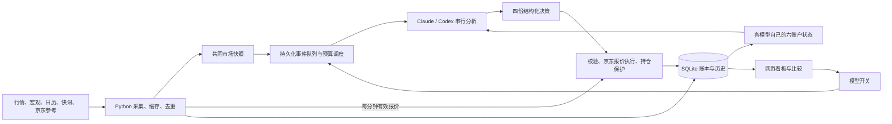

# 黄金积存金 AI 自主操盘与监控

让 Claude 与 Codex 基于共同市场数据，各自管理独立的黄金模拟账户，持续记录决策、成交与收益，比较两个模型的操盘表现。

本项目由黄金分析 Skill 扩展为常驻监控系统，包含数据采集、AI 调度、模拟交易执行、账户统计和网页看板。当前核心运行在 `monitor/`；原项目的独立分析 Skill 保留为兼容功能。

**所有交易均为本地模拟，不向京东或银行提交真实订单。**

[当前仓库](https://github.com/blue-green-red/Trade-Accumulated-Gold-CN) · [快速开始](#快速开始) · [核心配置](#核心配置) · [网页看板](#网页看板) · [独立 Skill](docs/legacy-skill.md) · [上游项目](https://github.com/PlevanTem/Trade-Accumulated-Gold-CN)

## 项目当前提供什么

| 能力 | 当前实现 |
|---|---|
| 双模型自主操盘 | Claude、Codex 分别决定买卖、数量、委托、止损止盈，程序校验并执行 |
| 六账户风险实验 | 每模型低/标准/高风险各设初始满仓/空仓账户，每户10万元；两模型共12户，以各户满仓持有/空仓持币为收益基准 |
| 一轮统一决策 | 同一会话输入模型自己的六账户状态，返回六份决策，不按账户分别调用 |
| 公众分析与推荐 | 同轮增加不含私人账户的市场分析，以及0%至100%共11档仓位建议；高风险波段口径，所有访客共用已保存结果 |
| 京东价格成交 | 买卖和估值使用京东通用积存金直取报价，失效时暂停成交 |
| 持续数据采集 | 行情、技术指标、汇率、宏观、日历、快讯由程序采集与缓存，采集过程不调用大模型 |
| 低配机器调度 | 两模型后台串行运行，轮换先后顺序；常驻监控不启动银行 Chromium |
| 真实账户建议 | 按启用范围只读同步持仓和电子户余额（当前仅浙商），同轮分析给人工执行建议，支持独立微信订阅 |
| 可追溯记录 | 保存共同市场快照、各模型账户输入、判断、委托状态、实际成交、费用与完整平仓周期 |
| 网页管理 | 五个主入口与按任务拆分的子页查看行情、账户、研究、记录与通知，可独立开关模型，支持桌面和手机 |

默认模式为 `risk_six_account`。旧短中长线及概率门槛实验已重置；定投类退出常驻运行，历史回测保留。

分析摘要按模型独立订阅（如 `codex:analysis`），与模拟盘成交和真实账户建议分开。即使同轮分析两个模型，也分别生成摘要事件，关闭另一模型的订阅不会混入其内容；未选中的事件仍留在前端记录。

通知开关在保存成功后直接使用接口返回状态更新，无需等待整份看板刷新；较早的刷新结果不会覆盖新状态。保存失败保持原设置并提示重试。

关闭模型后，前端隐藏该模型的账户、收益曲线、操盘对比、分析与预测成绩、操作历史和通知项，仅保留重新开启的模型开关。历史接口在分页前排除关闭模型，切换时清空浏览器旧记录缓存；数据库持仓、历史与训练归档不删除，重新开启后恢复展示。模型关闭仍沿用原执行规则，已有保护不会因隐藏而取消。

## 数据源连接方式

2026-10-27在当前服务器禁用代理实测，以下10个业务接口均HTTP 200并返回所需数据：

| 数据 | 数据源域名 | 连接方式 |
|---|---|---|
| 国际现货、日线指标及美元/美债/离岸人民币 | `scanner.tradingview.com`（cfd与global两个接口） | 直连 |
| 国际现货备用 | `quote.cnbc.com` | 直连 |
| 经济日历 | `economic-calendar.tradingview.com` | 直连 |
| USD/CNY主、备用 | `api.frankfurter.app`、`open.er-api.com` | 直连 |
| 金十快讯 | `flash-api.jin10.com` | 直连 |
| 京东匿名积存金报价 | `api.jdjygold.com` | 直连 |
| 黄金期货及人民币历史日线 | `query1.finance.yahoo.com`（GC=F与CNY=X） | 直连 |
| 京东资金与挂单参考 | `youqian.jd.com` | 直连；只实测TLS握手，未额外消耗密钥额度验证业务响应 |

启动时 `net_proxy.apply_proxy()` 清除监控进程继承的HTTP/HTTPS/ALL环境代理，数据采集和通知默认直连，不依赖Clash节点；不表示所有网络环境下永久可达。只有模型CLI的独立子进程环境、以及模型API的专用HTTP客户端使用 `GOLD_TRADING_HTTP_PROXY`（默认本机7890）；不会污染主进程路由，模型自带联网工具随模型进程运行。显式设置该变量为空可同时停用模型代理。本次未调用模型或发送通知做联网测试，也未关闭Clash进程。

## 六账户短线风险实验

默认 `GOLD_AI_TRADING_MODE=risk_six_account`。全部AI账户只做数日至一两周的短线波段，三档只改变风险预算：

| 风险场景 | 满仓起点 | 空仓起点 | 单次计划风险 / 当前净值 | 阶段最大回撤线 |
|---|---|---|---|---|
| 低风险 | `low_full` | `low_empty` | 1% | 5% |
| 标准风险 | `standard_full` | `standard_empty` | 2% | 10% |
| 高风险 | `high_full` | `high_empty` | 4% | 20% |

账户标识包含模型，例如 `codex:high_empty`。每户初始本金10万元，每模型60万元；两个模型共12个AI账户；`hold`、`position`、`short` 三个独立规则账户已删除，不再运行、展示或推送，旧环境配置不能恢复它们。仓位自主选择，风险上限不是必须用满的配额，高风险不强制多交易。预算定义见 `monitor/risk_profiles.py`。

风险六账户实验启用时的一次性迁移曾清除旧实验的持仓、委托、成交、净值、平仓周期和AI分析/账户输入；保留行情历史、新闻、外部接口缓存与额度、当天AI调用计数、模型开关。一次性迁移标记 `risk_experiment:v1` 防止重启清零。

独立规则账户使用另一项幂等迁移 `removed_rule_accounts:v1`，只删除这三个账户及其成交、净值、平仓周期、旧通知订阅与待发事件，不重置 AI 账户、真实账户、行情数据、分析归档和调用额度。回测工具仍可使用历史规则策略。

每个 AI 账户保留自己的同起点收益基准：初始满仓对应开账时买入后一直持有，按相同卖费估值；初始空仓对应一直保留本金，基准收益为零。低、标准、高风险各比较这两种起点，不另开基准账户。前端明确列出基准名称、基准收益、AI 收益及领先/落后的百分点，`AI 增益 = AI 收益率 − 基准收益率`。

在同一笔有效京东报价下，两个模型的六账户一起开账：满仓账户一次性买满，空仓保留现金。初始化不依赖模型开关，但关闭的模型不会分析或提交新交易；已有模型开关保留，不自动开启Claude。满仓初始化是实验起点，不是AI买入，不受单次计划风险约束；后续新增买入受预算约束。无有效报价或休市时等待开账，重启不重复初始化。

买入必填 `risk_exit_cny` 作为整仓计划退出参考，按买入后全部持仓在参考价退出的净值（扣卖费和价差），与当前净值比较计划损失；加仓必须计入已有仓位，实际保护止损更低时按更低价测算。接单和成交前都检查预算，超预算拒绝。`risk_exit_cny` 不自动设置止损，模型仍可自主设置/撤销实际保护，计划预算不保证最大实际亏损。阶段历史最大回撤达到该档回撤线后，本实验暂停该户新增买入，仍允许持有、卖出及调整保护，不强制平仓，也不随净值反弹自动解除。

模拟账户按模型和风险场景分组，详情显示预算与触线状态；成绩对比分别展示六种起点，避免只用模型总收益掩盖风险差异。通知按模型×风险档独立开关，新档默认关闭。

### 公众分析与11档仓位推荐

公众内容并入现有模型分析：每个启用模型同一请求返回市场判断、私人账户决策和 `public_content`，不再追问，不为公众增加独立模型轮次。Codex、Claude Code沿用各自当前单轮结构化调用；原生API统一使用同一会话的结构化提交工具，不再走先研究、再整理的两步路径。历史查询及必要搜索仍可能在这一会话内产生工具交互，不等于保证整个分析只有一个网络往返。原生API最终输出上限增加至12000 tokens，以容纳新增11档；上限不是每轮固定用量。

公众版采用**高风险、数日至两周波段**，单次计划风险参考4%、回撤参考20%，均非损失保证或自动执行限制；不强制买入、满仓或频繁交易。仓位口径是黄金市值占“黄金市值＋为黄金投资预留的现金”的比例，不是家庭总资产占比。11个当前仓位为0%、10%……100%，每档包含即时动作、目标仓位、简短理由、失效条件和最多2个条件方案；条件方案单独描述触发价及触发后目标仓位。共用市场依据写一次，各档只补充差异，不按金额、克数或私人盈亏给推荐。新增提示只在共用研究规则中写一段，不复制11份；仅补充该模型上一轮已发布公众观点和风险，供本轮说明变化。

公众输出v2增加共用 `decision_basis`：一次解释目标仓位与更高/更低仓位的取舍；可选的 `entry_scenario` 给假设入场、目标、退出及公共来源，不等于买入指令；无法可靠量化可为null，填写具体缺口。全部11档条件方案均可为空，此时只需共用 `no_conditions_reason` 说明原因及复评安排，不强制买入或凑条件单。`review_triggers` 用明确人民币阈值、具名事件或带时区时间表示复评，取代重复的 `watch_conditions`；各档失效说明引用共用条件。新发布要求共用依据完整；旧记录仍按v1读取，不补造旧情景。

程序通过公开的 `public_reference` 提供参考卖费/价差（默认0.4%/0），不借用真实账户参数；`scenario_metrics` 按假设新建仓计算扣费目标收益、退出收益和收益风险比，目标不足以覆盖费用时保留负收益、不伪造正收益风险比。按某档目标仓位加权的影响只是这笔黄金投资资金的假设收益风险，不是用户存量持仓盈亏，也不是最优仓位证明。前端集中展示仓位取舍、共用情景、参考费用与复评条件；仅说明各档差异。公众提示重写后由472字符缩至464字符，结构定义增加但不额外发起模型请求。

定时复评允许附带说明，但必须有带时区的具体时间。可选入场情景若命中私人价位或其他隐私校验，发布时整体置空，并说明无法核验全部价位的公共来源；关联理由中该情景的百分比收益测算、收益风险比也一并移除，保留仓位差异和明确参考费用。旧版已省略情景的公开记录读取时同样清理，避免遗漏理由中的关联数字。其余内容仍经过全部隐私与结构校验，若还含私人信息则整轮拒绝发布。不推测替代价位，不改动模型原始输出和训练归档，也不因此自动重试模型。原始候选情景与公开结果的差异可通过原归档及发布版本追溯。

`public_content.analysis` 单独生成形势、变化、驱动、风险、复评条件，禁止使用私人账户/历史/账户事件作为公众依据。相同模型仍能看到私人输入，因此提示约束不能构成完全的信息隔离保证；程序另外校验严格字段、11档覆盖、动作/目标一致性，拦截私人标识、绝对资产金额/克数及未见于公共行情的私人成本/委托价等明显泄漏。未经校验或分析期间已失效的结果不向公众发布；不从旧私人摘要、账户建议或分析归档补造公众内容。校验无法证明自由文本绝无语义泄漏，公开前仍应通过看板预览检查表达。

公众价位须独立取公共原值或按本轮数据重算，不能用“近似合理”把换算结果凑到私人旧目标。`public_reference.mapped_levels` 提供本轮公共京东价×国际MA20/MA50÷XAU的两位小数参考，要求报价及日线指标在快照时有效；仅为固定当前产品比例的假设换算，包含汇率、溢价误差，并非京东技术支撑阻力，不要求AI采用或交易。计算不读取账户、保护价或历史建议，不增加采集和模型请求；发布校验重新计算这些公共参考，不信任传入的派生数值。私人独有价位若出现在情景、条件、复评或正文，仍按原隐私规则处理，不自动替换价格，也不放行污染内容。

公众收益和风险测算统一用百分比。若模型写出“每万元”算术示例，仅在公共情景价位、公共费用及示例金额均能核对时，将该示例规范成程序计算的百分比；其余原文继续接受完整隐私校验。无法核对的金额、私人资产数字和标识仍拦截，不改写仓位动作、目标或条件价格，不新增模型调用。

结果单独存于 `public_ai_reports`，私人账户输入及完整输出继续留在原有私有存储和训练归档。匿名只读接口 **`GET /api/public/ai?model=primary&position_pct=20`** 仅查询该表的明确字段，默认主要分析视角；省略 `position_pct` 返回全部11档，可选模型仍遵循现有开关。接口不返回账户、余额、挂单、私有研究笔记、触发原因、运行ID或完整归档，其余看板/API继续要求密码。旧分析没有公众字段时返回 `unavailable`，不回填，不因此额外调用模型。访客共享数据库中的同轮结果，切换仓位只读缓存；接口支持ETag和强制重新验证缓存，不启动采集或模型任务。

方案有效期为行情快照起最多4小时，报价较输入公共京东价变化达到0.4%、当前报价缺失或休市时标记 `stale` 并说明原因，保留历史内容供参考。共用复评价格或时间满足时标记 `review_due`；这里只校验展示时效，不因访客查询额外排队分析，沿用现有模型调度。分析过程行情失效则不公开该轮；模型关闭/重新开启后旧代际结果隐藏。条件价、假设入场情景及价格复评必须有当轮新鲜公共京东报价，不借用真实账户专用报价；缺公共报价时仍可给仓位方向和事件/时间复评。私人看板AI研究页保留按需加载的“公众内容预览”；独立公众页面见下节。微信原生小程序尚未发布。

### 金析AI 独立公众页面

访问 **https://gold.goalgoal.fun/public/**，无需密码；私人看板继续使用根路径和现有密码。公众页为独立Vue构建，源码 `frontend/public-app/`、产物 `monitor/public_static/`，不导入私人页面或账户组件，也不请求任何私人API。仅包含三个入口：

| 页面 | 展示内容 |
|---|---|
| 行情 `#market` | 金价/快讯/日历/市场指标四个子页；金价含京东报价、国际现货/汇率、1/7/30天采样曲线；快讯支持重要/全部，日历默认7天范围、可切今天，显示实际/预期/前值，指标含美元、美债、离岸人民币与RSI/MA20/MA50 |
| AI分析 `#analysis` | 最新观点/历史观点；形势变化、方向、可展开的概率口径、关注价位的用途与可展开取值说明、消息驱动、风险和复评条件 |
| 仓位推荐 `#recommendations` | 0%至100%共11档单档参考；可展开11档总览表，点击仓位切换，不增加请求；共用取舍、可选情景/条件方案、方案失效条件与系统分析更新方式 |

页面及子页按路由懒加载并通过KeepAlive保留状态，行情初次进入不加载AI、快讯、日历或指标。AI分析与仓位推荐共用一份30秒内存缓存；切换仓位仅在本地选择，公众浏览器仅保存所选仓位百分比和共用的主题偏好，不输入金额或成本。行情报价缓存30秒、走势按范围缓存60秒，快讯/日历30秒、指标和历史60秒，重复并发请求合并；ETag支持304，失败保留上次内容并标明更新失败。历史按模型和7/14/30天范围缓存，10条分页、详情展开后读取，返回列表保留已加载记录；后台出现新观点时提示点击更新，不打断阅读。隐藏页面暂停轮询，返回可见时复查。引用有效期在浏览器本地时钟上到期，过期/休市/报价不可用/已触复评均有明确提示；“刷新”按钮仅读取已保存数据，不调用AI或采集接口。

匿名只读市场接口 `/api/public/market` 的 `view` 支持 `quote/history/news/calendar/indicators`（仅history接受1d/7d/30d的range），仅从已采集公共快照、快讯、日历和行情表白名单输出；不查询真实/模拟账户、通知或完整看板。服务器报价合并缓存最多5秒（不跨有效期/关盘边界）、快讯/日历15秒、走势/指标60秒。未来事件的实际值始终隐藏，零值保留，美元均线不会当作人民币价位。公众静态文件只从专用目录提供；其余看板和静态资源继续要求密码，路径穿越与未知参数拒绝。所有访客共用既有数据，无新增模型轮次或外部行情请求。

`/api/public/ai` 与 `/api/public/ai/history` 只读取公众表，模型关闭后不返回对应报告。历史列表接受 `model/days/limit/before`（每页最多20、时间最多30天），`report_id` 按需返回单轮已发布观点；历史详情不作为当前交易建议，不返回私人view/run ID、笔记、账户、成交或操作历史。方向、置信度与概率从同轮已有结构化研究中仅投影7个枚举/数值字段，存入公众表的 `assessment_json`；匿名响应额外移除置信度，仅保留方向与概率，不增加提示词或模型请求；概率明确标注国际现货、期限和涨跌阈值，不是交易胜率。`evidence_json` 保存关键价位对应的公共京东快照/每日采样匹配或模型假设说明，以及公共数据源时间。

公众展示统一使用“金析AI/补充视角”，接口用 `primary/secondary` 别名，不向页面输出具体模型名称或判断置信度；原 `analyst` 查询参数仅为既有私人预览和旧链接保留兼容。公众响应过滤采样不完整的说明，保留报价缺失/过期及其他市场风险提示；不修改已保存模型原文、私人研究或训练归档。页面采用与私人看板一致的金色主题、灰白/深灰背景及图表系列色，沿用 `gold-theme` 主题偏好并支持系统深浅色。

AI分析与仓位推荐共用“分析更新方式”，直接读取调度配置：目前国际现货黄金相对上次分析输入价涨跌达到0.4%、重要消息/经济数据、交易日08:40/20:45定时及交易时段4小时兜底。实际更新还受数据可用性、运行队列等约束。AI分析页分别展示“本轮风险”和“关注价位”，解释每个京东人民币观察价/情景价的用途，取值说明可展开；其他事件/时间观察点折叠展示，明确只是AI本轮关注条件，不承诺自动触发分析。触及这些关注点会使旧方案待复核，**不等同于启动新分析**。上述展示调整不新增触发器、不改变私人模型调度，也不增加提示词或模型请求。

公众界面使用统一的紧凑应用布局：固定顶部栏、同规格卡片与状态标签，手机单列、桌面AI分析分区；仓位页先展示所选档位参考，再看11档总览，细节按需展开。历史价位使用回顾措辞，条件参考方案明确不提交挂单或自动执行；各档复核说明与系统更新规则分开，参考截止不冒充交易平台的挂单期限。情景价格、收益率和黄金投资资金的加权影响分别标注单位与假设；到期后状态及截止时间文案同步变化。

行情独立标注国际金价采集时间/状态，USD/CNY明确为日更参考汇率并提供数据日期和获取时间；市场指标区分部分可用、缺失与过期，浏览器不会因缓存刷新而延长数据时效。日历的下一项日程跟随今天/7天范围筛选，已公布筛选不混入下一项日程；已过计划时间但尚未收到实际值时显示“待更新”。AI加载失败不再写成等待模型生成；确认模型关闭后清除其最新/历史关联缓存及在途旧响应，跨页面不恢复关闭模型的旧观点。

匿名AI响应另外提供 `reference_validity`：公众方案最多4小时、京东通用参考价相对本轮输入价变化0.4%等规则用于检查旧方案是否待复核，与 `update_policy` 中的实际分析调度分开；概率栏中的3交易日0.4%则是模型预测事件的定义。以上均为展示与时效修正，不新增模型请求、提示词或外部数据采集。

旧记录的元数据一次性离线补录：以模型、view ID及完成时间精确匹配，避免旧实验ID复用串档；不回填私人研究原文，价格依据只使用对应快照时刻之前的公共采样。缺少证据时标明未核验，不补造支撑阻力。匿名查询不读取原始 `ai_views` 或模型输入归档。新增元数据代码哈希进入原训练归档。

构建并发布两套页面：

```bash
npm --prefix frontend ci
npm --prefix frontend run build:all
python3 scripts/deploy_frontend.py
```

也可单独构建公众页 `npm --prefix frontend run build:public`，再用 `python3 scripts/deploy_frontend.py --source frontend/dist-public --target monitor/public_static` 发布；部署保留旧哈希资源，避免已打开页面的后续懒加载失败。公众版不等同于已发布的微信原生小程序；注册名称/简称/介绍/头像见[注册资料](docs/branding/mini-program.md)。

测速：`python3 scripts/benchmark_public_site.py --output docs/benchmarks/public-site-2026-11-03.json`，使用无认证、新浏览器上下文检查三个公众页面及缓存切换；与模型/采集浏览器错峰。结果是ECS本机浏览器测量，不代表外网用户时延。

### 浙商、民生真实账户与人工执行建议

浙商、民生各自保存真实账户快照，与六账户模拟账本隔离。后台 `gold-jd-sync` 分组直连查询：开市报价默认约1分钟、持仓/电子户余额/条件单约5分钟、历史首页约30分钟；休市降低频率，模型分析时错峰等待。账户列表支持手动刷新（30秒限频、重复排队合并）。查询持仓、报价、最近一笔交易、待处理条件单、持仓批次首页、清仓记录首页及电子户可用余额；不消耗ClawX行情密钥额度、不调用模型采集。记录账户身份必须校验产品名称及SKU，外层HTTP 200不能当作账户已登录。

| 账户 | 产品编号 | 账户首页查询 | 电子户可用余额查询 |
|---|---|---|---|
| 浙商 | `1961543816` | `/gw2/generic/jrm/newh5/m/indexDataStd` | `/gw2/generic/jrm/h5/m/queryStdAssetsBalV2` → `datas.availBalance` |
| 民生 | `21001001000001` | `/gw2/generic/jrm/newh5/m/indexData` | `/gw/generic/hj/h5/m/queryAccountAssetsV2` → `datas.availableBalance` |

以上为 `api.jdjygold.com` 官方H5内部只读路径，不是承诺稳定的开放API；持仓批次/清仓首页通过 `ms.jr.jd.com` 已验证查询读取。电子户资金与绑定银行卡余额分别看待，两家资金不可混用。条件单使用官方新版 `/gw2/generic/hj/h5/m/queryConditionalRuleList` 查询，历史状态使用 `/gw2/generic/jrm/h5/m/queryStdTradeListResourceNew`，按产品编号校验银行。完整逐笔交易历史仍未知；待成交列表是否完整由接口总数和实取条数判断，失败保留未知，不能把失败当作0笔。前端展示每类历史首页最多20条，模型输入只选持仓批次3条、清仓样本5条、待成交明细最多5条并标注截断，避免输入过长。源报价时间与抓取时间分开，休市旧报价明确标为历史价格。持仓浮盈亏按该银行卖价、成本和持仓克数估算，标明未扣卖费；接口累计收益不能当作当前持仓浮盈亏。

采集进程恢复专用Chrome配置中的京东会话后只在内存保存Cookie，后续轮询直接使用HTTP请求；Cookie不进入SQLite、模型、Git、报告或看板接口。只有启动/失效恢复才短暂启动无界面Chrome，随即关闭；模型运行时延后恢复，避免与模型争内存。失效时保留上次成功快照并标记需要登录，不自动发送验证码，连续失败采用5至30分钟退避。账户快照超过30分钟标记过期；单独更新报价不重置账户快照年龄。一次京东登录可复用两家账户；会话没有保证的固定有效期，取决于京东服务端。本次两家真实只读验证冷启动及完整采集约15.9秒，复用会话后仅更新两家报价约0.21秒，实际网络耗时会变化。

每个启用模型同轮输入自己的六个模拟账户＋两家真实账户，不额外逐户调用模型。模拟决策仍只进入原模拟执行器；真实户输出独立的 `live_account_advice` 并单独存档，只有人工参考作用。真实户按用户指定使用高风险建议偏好，参考单次计划风险4%、回撤线20%，`GOLD_JD_LIVE_RISK_PROFILE` 可改为 `low/standard/high`，默认 `high`。真实账户规则仅在存在对应输入时添加；每户附本模型上一轮建议的精简理由、判断复核、价格条件及执行进度，并额外保留仍关联待成交挂单的旧建议，既有持有建议不会遮掉此前的卖出或条件单方案。模型提示先检查已有委托，区分挂单与成交，避免重复建议同一笔操作。预算仅是建议参考，缺少完整历史峰值时不假定20%是否触线，成本浮亏不等于峰值回撤。不能借用模拟盘现金；卖出数量、资金不足、输入过期或分析期间行情变化均提示复核。建议到期、账户或委托版本变化、模型重新开启均不会冒充仍有效的建议。

真实建议通过 `reassessment` 简述本轮变化、原假设状态、当前假设与推翻条件、目标/复评价来源及沿用或调整理由。按风险偏好争取扣费净值增长，允许有依据地提前布局、逆势或分批参与，不要求确认底部、趋势反转或多项利好同时出现；`reason` 按本户仓位和共用规则选择规模及参与时机，比较持有与加减仓。情景标明假设，缺数保留未知，不编造价位或凑条件单。旧条件未出现不能单独支持持有，目标不是涨幅上限；允许有依据地保留旧价，不强制买入、改价或交易。账户页展示判断复核与新增下跌情景比较；旧分析保留原文，不补造新字段。

真实账户的 `position_pct` 和 `account_risk` 由程序按各自有效快照计算。黄金仓位为 `g×P/(现金+g×P)`；扣卖费净资产为 `现金+g×P×(1-f)`，单次风险金额按该净资产和本户风险档位计算，仅是参考，不是必须用满或自动止损的额度。输入还给出金价跌1%的账户净值影响；不包含绑定银行卡或其他账户资产。缺现金、费率或有效报价时，相应估值保持未知，不补零；现金为0、无持仓等边界单独处理。预计卖费只是清算估值预留，未实际扣款；历史峰值回撤仍未知。

新分析用 `downside_scenarios[]`（最多2项）独立比较有依据的候选下跌价：区分压力测试、假设失效、自选风险限制与入场观察，分别给加仓、继续持有、减仓/退出的理由及倾向；情景本身不是订单或复评触发器。拒绝现价加仓不能替代较低价的判断，低仓位不默认继续减仓，也不强制逢跌买入；无可支持候选时可留空并说明。新组合止损方案须有同价、倾向卖出的假设失效或自选风险限制比较；只有压力测试、缺少比较或与选择矛盾时，局部标记需核对并不作为有效条件单推送，不阻断其他独立有效项。旧存档不倒改，结构一致也不代表论据已被程序证明正确。

`limit_buy_reviews[]`（最多2项）另外评估能否提前挂出较低价买单，区别于现价买入和压力测试，不默认沿用压力测试价。每项记录推荐、机会不值得、需复评或信息不足，以及候选入场、目标、新增风险退出参考、克数、独立期限、来源和具体原因。退出参考可采用有依据的假设失效价或自选损失限制，不要求独立技术位确认，也不是损失保证；未知参数为null，不编价凑单。只拒绝现价买入或笼统说有事件、等确认，不替代限价候选判断。推荐项须完整，且对应同价、同量、同截止时间的 `limit_buy` 草案；不推荐项不生成该买单，参数或占用有冲突时局部标记需核对，不阻断独立有效建议。

模拟与真实账户共用价位选择规则：先按同一交易假设与期限选择T/R，不为支持买入或等待倒推价格。目标说明周期内的可达路径、当轮证据和近端/延伸用途，均线映射仅为候选；退出区分假设失效与自主损失限制，结合现有且时效合适的波动/结构、期限及整仓损失解释幅度，仅称“自选”不够。同规模用一组有依据的邻近T/R检查动作是否敏感；缺少替代依据可直说，不凑价，不编ATR或京东技术位，也不增加缺数据禁买条件。模拟写入`invalidation`，真实写入`reassessment.price_basis`，低位候选沿用`basis`；沿用或调整旧价均给当前依据，旧边界已触须重审假设，不强制买入、改价、挂单或延长持有，不增加模型轮次或硬性拒单条件。入场不直接套账户风险预算、压力价或每轮固定折价，等待仍须比较参与代价、可验证条件及复评截止。

模拟与真实账户共用分批比较规则：先按当前证据决策，再说明事件影响。可追加时，`reason`在事件结果未知的状态下，以同一E/T/R比较0、自选小额和常规一笔的金额与整仓损失；选择0须说明为何两个非零规模均不值得，并计买贵/踏空代价。路径用“本轮→后续”给1—2步条件及规模，分别评估报价变化和事件信息，不预设必须先有利好；无可行扩仓情景可明确放弃，不强造买点或目标。分批计累计投入、均价和整仓风险，首笔不求最低点，后批按新快照重评，不因浮亏自动追加。路径目标不自动下单，资金、整仓预算及保护边界校验保持原规则。

高风险偏好在有合理获利依据且损失可承受时提前参与，分歧优先通过规模和节奏处理。利好后的扩仓情景不能替代当前规模比较，弱趋势、没有新催化或历史建议的等待条件均不能单独成为本轮门槛。若仍等事件，说明何种结果改变哪条收益/风险假设、信息价值为何优于当前可行规模；中性、延期或缺数时独立选择行动与复评截止，不自动续等。允许合理等待，不强制买入、改价或挂单；真实账户沿用`buy`、`recommend`、`not_worthwhile`和`needs_review`，不新增模型请求或按文字自动交易。

`participation_review`由程序为真实和短线模拟账户计算参与/等待对照，覆盖空仓及持有但未追加。当前以净资产1%和5%为参考追加金额（不超过确认且未占用的现金），给报价同幅上涨/下跌2%时相对保留现金的扣费差额；这些是统一对照规模与敏感性情景，不是仓位目标、指令或复评阈值，原0.4%异动触发保持原规则。连续有效hold/wait按账户状态与模型开关版本追溯最多14天，不因逐轮刷新或改文字重置；记录最早观察输入报价，按当时净资产1%的固定对照金额持有至当前报价，正差额表示等待错过的对照收益，负差额表示等待避开的对照亏损。比较按当前费率，不模拟最佳成交、期间止损或真实成交回放；只用截至观察时已存在的记录，银行历史不混用公共或另一家报价。成交、余额/委托状态变化、有效买入方案、无效输入或模型重新开启中断对应连续观察，现金/部分成交占用未知则保留未知，风险暂停不生成可追加对照。反馈只读，不创建交易或通知；模拟输入直接附带，真实附在本模型上一建议的`strategy_review`并随新分析存档。账户详情展示金额和口径，公众内容继续排除私人对照金额。提示词要求同时评价少赚与避损，价格先涨也独立重算剩余机会，小额不提高胜率仍改变绝对损失及上涨参与；不因事后上涨强迫买入，不以等待获益推断永久空仓。

微信发送时将标题、Markdown正文及HTML可见文字中的`Codex`统一显示为`AI`（大小写均适用），链接目标及HTML属性保持原样。仅在推送服务请求前转换；前端、事件记录、模型标识、订阅路由及去重依据继续保留原模型名，已发送的历史消息不回改。

真实账户每轮自主给目标总仓位与本轮增减量，独立比较新增一笔、维持现仓及等待；可分批推进至满仓，已有首笔不是仓位上限，也不强制追加或满仓。废弃旧候选只在复核中解释，不替代本轮新增评估。未采纳（`not_worthwhile`）方案在前端单独折叠，仅显示原方案参考与拒绝依据，不按当前候选校验触价/期限/现金，也不显示当前候选收益测算；回传模型时仅保留决定、依据和理由。真实买单仍须匹配明确推荐且完整、有效的评估，拒绝方案不能授权下单。

保护状态由本轮新鲜待成交明细计算，区分已读取组合保护、完整明细未发现保护、明细不足待确认；旧建议不作为已挂证据。建议保存分析时保护状态，前端同时显示当前查询结果；微信明确提示新挂建议尚未生效。卖出情景分别显示相对分析时整户净估值变化，以及按账户买入均价估算的本笔扣费盈亏；均价未知不填零，部分卖出按均价估算而非冒充逐笔成本。全部为确定性派生展示，不新增模型输出字段、分析请求或通知触发规则；不重写历史建议，不操作银行订单。

真实账户`position_path`仅用四个模型字段关联现有信息：条件成立后的目标黄金仓位、`downside_scenarios`中退出边界的0起索引（无价格边界为null）、边界作用于整套建仓或当前这批仓位、分步条件与规模或不扩仓的障碍及复评截止。自选损失限制不自动等于整套交易假设失效，AI须说明边界范围；不强制加仓、撤保护或改价。前端和微信明确区分路径目标与本轮追加指令。新协议保存为schema_version=6；旧历史保持原样，新鲜账户的新协议缺少路径时暂停可行动通知。

程序校验边界情景、现有/建议保护、即时买入及待挂买单的衔接：进入退出边界的即时买入阻断，冲突条件买单及其推荐评估单独标记、从可行动通知中剔除，独立有效的保护/撤改单仍可提醒。旧买单仅被建议撤改不视为已完成，不据此放行新增买入。边界复评复用现有账户级价格条件，限于最多4条及原有交易时段/额度；未重复生成观察条件或额外调度器。报价触达边界时读取端立即将旧追加标记暂停；现有价格观察器记录触发后，即使反弹也不恢复该份旧路径，直至新的分析。页面读取不写库，原始建议保持不变；旧通知若在出队/重试前触达边界，取消该份旧通知，避免发送冻结的追加指令。账户或委托成交引起版本变化后旧建议失效，须用新快照重评；任何实际京东委托均不会被本程序撤改。

前端与微信显示目标、边界范围、继续条件及保护覆盖：已挂保护、新挂建议、若全部新增买入成交后的持仓与尚未覆盖数量分开测算；未成交的新增买入不计入确认现仓或自动扩大保护。部分成交剩余量或明细不完整时覆盖量保持未知。继续输入仅保留上一轮路径的4个字段、原边界、原持仓和当前状态，不重复派生覆盖表。买价高于退出价仍可能因跳价同时满足独立银行委托；页面及通知明确先核对成交、人工确认旧单撤改，再刷新重评，系统不保证外部委托原子互斥或成交先后。路径及校验留档，不重写旧记录，也不增加公众字段。

六个模拟账户同步使用关联路径，仅补充3个模型字段：目标仓位、引用已有风险参考/止损/不另设参考边界、继续或暂停追加条件；不再重复输出边界价。模拟已生效保护优先执行、作用于届时全仓，保护成交撤销旧委托并依账户版本重评；待成交买单上的取消保护标志不能提前取消当前保护。到参考边界先取消旧待买单并排队复评，不因反弹恢复；持有路径到参考边界也只暂停追加、请求复评，不自动卖出。每户只留一个计划触发标记，新分析可重建路径，原有整仓风险预算、回撤暂停、手续费及保护自主选择保留。模拟加仓后保留或新设保护覆盖实际全仓，真实账户保护克数则须本人按新快照核对，前端分别说明两种执行方式。旧协议路径可缺省，旧账户、仓位和历史不重置。

真实账户输入保留上一轮候选的简短`basis`，并在`previous_advice.strategy_review.entry_reassessment`中按同模型、同账户版本最近最多3轮提供折价比例、连续相同比例轮数、候选与输入价变化，以及旧候选在最新输入时是否已触及且未到期。只提供聚合事实，不重复输入多轮完整价位论证；实际买入或已推荐条件买单时不追加这类等待反馈。该信息不改变校验、候选价、买卖结果、微信触发或AI调用频率，旧历史保持原样。

程序按本户卖费核算候选新增收益/损失、所需金额、独立买入后仓位，以及新增持仓买入后到达退出参考时的整户扣费估值变化。原仓仍按同价估值，不表示必须一起卖出；新增退出参考也不自动附加到京东买单或修改旧保护。评估及测算在前端和已有微信事件中展示，实际推荐买单的目标或新增退出参考实质变化沿用该银行通知；解释、估值或候选期限滚动不单独提醒，未推荐的候选变化也不新增通知。同轮完成，不追加模型追问；历史记录缺少该字段时保持原样。

保存时由程序计算各下跌情景对当前账户净值的影响，以及每笔条件单触发后的黄金仓位；组合单分别估算互斥的止盈、止损两腿，各订单不叠加其他单成交。净值变化比较始终采用相同扣卖费口径，不重复扣费，未计跳价。前端账户持仓、建议详情和现有微信消息展示这些数据；只新增解释，不新增通知订阅或模型请求，理由与估值更新不单独触发微信消息。当前风险、实际模型输入、情景、校验结果与代码哈希均留档，真实账户继续只读和人工执行。

真实账户每轮仅补充最近最多3轮的方案连续性摘要：上轮实际输入价、当前变幅、相同交易方案连续轮数及其中削弱/失效轮数。参考报价、理由改写和方案截止时间滚动不算交易方案变化。连续维持同一方案且至少两轮假设削弱/失效时，首次合并排队一次旧价位复核；已经接收该反馈的新建议不会因此循环加跑。沿用原有 `reassessment.price_basis` 和 `reason`，给当前证据、目标可达依据及当下参与/等待/持有/减仓退出的扣费收益、风险与仓位取舍；允许有依据地继续持有，不强制卖出、改价或新增输出字段。输入事实随建议保存并在账户建议页展示，新增反馈代码哈希纳入分析归档。

每轮同时评估两户是否适合提前设置条件单，最多各2笔 `suggested_orders`，支持限价买入、限价卖出、组合止盈止损卖出，明确克数、价格、独立截止时间与依据；没有合适机会填空并说明原因。所有建议仅为待本人确认的方案，**程序不会提交京东订单**。买单不能借用另一个账户或尚未卖出的收入，卖单核对可卖量；与已有挂单、改单方案及本轮新增买卖合计核对资金/克数占用，重复方案、过期数据、无效期限、已满足触发条件等标记待核对。组合单的同一份克数只计算一次。条件单截止时间与建议有效期分开：本人在建议有效期内确认挂出后，按京东订单自身期限生效；休市仍不保证触发成交。

新增或实质调整条件单方案沿用对应银行的微信订阅，即使账户动作是持有也可提醒；相同参数只改解释或滚动延长截止时间不重复提醒，失效数据恢复或旧条件单方案到期后重新提出可再提醒。无效方案不推送为可行动建议。真实挂单同步后可按种类、参数和时间关联原条件单方案，并保留其历史输入；关联只代表推断。总览显示附带方案数量，账户页将“建议预挂”“已有挂单处理”和“价格触发复评”分开展示。

用户确认“当前满仓”的现金0只是带来源的备用声明，接口余额优先。持仓/交易变化或接口查到非零现金后，该声明失效并待重新确认，不能在卖出后永久按0计算。持仓、可用余额、条件单数量/参数/状态变化均加入现有AI事件队列；观望所缺的银行报价恢复、尚未关联执行的买卖建议到期也会排队复评，每个事件去重。两银行事件合并到同轮六模拟＋两真实分析，沿用开盘调度、串行运行及每日120轮上限，不因为每分钟刷新报价就每分钟调用AI。没有价格复评条件或撤改建议的持有/观望不会仅因建议到期循环调用；已有对应待成交或已结束条件单的旧买卖建议也不再单凭过期重复复评。完整模型输入、真实建议和代码版本哈希也进入原分析归档，接口凭据不进入归档。

条件单以银行原始标识的摘要保存在独立账本，不向模型或前端返回原始订单号、用户标识和优惠券信息。建议与委托按同银行、方向、数量、价格及建议有效期内创建时间关联；相近参数明确标注“参数有调整”，多笔相近委托保留待核对，不声称是程序下单的证明。关联结果持久化，未完成条件单对应的旧建议会随最近3条建议一并进入模型；前端还保留最近条件单关联的历史建议，后续多轮持有或成交不会丢掉原始关联。成交、撤单、到期等结果以官方返回为准，消失于待成交列表而无结果证据时标记状态待核对，不能猜测已经成交。前端分别展示建议有效期和京东条件单有效期，提供最近建议、挂单和历史状态。

真实账户首页按启用银行展示摘要卡：单户使用整行，多户桌面并排、手机单列，突出克数、电子户现金、浮盈亏估算及已挂/待确认方案数量。进入某家银行后，分别查看持仓、AI建议、条件单和记录。两家积存金买卖同价，各户只展示一个“银行金价”；浮盈亏仍标明未扣卖出手续费。报价时效、人工建议和历史样本分区展示，并支持暗色。

每户真实建议分为三个独立部分，允许“持有剩余仓位＋保留现有卖单＋到某价重新评估”同时存在：

| 字段 | 内容 | 行为 |
|---|---|---|
| `action/grams/price_condition/price_cny` | 账户持有、观望或新增买卖建议 | 仍由用户确认执行 |
| `order_management[]` | 对输入订单摘要标识给 `keep/cancel/replace`、理由及可选替换参数 | 保留、撤单或改单建议；不提交或撤销订单 |
| `review_conditions[]` | 本银行报价侧 `buy/sell`、`at_or_above/at_or_below`、元/克阈值、理由，可关联某个已有单 | 程序读取缓存报价，命中后只排队调用AI |

修改参数包括克数、触发方向、价格和含时区的截止时间，null保留原参数；部分成交单调整交易参数时默认使用已确认未成交克数，未确认剩余量则要求核对。组合止盈止损单允许仅建议修改截止时间，此时完整保留原数量、止盈和止损价，不当成新限价单，也不额外占用原单冻结资金或克数；其他复杂修改仍需核对。前端和微信同时显示止盈、止损参数。保存原单快照与修改后参数，校验未知/重复目标、无实际修改、期限无效、超可卖量或本户资金不足、卖单与新增卖出重复占用等问题。建议撤单或减量不视为实际释放冻结量，新增买卖与条件单不能预支尚未发生的撤改结果。可见的有效待成交单若未给结构化处理建议，也标记需核对。

校验区分整户阻断与逐项警告：数据失效、账户变化、资金或持仓占用冲突、未知警告继续拦截整条通知；单个挂单、复评条件或新条件单参数有误，只拦截对应项。通过校验的独立建议可正常提醒，微信不附未通过校验的结构化项及可能混杂其指令的总体理由，前端标记“部分建议需核对”并保留全部原始警告。历史分析不倒改，不补发旧的过期建议。

价格复评只使用所属银行新鲜报价，条件随本条AI建议到期，并在账户/委托版本变化、目标单失效、模型关闭、休市或数据不可用时暂停。每条条件每份建议最多触发一次；同一条件在连续分析中持续满足时保持锁定，不反复调用，价格回到另一侧后才重新允许后续建议触发。复评事件与其他事件合并，继续受每日调用预算约束；它独立于周期复查的0.4%变化门槛，不会自动买卖或撤改。需复评的买卖、价格条件或撤改方案，到期后按“模型＋银行＋账户版本＋连续方案”持久化去重：同一方案只因到期排队一次，换一轮分析编号或续建议有效期不会循环排队；交易条款、复评阈值、账户版本或模型开关代次变化可重新开启一次。建议到期仍显示已到期，不延长效力；市场波动、账户/委托变化、重要事件、手动分析和最长等待复查继续生效。

前端分别展示原单、保留/撤改建议、修改后参数、建议有效期、价格复评条件、监控状态与触发时间。老建议不从理由文字中猜测阈值，显示未结构化并为已开启模型合并排队一次升级分析；新输入还携带经过精简的历史挂单处理和复评条件。撤单、改单以及撤回这些建议的实质变化沿用各真实账户微信订阅，即使账户动作是hold/wait也可以提醒；除下述首次评估提醒外，单纯保留或条件未命中不新增微信通知。

账户页使用“真实账户 / 模拟账户”切换；有真实快照时默认展示真实账户。模拟首页按风险并排展示满/空两种起点，单户详情集中持仓与当前决策，成绩对比保留各户基准与六户组合曲线。AI页专注研究、控制和运行评估。通知位于“我的”，订阅设置与发送记录分开；同一消息的关联事件和重试在一行内展开，事件数、尝试数与消息数分别计数。

微信沿用现有PushPlus/Server酱渠道，使用 `codex:live_zheshang`、`codex:live_minsheng` 及Claude对应项，默认关闭，通知页可分别开启。可行动买卖及挂单方案的实质变化产生提醒，持续持有/观望通常保持静默，以下两种情况例外：按“模型＋启用银行”分别计算，北京时间每天首次有效真实账户分析提醒一次；持仓或确认资金实质变化后的首次有效复评也提醒一次。变化比较分析输入中的实际克数和确认现金，阈值为克数差≥0.01克或现金差≥1元；不以报价导致的仓位百分比变动、成本价、委托元数据或快照版本变化代替。未知值不当作0，向前查找最近有效分析中的已知值；无历史基准不凭空判定仓位变化。报价失效、整户校验阻断及没有可独立通知内容的局部失败不消耗首次评估机会。两种原因同轮重合只生成一条事件，消息标注原因；之后无实质变化的普通持有续评静默。去重依据持久化分析记录和通知事件，服务重启不重置；关闭订阅期间的分析仍计入首次评估，重新开启不追补历史提醒。

已发事件防重复，投递时再次检查有效性。通知去重与连续方案复核共用交易条款比较：仅供参考的现价、总体理由改写和建议有效期滚动不算策略变化；实际买卖方向/数量、硬价格阈值、条件单参数以及请求修改京东原单的截止时间仍算变化。真实账户建议优先单独发送，微信标题采用“💡AI账户建议｜银行｜动作/提醒原因”；同轮两家真实建议可以合并，但与模拟成交、分析摘要分开发送，各消息分别记录结果。消息明确写“真实账户建议，需本人手动确认；程序未自动下单”，附委托明细获取状态，不使用模拟成交措辞，不补发已过期建议。

真实账户微信正文使用简洁摘要：先展示本轮结论与需本人核对的具体事项，再列分析时仓位、正式挂单/撤改单参数、盈亏测算、关键依据、风险、价格复评条件及有效期。`needs_review`等非推荐买入候选明确标记“仅待复评/暂不建议挂单”，不排成可执行的入场价、克数、止损组合；复评阈值注明到价只重新分析、受交易时段和数据有效性限制。正式新单将方向/克数、价格比较方向、组合止盈、止损、独立截止时间逐行列出；改单并列原参数与修改后参数，也逐行保留部分成交及剩余量核对提示。盈亏测算单独成卡，区分按买入均价估算的本笔扣费盈亏与相对分析时的整户估值变化，均价未知不补零。完整情景分析、算式与候选收益表留在私人前端，通过通知中的账户建议页链接查看。通知时间统一为北京时间，缩写转换为可读名称；摘要由程序生成，不增加模型请求或提示词，不改变建议和通知触发规则。历史通知保持原样，不为验证格式额外推送。

分析摘要标题采用“📊AI行情分析｜短期偏多/偏空/中性”，正文按“本轮结论 → 概率判断 → 关键变化（本轮提供时）→ 关键依据 → 下一次观察 → 时间与有效性”排列。程序从同轮已保存结果生成摘要，普通依据最多3条、后续事件最多2条；微信保留3个交易日和3个月的涨跌概率，单独成卡；口径为国际现货金价累计涨跌分别超过0.4%和4%的模型估计，其余为区间内波动。缺失或无效概率显示待确认，不依据置信度补算。微信不展示置信度指标；完整概率、置信度、日程与研究结果继续保存在数据库和私人前端，通过详情链接查看。明确标记的重大风险及分析期间价格失效提示不因普通摘要长度限制而省略。时间取实际分析完成时间及输入快照，缺失显示待确认；行情分析标明本轮快照参考，不虚构交易委托有效期或保证事件时点必定推送。不增加模型字段、提示词、调用或联网取数。

PushPlus分析摘要与真实账户通知共用HTML分区卡片：顶部仅一个大标题，正文突出结论和操作事项，条件参数分行、盈亏口径分列，底部统一“时间与有效性”及详情链接。多条合并保留各事件小标题；混合包含分析的其他消息也使用卡片，普通模拟通知维持原格式。样式内联，文本转义，仅渲染程序输出的加粗和HTTP(S)链接，不引入外部资源；正文不再重复模型栏目标题。接口仍分别传递标题与内容，微信聊天卡片由渠道控制，此调整针对点开后的消息详情。Server酱保留可读Markdown回退，历史记录不重写，订阅、优先级、去重和重试规则不变，不为验证排版发送测试微信。

`notification_deliveries` 保存内部事件消息标题、服务受理状态、关联事件及PushPlus返回的消息流水号；标题中的模型名继续供前端识别，微信发送时才按显示规则转换为AI。通知页显示“服务已受理”，这不表示手机已收到或已读；接口成功只代表推送服务接受请求。当前未接入最终送达回调或查询，也不为验证功能发送测试微信。记录不含推送密钥。

`notification_outbox` 持久化本次已订阅事件的发送任务。明确失败在约60秒、180秒后重试，总共最多3次尝试、最长15分钟；重试前核对通知开关、模型开关、真实建议有效性及账户版本。受理成功不重发，关闭通知不补发旧事件；读取超时、连接中断或发送中进程退出等结果不明的情况标为“受理结果待核对”，避免自动重复发送。前端可查看重试次数、下次尝试时间及停止状态。

```bash
# 安装依赖后，安装并启动独立只读采集服务
python3 -m pip install -r requirements.txt
cp deploy/gold-jd-sync.service /etc/systemd/system/
systemctl daemon-reload
systemctl enable --now gold-jd-sync
# 单次只读检查，不打印账户金额或凭据
python3 -m monitor.jd_live_sync --once
```

开市期间 `GOLD_JD_LIVE_QUOTE_SECONDS` 默认60秒，`GOLD_JD_LIVE_REFRESH_SECONDS` 默认300秒（持仓、现金与委托），`GOLD_JD_LIVE_HISTORY_SECONDS` 默认1800秒（批次与清仓样本）；最低60秒，历史不快于账户轮询。账户变化时提前更新历史样本；休市报价暂停、账户检查降至至少30分钟，开盘立即补齐账户、委托和报价。手动刷新合并30秒内的重复请求并读取全量。这些只读接口不使用ClawX密钥，与京东参考数据每天10次的额度独立，也不消耗模型Token。数据读取、手动刷新、建议通知均不创建、修改或撤销真实订单。公开参考 [jd-gold-price](https://github.com/cyanlis/jd-gold-price) 提供持仓查询实现，其交易接口只是待验证猜测；[jdgold](https://github.com/xuqingyuan0902-dot/jdgold) 的账户OAuth后端契约尚未确认，买卖部分为模拟比赛，均不能当作真实下单能力。

### 分析前真实账户刷新

AI 组装共同输入前只检查已启用真实账户的持仓、现金、待成交明细及银行报价。持仓/现金/完整挂单在2分钟内可复用，报价沿用3分钟有效性；需要更新时，通过现有 `gold-jd-sync` 队列合并一次 `core/quote/orders` 刷新，两模型共用结果，不重新拉历史首页。手动全量刷新优先保留全部组件。等待刷新后再读取账户、事件和最新行情快照，避免分析沿用等待前的旧报价；准备状态记录在 `jd_live_preflight` 与 `ai_inputs.live_preflight`，不增加模型提示词。

每轮最多等待45秒：采集仍在运行时暂缓模型，不消费调用额度、手动请求或事件；采集失败或未响应时，未确认的真实账户输入标为不可用，相关新建议不作为有效行动推送，模拟盘可继续。相同缺项的失败检查冷却5分钟，恢复后可立即复用。Cookie恢复浏览器与模型执行共用进程间排他锁，避免启动竞态造成内存叠加。

挂单明细“更新失败”“缓存待刷新”“列表不完整”与京东条件单本身的到期、撤单、成交分别展示，失败保留上次成功记录。组件采集时间按实际完成记录；成功解析的订单必须先写入账本，才发布为可用快照。数据库异常只保存类型和安全错误码，不保存异常中的URL或账户参数。SQLite 使用 WAL 与15秒写锁等待，减少查询与采集提交争用；备份继续使用 SQLite backup，不直接复制运行中的主文件。

明细恢复后，即使订单参数和账户版本未变，也会针对受旧数据影响的建议去重排队一次复评；旧分析的警告保持原样，不能用新明细倒改历史建议。恢复事件可在本轮输入准备后纳入同一次分析，不要求额外加一轮模型调用。

真实账户启用范围独立于支持的银行种类。`state.jd_live_banks` 保存启用银行列表，未配置时兼容浙商/民生两家；当前部署仅启用 `zheshang`，民生停止采集、模型输入、价格/账户复评、当前账户展示与通知订阅。变更使用 `monitor.jd_live_readonly.set_enabled_banks`，同时移除停用银行的未处理复评事件并取消待发通知；历史快照、建议、挂单账本与已发送通知保留。采集结果只检查启用银行，停用银行的旧登录失效不会影响浙商会话；在途旧分析也不能重新发布停用账户建议。民生旧详情链接显示停用提示，单个账户以完整宽度展示，不新增冗余提示词或修改模拟账户。

### ECS临时远程只读浏览器（1455）

部署组件为Xvfb、Chrome、x11vnc、noVNC/websockify与nginx（Ubuntu可用 `apt-get install -y xvfb x11vnc novnc websockify nginx` 安装，另需Chrome和Python Playwright）；安装服务模板后手动 `systemctl start gold-jd-readonly`。不启用开机启动，最长60分钟自动退出，650MB内存和512MB交换空间上限；主监控与模型开关不变。仅启动一个浏览器/显示会话，现有会话未停止时不会抢占端口。

默认服务支持直接打开 `http://8.218.117.20:1455/`，自动跳转到同端口HTTPS。服务模板使用 `--dashboard-auth`：用户名 `jd`，密码沿用现有 `GOLD_WEB_PASSWORD`，不再生成单独的临时访问密码，也没有第二次VNC密码；HTTPS仍验证HTTP和WebSocket访问。临时自签证书首次会触发浏览器证书提示，需要本人确认服务器地址。权限600的 `/run/gold-jd-readonly/access.txt` 只记录入口和认证方式，不重复保存看板明文密码，退出即删除。公网安全组须允许TCP 1455。内部1456（noVNC）、5905（VNC）和9225（CDP）只监听回环，不应放行。

浏览器及其子进程不继承看板密码、模型/API密钥、通知凭据或代理。页面加载超时保留远程通道，可在其中刷新；检测到本人登录成功后，向只读采集服务合并排队一次刷新，恢复两家账户同步。没有 `--dashboard-auth` 的独立HTTPS启动仍可使用原临时口令模式；SSH模式继续使用回环VNC临时口令。

部署模板可复制到 `/etc/systemd/system/` 后执行 `systemctl daemon-reload`。若仅通过SSH访问，可移除模板中的 `--public-host` 及 `--dashboard-auth` 参数，重载并重启后使用下列方式（此时1455也只监听回环，无需安全组放行）：

```bash
# 在自己的电脑终端运行，按实际SSH配置调整用户名/主机/SSH端口
ssh -L 1455:127.0.0.1:1455 root@8.218.117.20
# SSH连接后在同一个终端读取临时访问密码；不要把文件内容发到聊天
cat /run/gold-jd-readonly/access.txt
```

SSH模式需保持终端连接，用本机浏览器访问 `http://127.0.0.1:1455/vnc.html?autoconnect=1&resize=scale`，输入上一步的VNC临时密码，在远程京东页面由本人完成扫码/验证码/身份验证。**不要点击买卖、开户或签约**。登录完成后在页面切换两家银行，由服务器继续检查查询，无需导出本地报告。

执行 `systemctl stop gold-jd-readonly` 或关闭Chrome会结束临时远程访问，已保存的京东登录配置仍可供 `gold-jd-sync` 按需恢复；会话是否有效由京东服务端决定，失效后需要本人重新登录。浏览器配置保存在被Git忽略的 `monitor/data/jd-remote-browser/chrome-profile`（目录700），不导出Cookie、不进入模型输入或网页接口，不启用浏览器密码保存。远程诊断只记录脱敏字段结构，不包含持仓金额；实际同步状态以账户页和采集服务为准。正常同步时账户页不展示电脑助手或重新登录引导，只在会话失效/尚未建立时提示开启临时远程浏览器登录。

浏览器导航前先安装与本地助手相同的只读查询白名单，并绕过已保存的Service Worker缓存代理，再开放远程入口；拦截器进程、Chrome或任一组件退出时整个会话停止。没有真实下单能力。需要更新白名单时先停止会话，修改并重新测试后再启动。

### 本地助手备用方式

仅供开发诊断或字段结构采样，正常后台同步不需要在个人电脑安装或运行，前端账户页不再提供该下载引导。服务器会话需要更新时，优先通过上面的ECS临时远程浏览器重新登录。

确需本地诊断时，将仓库中的 `monitor/jd_readonly_probe.py` 复制到个人电脑，使用独立脚本 `jd_readonly_probe.py` 并由本人完成登录。只需Python和Playwright，不加载本项目配置：

```bash
python -m pip install playwright
python -m playwright install chromium
python jd_readonly_probe.py --bank zheshang --headed --output jd-zheshang-report.json
python jd_readonly_probe.py --bank minsheng --headed --output jd-minsheng-report.json
```

若内置Chromium登录异常，可在命令中增加 `--browser chrome` 或 `--browser msedge`，使用本机安装的浏览器（独立临时会话，不读取已有浏览器配置）。登录白名单包含报告已确认的SSO、验证码及校验服务；通用 `api.m.jd.com` 仅允许官方公开登录脚本中确认的 `h5Config/getCustomCtrl/wsgw_getinfo`，缺少、冲突或未知functionId均拦截，不整域放行。黄金业务的 `plogin.jdjygold.com` 回跳只在交互登录时允许GET/HEAD/OPTIONS，未放开POST或其他黄金域名；相应重定向响应加入诊断记录。v5补充登录后观察到的产品详情、交易时段/说明、行情图、待处理委托数量及最近交易等精确只读路径，银行切换还允许已观察到的 `queryProductInfo` 产品元数据查询；营销活动、动态网关、埋点及未知请求仍拦截，不保证所有广告组件显示。报告新增布尔登录状态及持仓/产品/报价字段是否出现的诊断标记；它们不是账户金额，也不代表已完成账户同步。报告保留脱敏功能名及数字登录错误码，仍不保存验证码、手机号、请求体或Cookie。登录模式使用浏览器原生桌面标识，不伪装Safari；等待终端回车时持续处理浏览器事件，避免验证码/扫码请求被拦截器挂起。

窗口打开京东官方页面后由本人手动完成登录，查看账户首页，返回终端按回车。脚本使用临时浏览器上下文，不导出或持久保存Cookie/登录配置，不记录请求体、响应金额、姓名、证件号或验证码；报告只含已知查询路径、HTTP状态、字段类型和有限业务状态码，权限600，不覆盖已有文件。报告用于下一步账户接口适配，生成报告不代表已经同步。

业务API仅放行经过观察的精确查询路径，未知接口及交易/支付/签约请求阻断；登录认证域名仅在本人使用`--headed`时放行，验证码和身份校验按官方流程完成。不要在助手中买卖、开户或签约；如官方登录流程被阻断，保留错误供审核，不放宽到全域POST。未登录检查可用 `python -m monitor.jd_readonly_probe --bank zheshang --output monitor/data/unique-report.json`，不带`--headed`时不开放登录操作。不要上传Cookie、HAR或浏览器配置；完成上述检查后，只提供生成的字段结构报告即可。本地助手报告仅供诊断；后台接入成功后的账户快照会加入现有AI分析，输出人工执行建议，不提交真实交易。

### 分析完整归档与训练数据导出

每次正式分析都保存一份独立归档，不再只保留行情JSON：

- 调用前的原始上下文、实际筛选/压缩后的上下文；行情、日历、快讯、六账户余额、仓位、风险预算、历史摘要与触发原因。
- 当轮真正使用的系统提示、用户消息、输出JSON Schema、模型配置、关键代码文件SHA-256。Codex同时保存完整实际发送的prompt；续接时记录会话及上一轮归档ID，不能把续接轮误当成独立完整对话。
- 只读历史工具定义、实际查询参数与返回记录；原生API保存每次请求和返回块；Codex保存CLI返回事件与结构化结果，Claude Code保存CLI返回结果。支持两模型、失败与模型开关取消；行情异动失效的结果单独标记。
- 模型原始结构化输出、程序归档结果、耗时与token统计。输入在调用前落盘，未完成轮次保留`running`状态，不作为成功样本。

数据gzip压缩保存在现有SQLite数据库的 `ai_analysis_archives` / `ai_analysis_artifacts` 表，每条记录附校验摘要，不增加模型请求或输入token，不进入前端看板的大JSON。归档独立于账户账本，未来重置实验不会删除它。保存内容不包括环境变量和登录凭据，归档时会脱敏密钥/密码字段及已配置的凭据值。

本地导出（不调用模型、不联网；目标文件必须不存在）：

```bash
python3 -m monitor.analysis_archive --output monitor/data/training/analyses.jsonl
# 可选：--analyst codex 或 --analyst claude；--db 指定数据库
```

每行一个分析轮次，包含时间顺序的输入/请求/工具/输出记录，并附导出时可关联的委托与成交。执行标签与历史输入分开，并记录标签时间；若旧实验已删除或view ID已被复用，标记关联失效，不拼接新实验成交。导出采用一致性只读快照及逐轮处理，文件权限600，默认路径受Git忽略，不自动上传。

归档限于程序实际发送和收到的内容：模型服务内部系统提示、内部状态及未返回的搜索网页全文无法获得；Claude Code只返回最终JSON时，中间网页内容也不可补造。旧轮次缺失的提示词不能用今天的版本伪装补齐。低成本快讯初筛不属于正式操盘分析归档。后续训练/评测还需按时序划分样本、处理续接依赖、筛选失败/过时决策并设计收益标签，不能把所有模型回答直接当成正确答案。

### 模型决定，程序执行

AI 可以买入、卖出、持有、观望或撤单，自主选择买入金额、卖出克数、市价/限价、止损、止盈、委托有效期与失效理由。概率只用于预测评估，不作为买卖门槛。

止损止盈可以不设、收紧、放宽或撤销，没有程序固定12%止损。初始满仓不预设保护；已有保护价保留，直到模型更新或显式撤销：

- `stop_loss_cny` / `take_profit_cny`：设置保护价；`null` 表示保留原设置。
- `clear_stop_loss=true` / `clear_take_profit=true`：撤销对应保护，不可同时指定新的同类保护价。
- 委托最长24小时，到期撤销未成交委托，已设置的持仓保护继续有效。

程序保留执行约束：不借款、不做空、不超卖；检查现金、持仓、报价新鲜度、价格逻辑、账户版本和模型开关代际。默认拒绝超过15分钟的输入；分析期间账户发生变化时，拒绝过时决策并记录原因。某账户拒绝不阻止其他合法账户执行。

执行器每分钟检查有效京东报价、条件委托和已设置的保护。限价买入等待报价不高于限价，限价卖出等待报价不低于限价；保护触发时按当时实际报价卖出全部持仓，跳价时不保证成交在保护价。未设置止损的账户不会按固定亏损比例自动平仓，前端会明确标出。

### 开关与比较口径

模型开关集中在 AI 页，修改后无需重启。关闭模型会停止分析与新开仓，撤销未成交委托；运行中的 CLI 分析会取消，已发出的 API 请求返回后丢弃结果。已有账户、历史和成绩保留，已设置的保护继续执行；重新开启后先获取新判断。

收益包含现金和持仓浮盈亏，按京东报价及卖出费用估值。胜率按**完整平仓周期**统计，分批卖出合并为一次交易，扣费后盈利才算胜。满仓起点基准是从该账户开账价持有不动，空仓基准是现金；模型组合按本金加权。

模拟账户首页、单户详情与成绩对比提供盈亏拆解：未扣费用的价差盈亏、已付手续费、已付价差、预计卖出费用及累计净盈亏。历史价差成本由成交金额、剩余成本与账本已实现盈亏推导，不把今天配置的价差倒套历史成交；缺少持仓报价时浮动部分与总盈亏保持未知，已付费用仍可查看。预计卖费只用于现有持仓的清算估值，尚未扣款；已实现盈亏与净资产已包含相应费用，不能重复扣减。空仓时预计卖费为0。历史账户、成交和收益记录不重置。

模拟、真实和公众分析共用一处成本比较规则。设每克卖出净回款 `N(P)=P×(1-f)-s`（卖费率f、每克价差s）：新买入到目标T的收益为 `N(T)/E-1`，已有持仓持有到T相对立即卖出的收益为 `N(T)/N(P)-1`，风险退出情景同理。两种选择都要付卖费，不能只在继续持有的路径扣费；卖出后无费买回同克数的价格须不高于 `N(P)`。模拟输入的 `position_comparison` 仅按已有目标/止损给出持仓净回款差额及持有收益率，不再提供套用旧价位的 `new_buy_return_pct`；真实户按本行有效报价和已知费率提供持仓清算情景，未知输入不补造。新增或加仓需独立评估入场、目标、失效价、期限和规模；允许沿用旧价但说明当前依据，不强制买入或改价。原有持仓保护继续有效，程序不会因这项调整自动改价、撤销保护或重写历史。公众只使用公共产品费用与公共报价。程序负责算术，模型自主决定目标、仓位与行动；调整波段目标或提前退出需说明原日线/事件假设变化，不能仅凭近期采样极值缩短目标，也不强制持有到目标。

操盘对比展示收益、基准增益、回撤、胜率、完整平仓样本及盈利因子。实验起点不同、模型未开始或样本不足时会提示；预测命中率与交易胜率分别统计。

## 数据采集与模型输入



| 数据 | 采集频率/缓存 | 用途 |
|---|---|---|
| 京东通用积存金报价 | 每60秒；报价与抓取时间均须在120秒内 | 模拟成交及估值，失效时暂停成交 |
| XAU/USD、技术信号与点位 | 每60秒；TradingView、CNBC及程序计算 | 方向与技术参考 |
| USD/CNY | 每15分钟 | 汇率参考 |
| 美元指数、美债收益率、离岸人民币 | 每5分钟 | 宏观判断 |
| 经济日历 | 通常每30分钟；美国重要数据公布前15分钟至后30分钟每分钟 | 日程、实际值与事件触发 |
| 黄金相关快讯 | 金十每120秒，程序筛选去重 | 主要消息来源；输入最多12条重要、6条普通，每条最多160字 |
| 京东资金、挂单参考 | 仅分析时请求，每接口缓存15分钟，共用每日预算 | 辅助研究，不是积存金成交盘口 |
| 日线历史 | 按日缓存 | 模型5/20/60日趋势参考、规则账户与历史回测 |

京东成交报价与资金/挂单参考是不同接口。成交使用 `latestPrice` 的通用积存金报价，不标为某家银行专属盘口，也不以国际金价或理论换算价代替。默认卖出手续费0.4%，可配置价差。

京东通用报价单轮请求失败或返回无效数据时，仅复用仍通过原时效校验的最后成功报价，并标注 `cache_reused`。原报价时间与原抓取时间都不得超过120秒，失败不会重写时间或延长有效期，也不会新增重试请求。总览与行情页区分实时取得、沿用有效缓存、超过120秒、取价失败及休市；即使下一次页面刷新尚未到来，前端时钟也会在有效期结束时停止显示为可执行。没有合格缓存时仅保留历史参考，暂停模拟成交。该通用报价不依赖真实账户登录，不替代两家真实账户各自的银行报价。

京东参考使用 `gold-analysis-hub` 的资金与挂单结构化接口；后台不调用 `clawx-market-query` 自然语言查询，也不常驻请求机会评分、共振工具或 GUI 看板。今日必读、专栏等尚未接入。资金是最近一次事件，不能当成当前实时资金流；挂单价格单位未明确，不直接作为成交点位。

两个模型同批共用市场快照与基础提示，各自只接收自己的账户状态。默认允许每模型按需补搜最多2次，已提供的信息不重复搜索；各模型可能看到不同外部资料，比较的是各自完整研究与操盘表现。CLI 搜索次数通过提示词约束，API 通过工具参数限制。设置 `GOLD_AI_MAX_SEARCHES=0` 可关闭补搜。

共同输入按 `ai_input:<run_id>`、账户输入按 `ai_account_input:<run_id>:<model>` 存档。快照、模型开始和完成时刻分别记录。新预测从分析完成后5分钟内首个有效开市现货价格起算，无行情则记为缺数据，旧判断保留原口径。

## 分析频率与两套预算

AI 分析频率与数据采集频率分开；行情每分钟更新不代表每分钟调用模型。

| 触发来源 | 默认规则 |
|---|---|
| 价格变化复查 | 国际金价或任一真实账户银行价，较本模型各自上次分析输入变化达到0.4%；默认无最小时间间隔，任一满足即可合并复评 |
| 兜底复查 | 距上次成功分析满4小时，即使波动不足也可排队 |
| 定时 | 工作日北京时间08:40、20:45，附近已有分析则合并 |
| 经济数据 | 美国重要指标有效数值型实际值到达，且公布后至少10分钟；最小间隔15分钟 |
| 快讯 | 严格规则筛选，最多每天4批；单独触发的最小间隔30分钟 |
| 原有价格异动 | 30分钟内±0.6%，按原有冷却合并 |
| 初始化、保护触发、拒绝 | 初始化请求首次分析；保护触发和拒绝按15分钟冷却合并 |
| 分析失败 | 30分钟后允许重试，事件保留 |

0.4%按绝对变化计算：`abs(当前价 / 上次分析输入价 - 1) × 100%`。国际金价和两家银行人民币报价分别计算：例如XAU/USD从4000到4016或3984、银行价从850到853.40或846.60均满足。银行锚点保存为真实分析输入的 `input_quote_cny/input_quote_at`，不使用AI目标价或国际换算价；旧建议只从对应轮次归档恢复锚点，缺失不猜测。每模型、每银行、每份建议的变幅事件只排队一次，下一份建议重新锚定；陈旧、缺失、倒序报价及休市不触发。银行与国际价格事件进入同一个队列，由同轮分析合并覆盖，沿用最小间隔设置与每日预算，不额外发送微信事件提醒。

每模型北京时间每天最多120轮自动分析，普通来源最多118轮，最后2轮预留给重大消息、数据、初始化或持仓保护事件。成功、失败与取消都计入，不是固定每天运行120轮。其他满足条件的分析可合并覆盖已排队事件，因此单一事件的冷却不限制所有分析来源。两模型串行运行，事件存入 SQLite，成功后只确认本批实际覆盖的事件；额度用完后队列保留至次日。显式 CLI 手动强制分析可越过自动预算，仍记录次数。

### 京东参考接口预算

后台资金、挂单接口共享每天10次本地请求预算，失败与预留请求也计入，按北京时间重置。每批分析最多请求2次；15分钟内复用缓存，不按模型或账户重复获取。计数和缓存跨重启保留，请求前原子预留，避免并发重复或突破预算。

供应商返回当日额度耗尽时，两接口暂停24小时；普通429频率限制暂停15分钟，其他失败缓存15分钟。到可重试时间后，由正常分析触发重试，不由前端轮询。供应商实际重置时区尚未确认，页面显示的是本地重试时间。

本地账本从启用时开始记录，不包含历史或外部调用，**不是京东剩余额度**。手动运行安装的 Skill 不经过本项目预算。10次预算与AI的120轮上限相互独立，不限制独立的京东成交报价。

网页区分额度耗尽、本地预算用完、频率受限、获取失败、缓存待刷新、来源数据过期和暂无数据，并展示最近10条请求记录、成功获取与最近尝试时间。刷新失败时保留此前有效缓存；资金源超过24小时、挂单源超过1小时、成功缓存超过1小时均不可作为当前参考数据。

## 快速开始

当前运行环境为 Linux、Python 3.10。先准备可用的数据源网络连接；AI 后端按下面的配置选择。

```bash
git clone https://github.com/blue-green-red/Trade-Accumulated-Gold-CN.git
cd Trade-Accumulated-Gold-CN
python3 -m venv .venv
source .venv/bin/activate
python3 -m pip install -r requirements.txt
cp .env.example .env
chmod 600 .env
```

编辑 `.env`，填写需要的密钥、网页密码和推送配置。`claude` / `codex` CLI 应安装并完成登录，且能被运行服务的用户找到；程序检测命令是否存在，但可执行文件存在不等于鉴权已成功。CLI 非默认路径时，可设置 `GOLD_CLAUDE_CLI` / `GOLD_CODEX_CLI` 的绝对路径。

| 模型 | 后端选择 |
|---|---|
| Claude | `GOLD_AI_BACKEND=auto`：有 `ANTHROPIC_API_KEY` 使用 API，否则尝试本机 Claude Code；也可指定 `api` 或 `claude_code` |
| Codex | 使用本机已登录的 `codex` CLI，路径可通过 `GOLD_CODEX_CLI` 指定 |

没有可用后端的模型不进行分析。京东参考密钥可选，缺失时标为未配置；不影响独立的京东成交报价。通知可选，未配置 PushPlus/Server酱时仅记录日志。

分别启动监控与网页进程：

```bash
# 终端一
python3 -m monitor --dry-run

# 终端二，同样激活虚拟环境
python3 -m monitor.web
```

默认网页为 `http://127.0.0.1:8080`。`--dry-run` 只关闭通知推送，仍会请求行情、调度AI和推进模拟账户。首次运行会创建数据库和表；在网页 AI 页检查模型状态与开关，在账户页查看开账结果。

### 有效期与前端状态

未成交委托超过 `expires_at` 后标为“已到期”，不依赖开市或有效报价，也不触发强制平仓或自动续期。持有/观望在接收时已执行，前端另行显示“决策参考已到期”，保持原执行记录和持仓保护；已成交买卖不因原有效期结束变成到期未成交。总览“最新操作与待成交委托”分列待成交和最近6条到期项（包含决策参考到期），到期项独立查询，不受最近100条决策截断影响；已成交交易不会被列为到期未成交。AI账户卡片和操盘记录均显示有效期状态，页面自动刷新时即使业务数据未变也会更新到期提示。

### AI 按需查询自己的操作历史

每轮仍直接提供六账户当前状态、最新决策和最近3笔成交。需要复盘更早操作时，模型可调用 `query_account_history`，查询自己的成交 `fills`、决策委托 `plans` 和交易周期 `cycles`。`account` 只接受 `all` 或六账户起点名，模型身份由程序绑定，不能查询另一模型、传入任意SQL或读取其他表。

支持 `start` / `end`（含时区ISO8601）、`offset`、`limit`，按时间倒序分页；默认每页5条，最多10条，每轮默认最多6次查询。历史记录创建时间不晚于本轮快照；委托与交易周期的状态可能在查询时更新，因此历史结果只用于复盘，当前余额和持仓仍以本轮输入为准，不据此假定新成交。理由和失效说明最多保留160字，金额、数量、价格与手续费不降精度。缺失或查询失败时明确返回错误，不编造历史。

Codex CLI 与 Claude Code 通过每轮独立配置的本地 MCP stdio 工具访问，Claude API 使用相同只读查询逻辑。历史查询使用Python标准库和SQLite只读连接，不加载`.env`、不请求行情接口、不执行交易；不会额外占用京东额度。MCP接入采用[Codex官方文档](https://learn.chatgpt.com/docs/extend/mcp?surface=cli)的本地进程配置方式。

每次实际查询的参数和返回结果归档到数据库 `ai_history_queries:<run_id>:<model>`；成功、失败或取消的分析均保留已经取得的查询审计。AI页“本轮分析效率”显示历史查询次数和返回条数。查询本身不消耗模型token或额外创建操盘轮次，但模型阅读工具定义、结果并继续推理会增加token和耗时。默认不强制查询，已有摘要足够时不调用。

```dotenv
GOLD_AI_HISTORY_MAX_QUERIES=6
```

设为0关闭历史工具，修改后重启监控。该上限独立于网页补搜预算，不改变每日操盘轮次和价格风控。

### 网页原文读取失败的兜底

内置网页工具打开已知公开链接失败时，模型在同一轮对话调用`fetch_public_page(url, focus)`，由ECS直接GET原文；`focus`可选取相关段落及相邻上下文，减少无关正文并保留条件语句。Codex CLI、Claude Code及Claude API共用此逻辑，历史查询关闭时仍可独立补取正文；`GOLD_AI_MAX_SEARCHES=0`同时关闭联网兜底。

默认每轮最多2次补取，单页读取时间预算12秒、最多1MiB网页数据、最多返回12000字符正文；标题和日期也设长度上限。相同公开页面缓存15分钟，最多64份，仅保存公开正文，不携带Cookie、API密钥或账户数据。正文抓取不额外创建操盘轮次，但模型阅读返回内容和继续推理仍会消耗token。可设置`GOLD_AI_PAGE_FETCH_MAX_CALLS=0`关闭，最高4次；这与内置补搜次数分别计数。

只接受公开HTTP(S)标准端口，拒绝本机、内网、元数据地址及带认证参数的链接；连接固定到已验证的公网IP，HTTPS保留证书和域名校验，每次重定向重新验证目标。不会代读本机文件或登录页面。HTML优先提取文章/正文，去除脚本、导航等；明确返回HTTP状态、原文URL、发布日期（可识别时）、抓取时间、缓存标记和是否截断。仍失败时保留具体错误类型，不把搜索摘要当成已读正文，也不改写原有账户决策。

工具定义与每次实际返回的正文/错误都保存为分析归档中的`tool_definition`和`public_page_fetch`，便于复盘或后续训练；性能记录增加`page_fetches`。补取工具复用现有MCP进程，不新增浏览器或常驻采集服务。部署验证使用真实美联储讲话链接：HTTP 200，按主题返回约5400字符正文，包含50基点讨论及相邻条件说明。

### 前端手动触发操盘

AI 页的每个模型卡片提供“立即分析并操盘”按钮。点击提交一次持久化请求，监控在下一次有效行情周期使用最新数据分析该模型的六个账户，并按正常委托条件执行；模型可以选择持有或观望，不代表点击就一定成交。按钮不会改变自动分析频率，也不会开启已关闭的模型。

忙碌时最多排队一份手动请求，连续点击或刷新不会重复创建；状态展示排队、分析中、完成、失败或取消。关闭/重开模型会取消旧请求。休市或没有有效报价时等待；已经开始的请求若因服务重启中断，不自动重放。手动触发可跳过定时、价格变化和失败冷却条件，但仍计入每日调用预算，不能占用重大事件预留轮次，仍受串行执行、账户版本、输入时效、行情异动和成交价格区间校验约束。失败后可再次手动提交，不会无限自动重试本次请求。

接口 `POST /api/models/{claude|codex}/analyze` 的 JSON 请求体为 `{}`，返回202和请求状态；沿用网页登录认证、同源与 `X-Gold-Control: 1` 校验。Web进程只写入请求，模型调用和模拟成交由监控进程处理。

### 快行情下的决策与成交校验

AI 的买卖决策必须指定 `min_execution_price_cny` / `max_execution_price_cny`，即自身策略允许的京东成交价区间，程序不会代填固定滑点。市价委托在接收和成交前检查；限价委托未达到限价条件时等待，达到条件后再检查区间。若价格越界（含跳空穿越），拒绝本委托并排队复查，不追价成交。区间两端均可成交；缺少区间的旧买卖委托拒绝执行。观望、持有、撤单不要求区间，已有持仓保护按模型设置继续执行。

分析期间，监控仍约每分钟读取行情；有效京东报价或 XAU/USD 相对本轮输入的绝对涨跌幅达到 `GOLD_AI_INFLIGHT_MAX_MOVE_PCT`（默认0.4%）时，该轮六账户决策标记为失效。即使价格回落，失效标记也保留。模型继续完成本次生成供审计，程序不应用这轮交易或保护修改，并去重排队，按最新快照重做分析；已排队模型使用的共同快照也接受同样检查。接收结果时再次检查最新行情，拦截返回后、执行前出现的明显偏离。

失效分析不会确认其覆盖的新闻/事件已处理；复查不额外等待15分钟，但仍遵守每模型每日预算、串行执行和模型开关。不会因每次小波动反复取消或并发重跑模型。已有有效委托、持仓止损止盈继续执行，失效决策不能撤销这些保护。AI 页显示异动失效原因，账户和操盘记录展示成交价格区间及拒绝原因。

该机制以监控采样为准，不是逐笔实时风控：两次采样之间的瞬时变化可能看不到，过期报价仍禁止成交，文字形式的其他失效条件仍由后续AI判断。

### AI 调用效率与会话

仍通过本机 `codex exec` 调用模型。默认精简重复快讯和历史成交说明：最近3笔成交保留时间、方向、数量、价格、费用，理由仅保留初始化、持仓止损/止盈或AI委托成交等触发类型，避免反复灌入旧价位论证；完整理由仍在账本、分析归档与按需历史查询中。六账户当前余额、版本、委托、保护价、最新计划及其失效条件、本轮触发事实保持不变。研究说明采用短格式，不改变模型的交易权限。Claude 同样使用输入精简和短说明。

日常分析仍为一轮请求，共用成本规则要求先依据当前市场评估新增/加仓机会，再管理已有持仓与委托。`stop_price` / `target_price` 明确表示当前生效的保护，并非新买入默认价位；程序不自动撤销或修改它们，也不要求AI买入或换价。

机会判断同时考虑情景发生的可能性与依据，不把盈亏比≤1单独作为买入否决条件，也不要求模型编造胜率。模拟、真实与公众内容共用一处规则，比较当前参与、部分参与后随事件调整及等待；不新增也须说明分批参与为何不合适，较小金额仅缩小损失，不会改善单位期望。选择等待须说明获取信息的优势、可能买贵或踏空的代价，以及改变决定的事件结果和复评时点；事件存在本身不构成统一禁买条件。风险预算、报价新鲜度和原有执行约束保持不变，部分参与也不作为强制试仓要求。

需要排查旧价位锚定时，可运行一次独立对照：

```bash
python3 -m monitor.anchor_audit --run --output monitor/data/anchor-audit-new
```

默认取最近成功Codex分析的实际输入，`--source-key` 可指定归档的 `ai_model_input:…:codex`。两组使用同一冻结行情和当前资产事实：基准组保留旧计划/保护/建议；影子组隐藏旧保护价、旧计划论证及旧建议，保留实际成交和银行真实挂单。原始行情里的相同数字不会被删除。两组都禁用补搜、历史查询与会话续接，使用相同当前提示词；只直接生成结果，不调用日常分析发布、模拟执行或通知流程。两次调用串行占用模型/浏览器资源锁，计入Codex每日预算，失败也计次；资源忙时直接退出，待现有任务结束后重试，不中断线上分析。

输出目录必须为新目录，权限700；输入、输出、请求归档及报告文件权限600，默认放在Git忽略的 `monitor/data/`，含私人账户信息，不可公开。单组对照仅作探索：隐藏旧计划也会丢失原假设及期限上下文，不能仅凭价位不同证明锚定，或把影子结果直接拿去执行；旧价位仍有当前行情依据时可以合理沿用。该工具不增加日常调用轮次。

Codex 使用固定的私有工作目录及输出 schema，支持按明确的会话 ID 续接（实测未稳定加速，默认关闭）。开启后每轮仍发送完整最新行情和六账户状态，旧决策不能被视为已成交。默认最多连续6轮、最长240分钟；跨北京时间日期、模型开关代际变化、模型/提示词/schema/搜索设置变化或调用失败后重建会话。失败不会自动追加一次付费重试。监控与测速的 Codex 进程使用同一把串行锁，避免低内存机器同时启动多个 Codex。

AI 页的“本轮分析效率”和操盘记录中的分析条目展示耗时、输入/输出 token、缓存 token、搜索次数及新建/续接状态。首个模型事件耗时并非首 token 延迟；未返回的缓存或搜索耗时显示为未知。完整原始输入与实际发送的精简输入分别留档，便于核查。固定前缀和会话续接有利于复用上下文，但缓存命中与加速取决于模型服务，不保证每轮更快。正常分析仍允许按需补搜，默认每轮最多2次。

```dotenv
GOLD_AI_OPTIMIZE=1
GOLD_CODEX_RESUME=0
GOLD_CODEX_SESSION_MAX_TURNS=6
GOLD_CODEX_SESSION_MAX_MINUTES=240
```

`GOLD_CODEX_RESUME=1` 可试用续接，默认每轮独立会话；关闭 `GOLD_AI_OPTIMIZE` 同时恢复完整输入和较长说明。修改环境配置后重启监控生效。

可使用已有归档做真实测速：

```bash
python3 -m monitor.benchmark_ai --warm-runs 2
```

默认调用真实 Codex 四轮：关闭优化一次、优化后新会话一次、续接两次，使用同一份冻结的四账户输入。所有轮次关闭补搜，隔离数据库，不执行交易，也不请求京东参考接口；会消耗模型额度。结果逐轮保存到被 Git 忽略的 `monitor/data/ai-speed-benchmark.json`。该测试用于观察调用方式差异，不能代表含联网搜索的日常完整分析耗时。

2026-10-19 的四轮实测如下（单样本，不能据此保证日常加速）：

| 模式 | 耗时 | 输入 token / 其中缓存 | 输出 token |
|---|---:|---:|---:|
| 原方式 | 56.2秒 | 23,053 / 0 | 原记录2,635，无法精确校正 |
| 优化后新会话 | 45.5秒 | 22,311 / 0 | 2,221 |
| 续接第2轮 | 44.9秒 | 31,948 / 22,144 | 2,291 |
| 续接第3轮 | 67.0秒 | 39,497 / 31,744 | 2,324 |

四轮均通过四账户结构校验。优化后首次调用比原方式约快19%，但续接未稳定加速，因此默认关闭续接。续接输入的缓存率约69%和80%，未缓存输入降至9,804和7,753 token，输出长度基本稳定；不能把变慢简单归因于未缓存输入或输出暴涨。第3轮与浏览器回归有重叠，低内存主机存在资源竞争的干扰，67秒不能全部归因于续接；该测试不足以证明续接本身更慢。原统计误将会话累计用量当作单轮用量，现已根据会话底层日志校正，并移除推理 token 的重复相加；原方式为临时会话，缺少日志，原输出 token 仅作待校正记录，耗时不受影响。完整指标见[测速记录](docs/benchmarks/codex-speed-2026-10-19.json)。这份实际输入中可删除的重复内容很少，不能声称输入精简必然减少 token。


### 核心配置

完整选项见 [`.env.example`](.env.example)，以下是当前运行模式的主要参数：

```dotenv
GOLD_AI_TRADING_MODE=four_account
GOLD_AI_ANALYSTS=claude,codex
GOLD_AI_BACKEND=auto
GOLD_AI_SHORT_REVIEW_MINUTES=0
GOLD_AI_PERIODIC_MIN_MOVE_PCT=0.4
GOLD_AI_REVIEW_MAX_IDLE_MINUTES=240
GOLD_AI_MAX_RUNS_PER_DAY=120
GOLD_AI_URGENT_RESERVE=2
GOLD_AI_MAX_SEARCHES=2
GOLD_AI_DECISION_MAX_AGE_MINUTES=15
GOLD_JD_RESEARCH_MAX_REQUESTS_PER_DAY=10
GOLD_MONITOR_ACCOUNT_BUDGET=100000
GOLD_MONITOR_SELL_FEE_RATE=0.004
GOLD_WEB_HOST=127.0.0.1
GOLD_WEB_PORT=8080
GOLD_WEB_MIN_PASSWORD_LENGTH=12
```

- `GOLD_AI_SHORT_REVIEW_MINUTES=0` 表示无最小间隔，负数关闭周期复查，正数设置最小间隔。
- `GOLD_JD_RESEARCH_MAX_REQUESTS_PER_DAY=0` 停止参考接口请求。
- `GOLD_AI_HARD_STOP_LOSS` 已移除，不控制四账户；旧概率模式的参数只用于兼容逻辑。
- 密钥与密码写入 `.env`：`ANTHROPIC_API_KEY`、`CLAWX_JR_API_KEY`、`GOLD_WEB_PASSWORD`，不要写入代码或 README。
- 对外监听须设置网页登录密码，默认最短12位，`GOLD_WEB_MIN_PASSWORD_LENGTH` 下限8位。浏览器使用 Basic 登录，用户名可填 `gold`，实际校验密码；公网访问可通过 HTTPS 反向代理；使用反向代理时也应配置该密码。
- 修改 `.env` 后重启对应服务；网页模型开关写入数据库，无需重启。

### systemd 常驻部署

模板默认使用 `/root/Trade-Accumulated-Gold-CN` 和 `/usr/bin/python3`。部署到其他目录或使用虚拟环境时，**先修改两个服务的 `WorkingDirectory` 和 `ExecStart`**，并按服务用户调整 `HOME`，确认其可访问 CLI 登录凭据。

```bash
sudo cp deploy/gold-monitor.service /etc/systemd/system/
sudo cp deploy/gold-web.service /etc/systemd/system/
# 编辑服务路径及 Python 解释器后执行
sudo systemctl daemon-reload
sudo systemctl enable --now gold-monitor
sudo systemctl enable --now gold-web
```

模板提供重启策略和内存限制：监控900MB、网页150MB。内存限制并不保证任何配置下都不会耗尽内存，应结合模型进程和服务日志观察。

### HTTPS 域名入口与自动续期

当前看板入口：**https://gold.goalgoal.fun/#overview**。登录沿用现有看板密码，用户名可填 `gold`。域名的 HTTP 请求自动跳转 HTTPS；原 IP 的18080入口保留。域名入口与IP入口属于不同站点，首次访问域名需要重新登录，界面偏好与浏览器缓存也分别保存。

域名 `gold.goalgoal.fun` 的 A 记录指向 `8.218.117.20`，安全组需要放行 TCP 80、443。Nginx 转发至本机 `127.0.0.1:18080`，保留认证、同源控制校验、ETag及前端静态资源缓存，不缓存账户接口。证书使用免费的 Let's Encrypt，2026-11-02首次签发，当前证书有效期至2027-01-31；实际有效期以服务器证书为准。

密码错误限流仅信任本机回环代理覆盖的 `X-Real-IP`，按实际访问者分别计数，避免所有域名访问者共享回环IP的锁定；公网直接访问18080时忽略该请求头。

HTTPS 使用独立的 `gold-https.service` 和 `/etc/nginx/gold.conf`，仅一个worker，内存上限64MB，不加载其他 `sites-enabled` 站点。当前80端口由既有Nginx负责：原有视频中心仍转发至8097，只为 `gold.goalgoal.fun` 增加HTTP跳转和ACME验证路由；独立看板实例只监听443，避免抢占80导致反复重启。Tailscale和Jellyfin保持原有进程与端口，不读取视频内容或日志。修改仓库里的部署模板后需重新复制、测试并reload，服务不会自动读取仓库修改。

首次独立部署（仅适用于没有其他进程占用80端口的机器；已有HTTP服务时使用后面的共存配置。模板已填写当前域名和后端端口，其他域名需先修改）：

```bash
sudo apt-get install --no-install-recommends certbot
sudo install -d -m 755 /var/lib/gold-acme/.well-known/acme-challenge
sudo install -m 644 deploy/gold-https-http.conf /etc/nginx/gold.conf
sudo install -m 644 deploy/gold-https.service /etc/systemd/system/gold-https.service
sudo systemctl daemon-reload
sudo systemctl enable --now gold-https.service
sudo certbot certonly --webroot -w /var/lib/gold-acme \
  -d gold.goalgoal.fun --cert-name gold.goalgoal.fun \
  --key-type ecdsa --non-interactive --agree-tos \
  --register-unsafely-without-email --no-eff-email
sudo install -d -m 755 /etc/nginx/gold-http.d
sudo install -m 644 deploy/gold-https-http-site.conf /etc/nginx/gold-http.d/gold.conf
sudo install -m 644 deploy/gold-https.conf /etc/nginx/gold.conf
sudo nginx -t -c /etc/nginx/gold.conf
sudo systemctl reload gold-https.service
sudo install -d -m 755 /etc/letsencrypt/renewal-hooks/deploy
sudo install -m 755 deploy/gold-https-renew-hook.sh \
  /etc/letsencrypt/renewal-hooks/deploy/gold-https-reload
sudo systemctl enable --now certbot.timer
sudo certbot renew --cert-name gold.goalgoal.fun --dry-run --no-random-sleep-on-renew
```

与既有Nginx共存时，将 `deploy/gold-https-http-site.conf` 安装到其 `sites-available/gold-http` 并链接至 `sites-enabled/gold-http`；保留原有站点，验证默认配置后对持有80端口的实例执行平滑reload，不另启动一套系统Nginx。此时 `/etc/nginx/gold-http.d/` 不加载任何80端口配置，`gold-https.service` 使用TLS模板只监听443。首次申请证书直接通过已有实例的ACME路由完成，无需启动独占80端口的bootstrap实例。证书签发后安装TLS配置和续期钩子，启用 `gold-https` 与 `certbot.timer`。切换模式前先确认实际端口和进程归属；不能仅凭 `nginx.service` inactive 判断80端口空闲。

验证包含：HTTP跳转保留路径和查询参数、ACME测试文件可通过HTTP读取、HTTPS证书链/域名有效、私人看板未登录401而正确登录200、公众页200。共存模式还检查原视频入口的HEAD响应、原Nginx主进程及Tailscale/Jellyfin进程保持不变。不要查看视频内容或媒体访问日志来验证。

`certbot.timer` 每天定时检查续期条件，到期前自动续期；部署钩子在本域名续期成功后先验证Nginx配置，再reload加载新证书。HTTP-01验证路径独立于看板密码，不代理至后端；**80端口和该验证路径需长期保留**。证书及私钥只保存在 `/etc/letsencrypt/`，不得复制到代码库、前端或模型输入。当前ACME账户未填写邮箱，续期失败排查使用 `systemctl status certbot.service` 和 `journalctl -u certbot.service`，HTTPS服务状态使用 `systemctl status gold-https.service`。

## Vue 前端与构建

前端源码位于 `frontend/src/`，使用 Vue 3 单文件组件与 Vite。采用总览、行情、账户、AI、我的五个主入口，子页分别构建为按需加载的代码块。真实账户详情、图表和预测成绩单按打开时加载。沿用 `#overview`、`#strategies`、`#compare`、`#records`、`#notifications` 等旧地址；只把主题和主入口偏好写入本地，账户数据仅在标签页内存中短时复用。

仓库附带 `monitor/static/` 构建产物，运行服务不需要 Node.js、npm、CDN或额外前端进程。修改源码时使用 Node.js 22.12+：

```bash
cd frontend
npm ci
npm test
npm run build
cd ..
# 后端有变更时先升级服务并验证兼容接口，再发布新前端
sudo systemctl restart gold-web
python3 scripts/deploy_frontend.py
```

构建先写入 `frontend/dist/`；部署脚本先发布带内容指纹的资源，最后原子替换入口页，并保留旧代码块，避免仍打开的标签页切换页面时找不到文件。入口页使用私有缓存校验，资源文件使用私有长期缓存；静态资源同样受看板登录保护。部署时不要将服务指向 Vite 开发服务器。

`GET /api/pages/{page}?view=...` 根据子页读取数据库，不因拆成子页而下载整页账本。新前端使用以下接口：

| 页面 | view / 接口 |
|---|---|
| 总览 | `overview?view=summary`：报价、真实建议摘要、模型汇总、模拟待成交数量、下一重要事件 |
| 账户列表 | `strategies?view=auto-list\|live-list\|simulation-list`；auto 有真实快照时优先真实账户 |
| 银行详情 | `strategies?view=live/{zheshang\|minsheng}/{holdings\|advice\|orders\|records}`；仅返回选中银行及分区数据 |
| 模拟单户 | `strategies?view=simulation/{model}:{risk}_{full\|empty}`；返回该户持仓、风险和最新计划 |
| 成绩对比 | `compare`；打开后才查询曲线与完整比较 |
| AI | `ai?view=research\|control\|evaluation`；控制页不加载研究及六账户决策 |
| 行情 | `market?view=prices\|news\|calendar\|reference` |
| 我的 | `me`；仅配置状态；通知 `notifications?view=settings\|history`、诊断 `diagnostics` 按进入时加载 |
| 操作记录 / 预测 | `records` 只提供筛选元数据，记录走 `/api/history`；展开预测后请求 `scorecard` |

旧页面无 view 的响应及账户 `auto/live/simulation` 保留，兼容已打开的旧前端；`/api/dashboard` 不参与新首屏。入口 HTML 不嵌入账户数据，也不等待 SQLite 汇总。

页面接口按 page+view 提供2秒进程内缓存并合并并发查询；ETag忽略获取时刻，保留报价时间、可用状态与委托状态。前端按子页独立缓存10秒、合并请求并设15秒超时；只对可见的当前子页每分钟重新校验。返回子页保留筛选、折叠状态和滚动位置。记录按完整筛选组合缓存，最多保留16组，每次加载20条；刷新保留已加载范围，较长窗口分批查询，每次不超过100条。账户数据不写入 localStorage 或其他持久缓存。

模型开关清除页面与记录缓存，并使旧请求代际失效；通知保存后即时更新，旧响应不能覆盖新开关。网络失败保留原数据并提供重试。持仓保护、委托到期和参考到期继续按各自规则展示。所有读接口只访问已有数据，不调用模型、京东接口或推送服务。

### 子页拆分测量（2026-11-03）

同一 ECS 当前数据库，分别读取旧完整页与新子页3次，取查询加序列化耗时中位数；只记录耗时和字节数，不保存账户内容。以下为未压缩 JSON 大小，不代表公网整页加载耗时：

| 入口 | 旧响应 | 新响应 | 缩减 |
|---|---:|---:|---:|
| 总览 | 16,620 B | 6,245 B | 62.4% |
| 模拟账户首页 | 85,235 B | 3,808 B | 95.5% |
| 真实账户首页 | 40,522 B | 5,740 B | 85.8% |
| AI最新研究 | 32,659 B | 4,398 B | 86.5% |
| AI模型控制 | 32,659 B | 1,306 B | 96.0% |
| 通知订阅设置 | 7,277 B | 1,789 B | 75.4% |

模拟首页查询中位数由53.06ms降至4.14ms；实际数值受数据积累、资源竞争和缓存影响。完整 gzip/耗时样本见[子页接口测量](docs/benchmarks/mobile-pages-2026-11-03.json)。可执行 `python3 scripts/benchmark_mobile_pages.py` 只读复测。

### Vue 迁移测速（2026-11-02）

使用同一ECS、同一浏览器与数据库进行迁移前后对比；每组5次访问，第一次为应用资源冷缓存，后4次取整页刷新中位数。模拟网络限制为1 Mbps、150毫秒延迟，浏览器渲染器先初始化。测速使用登录请求头，避免 Playwright HTTP认证拦截自动禁用浏览器缓存；没有触发模型分析、京东采集、账户控制或测试微信。

| 模拟网络场景 | 迁移前 | Vue 版 |
|---|---:|---:|
| 首次打开应用 | 1.417秒 | 1.224秒 |
| 静态资源缓存后的整页刷新中位数 | 1.296秒 | 0.398秒 |
| 首次打开网络传输 | 123.3 KiB | 54.0 KiB |
| 缓存后每次整页刷新网络传输 | 123.3 KiB | 5.7 KiB |

缓存后的整页刷新约快69%，传输量下降约95%。本机缓存后整页刷新中位数约106→68毫秒。新版本切回10秒内已访问的总览约59–83毫秒，无新增请求；首次进入其他页面需要加载该页代码和数据，模拟网络下约0.8–0.9秒。结果为受控环境测试，实际公网耗时取决于终端、链路及当时机器负载，不能视作用户端实测。完整样本见[测速记录](docs/benchmarks/vue-dashboard-speed-2026-11-02.json)。

可用下列只读脚本复测当前版本：

```bash
python3 scripts/benchmark_frontend.py --latency-ms 150 --kbps 1000 --switches
```

低内存机器应在模型与京东登录浏览器空闲时运行浏览器测速，避免把资源竞争当作网页性能。

## 网页看板

| 主入口 | 子页与展示顺序 |
|---|---|
| 总览 | 京东报价 → 真实账户待关注 → 模型运行与模拟成绩 → 下一重要事件；详情通过入口打开 |
| 行情 | 金价走势 / 黄金快讯 / 经济日历 / 市场参考，各自按需加载 |
| 账户 | 真实银行摘要 → 单银行的持仓 / AI建议 / 条件单 / 记录；模拟首页展示三档风险的满/空对照 → 单户持仓、决策与保护 |
| AI | 最新研究 / 模型控制 / 评估与运行；研究仅显示动作数量及账户入口，完整当前决策在账户详情查看 |
| 我的 | 微信通知 / 发送记录 / 系统诊断 / 模型控制入口 / 操作记录 / 主题偏好 |

成绩对比属于模拟账户：保留 `#compare`，风险筛选仅影响单户明细，模型总成绩和组合曲线始终按六户统计。满仓持有、空仓持币基准及相差百分点全部保留，比较口径默认折叠。操作记录保留 `#records`，默认突出成交与决策，交易周期、分析历史和系统事件放在“更多类别”；模型、账户、时间筛选可展开，翻页和阅读位置可在返回时恢复。

通知保留 `#notifications`，默认订阅设置，支持 `#notifications/settings`、`#notifications/history`。发送记录按逻辑消息合并重试，展开查看实际关联事件与尝试结果；失败、等待重试、受理不明可单独筛选。服务已受理不等于手机收到或已读。旧系统事件仍可在记录页查询，不重复堆到发送列表。

银行详情地址示例：`#strategies/live/zheshang/advice`、`#strategies/live/minsheng/orders`；模拟详情示例：`#strategies/simulation/codex:high_empty`。AI支持 `#ai/research`、`#ai/control`、`#ai/evaluation`，诊断为 `#diagnostics`。旧 `#ai` 默认研究，旧账户地址继续根据快照选择入口。真实记录明确区分只读条件单状态、建议关联推断与持仓/清仓首页样本，不声称完整成交历史。关闭模型后缓存失效，相关账户、研究、成绩与通知项隐藏，仅在模型控制保留开启开关。

页面只读取已有缓存与账本。模型开关、手动分析和真实账户刷新使用受登录及同源保护的写接口，分别写入控制/排队状态，不在网页请求中运行模型或执行真实买卖。

### 历史查询接口

接口与网页使用相同登录保护。筛选先在数据库中执行，再分页，不限于看板默认加载的最近记录。

```text
GET /api/history?kind=fills&model=codex&days=30&account=codex:low_empty&offset=0&limit=50
```

| 参数 | 值 |
|---|---|
| `kind` | `fills`成交、`plans`账户决策、`cycles`交易周期、`analysis`分析历史、`alerts`系统提醒 |
| `model` | `all`、`claude`、`codex`；已关闭模型不返回记录 |
| `days` | `all` 或正整数天数 |
| `account` | `all` 或账户标识；分析历史和提醒无需指定 |
| `offset` / `limit` | API默认0/50，页大小最多100；Vue记录页每次20条 |
| `compact` | 设为1移除已解析的重复JSON字符串，保留决策、分析和记录标识 |

返回 `items`、`offset`、`limit`、`has_more`。成交记录包含价格、数量、金额、手续费与决策依据；决策记录包含持有/观望、保护修改、拒绝和委托状态；分析历史关联已到期的预测结果。

## 运维、数据与验证

```bash
# 服务状态及监控日志
systemctl status gold-monitor gold-web
journalctl -u gold-monitor -f

# 更新代码后：先完成监控表结构初始化，再启动新版网页
sudo systemctl restart gold-monitor
sudo systemctl restart gold-web
```

默认数据库为 `monitor/data/monitor.db`，可通过 `GOLD_MONITOR_DB` 修改。账户、权益、开关、事件队列、市场缓存、分析输入、成交和请求账本均保存在 SQLite；升级前使用 SQLite 在线备份，避免只复制正在写入的数据库主文件而遗漏 WAL。重启保留账户与开关，不重置实验。

旧概率账户不复制进新实验，已有旧持仓仅保留原有风控。已删除的定投类不会重新创建。缺失或过期的京东成交报价暂停成交，估值可保留上次有效报价并显示状态；参考数据缺失不阻塞分析，模型不能编造缺失值。

### 辅助命令

```bash
python3 -m monitor --once              # 单轮监控，不推送
python3 -m monitor --once --ai-now     # 手动强制分析，并等待完成
python3 -m monitor --stats             # 命令行模拟统计
python3 -m monitor.backtest            # 原有规则的历史回测
```

前三条命令会初始化监控并请求行情，`--once` 也可能按正常调度触发AI和推进模拟账本。完整六账户决策、成交与比较以网页为主要入口。历史回测只验证可重放的规则，不能重现当前两个模型的自主研究与操盘。

### 离线测试

```bash
# 安装浏览器供集成测试使用；常驻监控本身不需要 Chromium
python3 -m playwright install chromium
python3 -m unittest discover -s tests -v
# 周末运行依赖可成交报价的业务用例；时段边界仍验证真实规则
python3 tests/run_open_market.py
```

本轮子页调整的前端逻辑与浏览器测试覆盖旧链接兼容、关闭模型隐藏、页面数据隔离、登录与私有缓存、请求合并和失效、通知竞态、模型开关、账户基准、委托到期、真实账户结构化建议、各页筛选与桌面/手机展示。交易时段边界测试保留真实规则，其余执行用例使用开市fixture。自动功能测试使用临时数据库与模拟响应，不调用真实模型、京东参考接口或微信服务；性能测试只读取已有数据库，没有提交订单或发送测试微信。

`.env` 与数据库被 Git 忽略；京东密钥不进入模型上下文，调用模型 CLI 时也从子进程环境移除。网页登录密码仅用于本机配置，不提交仓库。

## 代码结构

```text
monitor/
├── __main__.py          # 常驻监控、串行模型调度、事件与网页快照
├── market.py            # 行情与京东成交报价采集
├── macro_cache.py       # 宏观行情与经济日历缓存
├── jd_research.py       # 京东参考采集、预算、退避与请求账本
├── jd_live_preflight.py # 分析前真实账户刷新检查与有界等待
├── runtime_resources.py # 模型和Cookie恢复浏览器的进程间排他锁
├── ai.py                # Claude/Codex 后端、结构化输出及分析记录
├── ai_inputs.py         # 保留账户与触发事实的输入精简
├── history_tool.py      # 限定模型和账户的只读历史查询、MCP服务
├── history_access.py    # CLI/API接入、每轮查询预算与结果审计
├── codex_runtime.py     # 有界会话、串行锁、缓存与耗时统计
├── benchmark_ai.py      # 隔离账户的真实 Codex 对照测速
├── cadence.py           # 价格复查与AI自动调用预算
├── ai_events.py         # 持久化事件队列与成功确认
├── autonomous.py        # 六账户状态、成交价格区间、保护与成交执行
├── price_guard.py       # 分析中行情异动失效标记与复查去重
├── controls.py          # 模型开关、代际和账户身份
├── manual_ai.py         # 一次性手动请求、排队去重和状态恢复
├── performance.py       # 完整平仓统计与同起点比较
├── scorecard.py         # 预测命中率与概率成绩
├── web.py               # 登录保护、静态资源缓存、控制与历史分页
├── page_data.py         # 各页独立只读查询、ETag与并发缓存
├── mobile_data.py       # 银行/单户、AI、通知等子页的精简数据契约
└── static/              # 已构建入口与带内容指纹的资源

frontend/src/
├── App.vue              # Vue入口、导航与按需页面
├── pages/               # 五个主入口及 accounts/ai/market/notifications 子页
├── components/          # 图表、真实建议、成交记录等组件
└── composables/         # 子页/历史筛选内存缓存、请求合并与失效控制
scripts/deploy_frontend.py
                        # 原子发布入口并保留旧代码块
scripts/benchmark_frontend.py
                        # 只读整页刷新与页面切换测速
scripts/benchmark_mobile_pages.py
                        # 子页只读查询和响应字节数对比

deploy/                 # systemd 服务模板
tests/                  # 离线回归与浏览器集成测试
docs/legacy-skill.md     # 独立分析 Skill 的安装与使用
.claude/skills/gold-analysis/
                        # 保留的 Skill、技术资料与共享采集/计算脚本
```

## 上游来源与许可

本仓库在 [PlevanTem/Trade-Accumulated-Gold-CN](https://github.com/PlevanTem/Trade-Accumulated-Gold-CN) 基础上持续开发。上游提供黄金分析 Skill、技术资料与早期采集/计算脚本；当前项目扩展了双模型各六个风险模拟账户、两家真实账户只读建议、常驻数据流、执行账本、事件预算调度和网页管理。

原作者资料与独立 Skill 使用方法保留在[兼容文档](docs/legacy-skill.md)。京东参考数据来源为[京东金融有钳](https://youqian.jd.com/)；其他数据源及口径见本文的数据表和代码。

MIT License（沿用上游声明）。本项目用于模拟实验与研究，输出不构成投资建议。

操盘记录按实际成交、AI 决策、交易周期、分析历史和系统提醒分别查看。总览优先展示最近成交与待成交委托，到期记录折叠显示；持有、观望明确标注无成交，初始化建仓不计作 AI 主动买入。记录中的决策时间与成交时间分别标注，买卖决策的状态表示委托处理结果。

微信操作通知在独立的“通知”页设置，按模型与低/标准/高风险档独立开关（每档覆盖初始满仓、初始空仓两户），默认全部关闭，持久化到 SQLite，修改即时生效，不改变模型操盘开关。模拟操作仅成交及持仓止损止盈推送，初始化、持有、观望、挂单不推送；真实建议和模型摘要使用各自开关，默认关闭。

当前风险六账户模式只允许低/标准/高风险、分析摘要及浙商/民生真实建议订阅；旧短/中/长线、规则对照与system订阅会被清理，设置接口和发送队列也按当前模式校验，不依赖前端隐藏。

行情急涨急跌、价格变化、重大新闻与经济数据、真实账户/条件单变化和价格触发复评继续内部调度，不单独推送微信。取消支撑阻力触及、规则低吸区、30m/1H门控切换和每天9/20点规则计划提醒；启动状态写日志，战绩在前端查看，不再发送启动或周报消息。行情异动仍有同方向冷却（GOLD_MONITOR_MOVE_COOLDOWN_MINUTES，默认60分钟），与AI复评阈值0.4%和调用预算分别控制。

停用订阅的待发/重试任务停止发送，历史系统事件及已发消息回执保留；只有已选且当前模式有效的通知参与推送，关闭通知不补发旧消息。

服务器 `.env` 设置 `PUSHPLUS_TOKEN`（优先）或 `SERVERCHAN_SENDKEY` 后重启 `gold-monitor` 和 `gold-web`；前端仅显示配置状态，不返回密钥。开关接口沿用登录与同源校验。

京东模拟交易按用户指定的固定北京时间时段运行：周一 09:00（含）至周六 02:30（不含）连续交易，其余时间休市；本规则不单独识别节假日。休市不请求京东成交报价、不启动常规或手动分析、不成交，委托到期仍正常清理。国际行情活跃状态单独记录，不再决定京东开闭市。AI 输入包含时段规则、当前状态及下次开盘时间，正常休市不会被解释为取价异常；监控观察到重新开盘且有效报价恢复后，向已开启模型排队一次新分析。

网页资源与 JSON 在客户端支持时使用 gzip；静态代码按内容指纹缓存，页面数据按需获取，刷新设15秒超时并合并同时发起的请求。失败或超时保留已有数据，顶部显示原因并提供重试；通知开关保存后即时更新，模型开关会清除其他页面缓存后重新核对状态。

看板按页面分别查询并提供2秒进程内缓存，减少并发刷新时重复查询；控制设置写入后立即失效缓存。首屏只加载总览报价、真实建议摘要、模型成绩、待成交数量和重要事件，完整决策、委托、曲线、研究与历史记录在进入对应页面后读取；数据库历史记录不删除。

整页刷新时，登录验证后先返回静态 Vue 入口，再按当前路由读取对应子页。代码使用指纹私有缓存，JSON使用ETag重新校验；入口HTML不包含账户快照。

短线决策以日线和数日至周级别价格结构、资金与事件变化判断机会，忽略共用输入里的30分钟、1小时、4小时信号，不要求小时K线、收盘或回踩确认，持仓数日至一两周，不要求日内平仓或三交易日退出。每周约两次买卖操作是节奏参考（买入、卖出各计一次），不是必须完成的配额，也不是限制必要风控的硬上限；不要求所有周期同时转多，不强制买入。每轮比较等待与自主选择仓位的参与方案的收益、回撤和踏空代价；空仓时每轮均须给一个试买情景（自主选择轻仓、中等仓位或重仓及金额、入场E、目标T、风险退出R与依据），比较扣除卖费后的收益和亏损，最终仍可观望；已有持仓比较持有、加减仓与退出。情景不自动创建委托或保护，不设固定盈亏比。无法给数值时，须说明现有证据为何不能支持带假设的测算。观望需在 `invalidation` 写可验证的买回观察条件及复查时点，`reason` 复查上次条件及当轮变化；前端短线观望卡片将其标为“买回观察与复查条件”。目标不固定为900，短线不无限期延期。

空仓短线账户的 `short_wait_review` 同时覆盖观望和未成交限价买单：包含锚定快照价、当前京东报价、期间开市有效报价采样范围及变化百分比。入场金额、限价及允许成交区间相同的连续续单保留最初等待起点，附等待分钟数、连续轮数与落入当前入场区间的报价样本数；滚动有效期、改写理由或调整保护目标不会清空等待反馈，入场条款、模型开关代次或实际成交会重开统计。统计截至本轮共同快照，不含未来行情；缺少锚定价或报价时保留未知，不以限价或成本代替。触价样本不能证明当时委托仍有效或已经成交，采样范围不代表完整逐笔极值；模型仍自主决定等待、修改或取消，不自动追价。单户详情按需读取同一等待反馈，不新增行情采集或模型调用。

休市旧持有/观望/撤单参考若在开盘时已超过共同输入保鲜期，跳过应用，不创建六条误导性的委托拒绝记录，不覆盖现有保护，并合并排队一次新鲜报价复评。真正买卖委托继续按原保鲜期、账户版本、价格区间及异动保护检查，历史拒绝记录保留。

短线账户输入包含策略周期说明与最近7天实际买卖操作次数（排除初始化及本轮快照之后的成交），提醒模型控制换手；分析频率与交易频率分开。历史账本与账户ID保持不变，短线的协议字段 `horizon=intraday` 作为兼容编码保留，实际含义为短线波段。

中线、长线AI账户已删除，当前只运行三档风险预算的短线六账户。旧 `four_account` 与 `six_account` 协议仅保留兼容测试，不用于当前服务。

AI 入场和复查条件须能由当前有效输入或实际核实信息验证：国际日线/周线信号及趋势代理用于方向，汇率用于人民币传导，京东有效报价用于实际成交与扣费测算；不把未提供的完整京东日线、连续K线路径或独立人民币技术位设成必备门槛。可以提供明确标注假设与误差的人民币目标/退出情景，不伪造历史形态或保证价格。观望理由区分“机会不合适”和“证据不足”，后者说明具体缺项及影响，并将旧的不可验证条件改为现有信息可观察的变化；不新增数据接口、不自动强制买入。

自主账户提示统一研究与操盘角色，目标是在各自周期内争取扣费后的净值增长，同时考虑回撤与成本。仓位由AI按机会质量自主选择，不默认小仓；目标与退出允许是有依据、明确标注假设的估计，不要求证明一定盈利。研究置信度及中性方向不是交易开关；存在矛盾时评估来源并说明取舍。 当前六账户提示独立组织为操盘目标、风险预算、决策依据、执行语义四部分，不再通过旧短中长线提示替换拼接；数据口径只在研究部分解释，输出部分只规定格式与篇幅，优化开启时研究笔记300字、关闭时1000字。

有效执行报价和账户状态属于交易必需信息；京东资金/挂单、ETF与央行配置流属于辅助证据，其缺失降低相应判断的信心，不单独阻止交易。“证据不足”只用于关键判断或执行缺口；有数据但机会不值得参与应写“机会不合适”。短线同时考虑下跌损失和空仓踏空，在日线未完全转多、尚未收复MA20时，也可根据有依据的反弹/事件情景自主分批参与，不设强制试仓、买入次数或仓位。每轮复查旧条件，改变门槛须说明新增证据或旧条件不可验证的原因，不能随上涨不断追加确认条件。配置流不是必备门槛。短线理由预算放宽到360字以容纳测算；这些理由沿用前端现有操作依据展示，不另增重复卡片。

AI 输入只保留日线/周线技术信号，不默认传入小时级信号及程序日内支撑、阻力、枢轴点；这些数据仍可供原监控和前端使用。京东资金/挂单参考保留有效数值、状态、来源与时间，移除重试、错误码和额度等运维字段。该筛选不受 `GOLD_AI_OPTIMIZE` 开关影响，实际发送内容仍保存到 `ai_model_input`；原始监控快照不修改。

波段输入复用现有缓存：提供最近30个已结束日期的GC=F期货代理开/收盘序列（不含最高、最低、成交量），保留5/20/60日涨跌幅；TradingView现货日线补充RSI、MA20和MA50，注明盘中指标会变化。日历由前后24小时扩展为过去1天及未来7天，最多32项，优先重大事件，未公布的实际值不提前输入。京东本地报价按北京时间自然日整理最近10个有样本日期，显示首末笔、采样高低、样本数、分钟档缺口、最大采样间隔和未结束标记，不补造缺失日或冒充官方K线。以上统计不额外请求外部接口。

行情页拆为四个平级子页，支持直接打开 `#market/prices`、`#market/news`、`#market/calendar`、`#market/reference`，原 `#market` 默认进入金价走势。金价页突出京东报价，国际现货和汇率为辅助行，图表可选京东逐日或国际分时1/7天，始终标明数据品种与单位。快讯默认只看重要、每批8条；日历默认今天，突出下一项重要事件，可切换近24小时及未来7天，未公布实际值不提前展示。市场参考集中宏观、日线技术指标、国际期货历史及京东资金/盘口，低频项目按需展开。接口额度、请求错误及重试记录移至“我的”下的“系统状态与接口诊断”，市场参考只保留入口。

四个子页分别使用 `GET /api/pages/market?view=prices|news|calendar|reference`，代码、内存缓存、ETag和请求合并分别处理，只有当前子页按原每分钟周期刷新；切回10秒内的缓存不重复请求，保留筛选、展开状态和滚动位置。接口诊断使用 `GET /api/pages/diagnostics`，打开时才加载，刷新按钮仅读取后台已有状态，不额外请求京东或调用模型。无view参数的旧行情接口保留完整响应以兼容已打开的旧版页面；新前端不使用完整响应。账户数据不写入浏览器持久缓存。

前端及行情页接口只保留逐日价格，不展示采样明细和缺口诊断，完整质量信息继续供后台与AI使用。折线价格和收益率保留两位小数，标明单位；手机刻度按实际宽度绘制，行情价格直接标在数据点附近，最新或点选价格及日期显示在图内，标签自动避让；悬停或轻点可保留选中数据，不把缺失价格画成0。AI页的输入详情按各模型最新分析归档显示实际使用的数据数量、状态及快照时间，旧轮次明确标记未包含新数据，与行情页最新缓存分开。

总览突出京东积存金报价，国际现货与汇率在行情金价页展示；总览不查询或展示期货涨跌。“国际黄金期货历史参考”保留历史图及5/20/60日涨跌，注明来源、单位、数据日期和参考用途；后台采集及AI历史输入不变。
